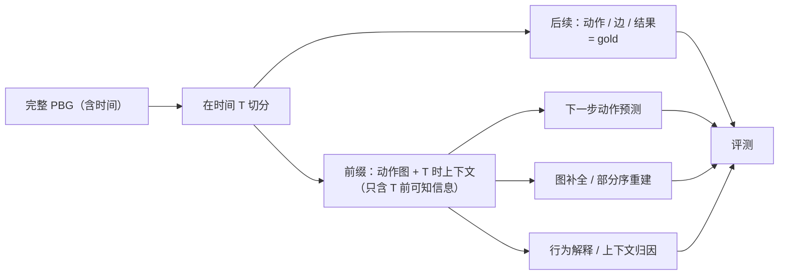

# 5 · 用途：训练数据集与评测协议（benchmark）

> 对应框架规则：**FR-10**（并依赖 FR-8、FR-9）。框架层定义，不含字段/schema。
> 关联：[2-action-graph](2-action-graph.md) · [3-context-model](3-context-model.md) · [4-evidence-and-provenance](4-evidence-and-provenance.md) · [6-production-review-and-validation](6-production-review-and-validation.md)

---

## 5.1 一套结构，两种下游用法（不是两种结构）

先澄清一个容易误解的点：**PBG 只定义 sample 的结构（L0–L3），不定义“训练集/benchmark”这两种东西。** 它们是同一批 sample 的两种**下游用法**：

| 下游用法 | 内容 | 用途 |
|---|---|---|
| **训练数据集** | 完整 sample：证据包 + 完整层级/动作图 + 上下文 | 让模型学习人物行为结构（监督/微调/指令数据） |
| **Benchmark（评测协议）** | 同一批 sample 按时间 T 切分；输入 = T 前的前缀图 + 当时上下文；金标 = T 后的动作/边 | 衡量模型能否重建/预测行为；带任务、切分、指标 |

**类比**：完整病例记录（教材/训练） vs 闭卷考题（benchmark）——知识是同一套，用法不同。

- Benchmark 不是“另一套数据”，而是**数据集的一个子集 + 评测协议**；
- 训练集、验证集、benchmark 必须按**人物 / 事件 / 时间**隔离，防止同一事件后半段泄漏；
- 一个 sample 可以只做训练数据，也可以只进 benchmark；角色由数据集划分决定，不由结构决定。

**非目标**：不做情景/环境模拟，不需要 transition function，不需要世界引擎。PBG 只描述“这个人物在这个事件中的行为”，不模拟环境如何响应。

---

## 5.2 从 PBG 可派生的任务类型

| 任务 | 输入 | 金标 | 评测要点 |
|---|---|---|---|
| **下一步动作预测** | 时间 T 前的行为图 + T 时上下文（含 belief） | T 后实际发生的动作（证据支持） | 动作类型/对象/时间窗；是否可接受多个合理答案 |
| **图补全 / 部分序重建** | 部分动作与部分边（可含噪声） | 完整偏序图 | 节点 P/R/F1、边与偏序准确性 |
| **行为解释 / 上下文归因** | 动作 + 候选上下文 | 人工/证据确认的条件/触发/约束 | 归因是否正确、是否有证据支持 |
| **阶段/phase 边界评估** | 证据包（或完整时间线） | 人工确认的 stage/phase 边界 | 边界位置一致性（分开评 stage 与 phase） |
| **fork/join 结构恢复** | 动作子集（可含部分边） | fork/join 与偏序结构（人工标注） | 分叉/汇合点匹配、结构一致性 |

> 任务派生应尽量**复用同一张图**，避免为每个任务单独标注一套结构。

---

## 5.3 时间切分与防泄漏

**防泄漏规则**

1. 输入只能用 **T 时点可知** 的信息（含人物当时 belief）；T 后事件、T 后才公开的信息不得进入输入。
2. T 的选择要有意义（决策点/阶段边界附近），避免“切在所有动作之后”的伪任务。
3. 同一事件的训练/测试切分必须按时间或按人物隔离，防止“同一事件的后半段泄漏到训练”。
4. 证据包也要切分：评测时的输入证据包只含 T 前材料；T 后材料仅用于金标/核对。
5. 跨人物切分：不同人物之间可共享结构规则，但不应把同一人物的其他事件作为测试上下文（除非任务明确允许）。

---

## 5.4 Benchmark 协议要点

| 要素 | 框架层要求 |
|---|---|
| **判定世界** | closed-world：固定证据包；任务是在包内重建，不评价“包外是否还有行为” |
| **金标** | 由人工/规则确认并冻结的图；标注过程可审计；版本固定 |
| **可接受多解** | 预测类任务允许合理多解（如多个等价动作），需预先定义接受规则 |
| **分开评估** | stage 边界、phase 边界、动作集合、边/偏序、上下文归因分别评，不混成一个分数 |
| **不确定表述** | 模型可输出“未知/证据不足”；评测需区分“答错”与“合理弃答” |
| **成本与可复现** | 记录模型/配置/时间；评测可重跑；输入证据包哈希固定 |

### 5.4.1 建议的评测维度（概念层）

- **可靠性（soundness）**：预测的节点/边是否有证据支持；
- **覆盖（recall）**：金标中的行为是否被找回；
- **结构准确性**：偏序关系、并发/不可比（顺序未知）、跨 phase 连续是否正确；
- **上下文归因**：条件/触发/约束/结果/知识来源是否命中；
- **阶段一致性**：stage/phase 边界与人工标注的一致度；
- **不确定性校准**：`unknown` 的使用是否合理。

### 5.4.2 标注一致性（IAA）

- stage 边界：两位标注者的边界位置一致性；
- phase 边界：同上；
- 动作集合：按行为身份匹配的 P/R/F1；
- 边关系：抽样核对类型与方向；
- 上下文链接：抽样核对类型与对象。
- 未达阈值的样本不进入 benchmark（或进入“待修订”池）。

---

## 5.5 一个 sample 是什么

**sample = 一个人物 × 一个事件**，以固定证据包为基础。概念上包含：

| 组成 | 说明 |
|---|---|
| 身份与范围 | 人物、事件、时间窗、研究范围 |
| 证据包 | 支持该 sample 的来源集合与核验状态 |
| 分层结构 | stage/phase 划分与边界理由 |
| 动作偏序图 | 节点、边、连续性、支持状态 |
| 上下文 | phase baseline + action delta（人物/环境/自身状态） |
| 评审记录 | 复核状态、版本、修订历史 |
| 用途信息 | 可用于哪些任务、切分归属、是否进入 benchmark |

> 具体文件/字段/目录布局属于实现层，后续版本再定；本文只确认“一个 sample 必须带哪些信息块”。

---

## 5.6 质量门槛（进入数据集/benchmark 前）

| 门槛 | 要求 |
|---|---|
| 结构合法 | 层级分区、时间契约、ID/引用完整 |
| 动作合法 | 准入四条通过；无孤点；无重复；粒度符合原子性 |
| 证据合法 | 每个元素可回指证据或显式 inferred/unknown |
| 上下文合法 | 六种语义、最小化、防泄漏 |
| 评审通过 | 人工复核；冲突/缺口已记录 |
| 一致性 | IAA 达到预设阈值（阈值后续版本定） |
| 冻结 | 版本、证据包哈希、标注指南版本固定 |

---

## 5.7 明确不做的事

- ❌ 情景模拟 / 环境推演 / transition function；
- ❌ 多人物社会模拟；
- ❌ 用 PBG 预测“世界会怎样”；
- ❌ 把“证据支持的行为”宣称为“真实世界全部行为”。

---

## 5.8 与其他文件的关系

- 规则来源：[0-overview](0-overview.md) FR-10。
- 结构：[1-hierarchy](1-hierarchy.md)、[2-action-graph](2-action-graph.md)。
- 上下文与防泄漏：[3-context-model](3-context-model.md)。
- 证据与 closed-world：[4-evidence-and-provenance](4-evidence-and-provenance.md)。
- 生产/复核/冻结：[6-production-review-and-validation](6-production-review-and-validation.md)。
