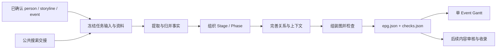

# 0 · 人物 Event 构建器：工程设计

本目录规定 FinMycelium 如何将一个已确认的人物 Event 和冻结的资料，构建为可追溯、可检查、可恢复的单 Event 草稿。结构语义以 [person-event-structures](../person-event-structures/0-overview.md) 为依据，规范约束见其 [设计规范](../person-event-structures/7-specification.md) 与 [形式化模型](../person-event-structures/8-formal-model.md)。

这里定义的是目标工程协议与实现要求。文档落盘不表示这些能力已经全部实现；当前可运行入口与操作方式见 [人物 Event 工作流](../workflows/person-event-build.md)。

## 0.1 文档分工

| 文档 | 定义内容 |
| --- | --- |
| [1 · 输入与统一事实](1-input-and-facts.md) | 任务输入、身份、时间、来源、引文、支持记录和事实检查点 |
| [2 · 图数据协议](2-graph-contract.md) | Event、Stage、Phase、Action、Context、关系及引用约束 |
| [3 · 构建流程](3-construction-flow.md) | 六步顺序、多角色协作、上下文分配、局部检索和有限修正 |
| [4 · 执行与恢复](4-execution-and-recovery.md) | 配置、预算、调用记录、检查点和恢复失效条件 |
| [5 · 检查与输出](5-validation-and-output.md) | 检查结果、完成状态、文件保存、Gantt 和入口衔接 |
| [6 · 贯通示例](6-example.md) | 一个合成案例的输入、事实、图与检查结果 |

`person-event-structures/` 解释结构的含义；本目录将其落实为工程约定；`workflows/` 说明实际操作。字段与共享规则只在所属章节定义，其他章节引用，不重复维护多套协议。

## 0.2 一次构建的边界

一次任务固定 `person_id / storyline_id / event_id`、名称与纳入/排除范围，生成一份独立的 Event 图。`storyline` 是上层目录分组，不是 Event 内的 Stage，也不作为动作图节点。

上层研究计划负责人物研究与 Event 选择。公共搜索负责外部资料发现、获取、筛选、常规补搜和交接。构建器消费确认后的资料，在已有资料中按需检索，不在构建过程中重新发现人物目录、扩大研究范围或自动联网补搜。

四项逻辑交付贯穿流程：任务输入、统一事实记录、原生人物图、检查结果。执行状态、调用记录和绘图状态单独保存。结构有效、执行完成与内容审核通过分别表达。

## 0.3 模块职责

人物构建逻辑集中在 `finmy/person_epg/`。下表划分职责，不要求每个职责各建一个子包、服务或独立 Agent；实现时按代码规模组织。

| 模块职责 | 输入 → 输出 | 责任边界 |
| --- | --- | --- |
| 输入适配与冻结 | 已确认身份、搜索交接 → `input.json`、溯源记录 | 保留现有 `user_query + samples` 入口；检验来源对应 |
| 事实提取与统一 | 实际正文 → 动作、上下文、关系线索与证据 | 语义处理与确定性定位、去重配合 |
| 层级组织 | 统一事实 → Stage、Phase、动作归属 | 同时判断局面与行为模式，不重写整份事实 |
| 关系与上下文完善 | 分组事实、全局索引、局部原文 → 类型化关系与上下文引用 | 支持跨 Phase/Stage 联系，按需执行 |
| 图组装与检查 | 各步记录 → `epg.json`、`checks.json` | 程序维护 ID、引用和图组合；语义问题保留待审核 |
| 执行与恢复 | 任务、配置、检查点 → 调用账本与状态 | 累计预算、保存有效中间结果、确定恢复位置 |
| 绘图适配 | 固定图文件 → `gantt.html` | 读取图，不生成或更改事实 |
| 工作台适配 | 人工范围/材料确认 → 共用构建入口与结果展示 | 选择输出位置、显示过程与状态，不复制构建算法 |

模型角色是可合批的语义职责。程序承担身份映射、引文定位、精确去重、引用校验、预算与文件保存；模型承担有歧义的事实理解、归并、分组和关系判断。不为每个动作固定发起一次调用，也不让各角色反复生成全部内容。

## 0.4 输出与实施边界

- 工作台构建使用配置的 `EPG-dataset/output/`；CLI、脚本或直接调用默认使用 `FinMycelium/output/`。入口传入输出目录，共用构建流程。
- 运行输入、原文、调用记录、检查点和草稿位于 Git 忽略的输出目录。构建器不直接写入正式 `person-epg/` 成果目录。
- 每条 Event 独立输出 JSON，再据此绘制展开式 Gantt；人物总图、跨 Event 关系与汇总另行定义。
- 内容审核与正式收录是后续工作。本目录只提供可供其使用的图、证据、缺口和检查记录，不定义审核 Skill。
- 公开操作文档应随实际实现更新；不得仅因为目标字段已在这里定义，就将运行入口标为已支持该协议。

对象字段、空值和引用以第 1、2 章为准，执行上限与恢复规则以第 4 章为准。实施中的具体提示词、参数默认值和文件拆分可以细化，但不得改变已确认范围、证据语义和六步职责。
