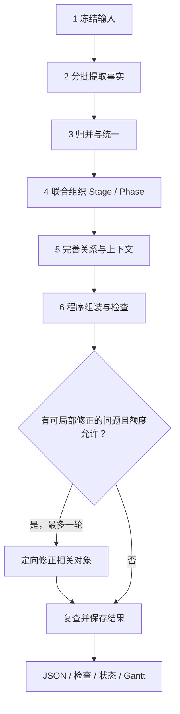

# 3 · 六步构建流程

导航：[总览](0-overview.md) · [输入与事实](1-input-and-facts.md) · [执行与恢复](4-execution-and-recovery.md)

六步是处理职责和依赖顺序，不是六次固定模型调用，也不是六次人工确认。用户确认范围和实际材料后，构建器可按顺序执行；各步保存检查点、使用有限预算，支持中断后恢复。

## 3.1 冻结任务输入

输入适配器核对目录身份、确认范围、实际 sample 正文和来源映射，保存输入、溯源和配置快照。来自公共搜索时同时固定实际交接 revision 与选择记录。任一 sample 缺少来源对应、身份与任务不一致或正文为空，应在调用模型前明确失败。

这里不重新筛选整个搜索结果，也不偷偷扩大正文预算。未交接的资料不算本次构建读过；已知缺口可作为任务说明，但不能当成事实。后续更换材料必须形成新的输入与运行身份。

## 3.2 分批提取动作与相关事实

按来源或连续正文区间组成批次，一起提取动作、相关上下文和来源明确表达的关系线索，保存主体、时间、原文与必要限定。批次不要先分成彼此隔离的“动作提取”和“上下文提取”，导致同一句话被重复理解而失配。

初始抽取覆盖本次**全部实际交接正文**。长资料按连续区间拆分并记录覆盖位置；允许有限重叠用于保留上下文。不能只检索若干 top-K 片段，却将其他已交接材料标为已处理。因预算未处理完的区间进入执行记录和检查结果。

模型负责读懂行为和相关事实；程序给来源与 sample 加稳定映射，定位引文、分配 ID、校验批次输出。无可定位引文的候选不静默升级为有效证据。一个批次可以产出多个动作，也可因没有范围内内容而产出空结果并说明原因。

## 3.3 归并事实与统一身份

程序先处理精确重复、引用和明显别名，再对真正有歧义的候选组进行语义归并。候选依据包括相同具体事项、参与实体、时间与行为内容，不以全文两两比较作为默认操作。

需区分：

- 同一次行为的不同报道：一个动作、多条证据。
- 不同时间的相似行为：分别保留，不能只按文本相似度合并。
- 他人/公司的独立行为：检验焦点人物归属；有关影响进入上下文。
- 一条过宽描述包含多项可区分行为：有据拆分，保留 lineage。
- 来源之间存在分歧：保留 alternatives 和证据，不以多数报道覆盖少数。

输出统一动作目录、相关 Context、关系线索、来源与 Evidence。模糊身份和未解决归属保留 pending。每条事实有保留、合并、拆分、排除或待定的去向，记录相关候选、理由和证据；程序保存旧新 ID 对应并更新引用，避免多轮摘要丢失重要材料。

## 3.4 联合组织 Stage 与 Phase

以统一事实的精简全局索引、相关上下文和边界证据为输入，在一个组织任务中同时考虑局面与行为模式。大事件可分批讨论候选边界，再统一检查，不要求整个正文反复进入每次调用。

常规组织结果只返回 Stage/Phase 描述、时间、边界理由、支持与动作归属映射，引用已有 ID；不重新生成动作正文和整份证据。程序验证成员、边界和映射，并保存组织检查点。

联合组织按局面变化优先判定 Stage，其起点同时是首个 Phase 的起点；仅在 Stage 内再次出现行为模式变化时增加 Phase，不因同一变化重复切分。起点和终点均需说明依据；研究范围截止不等于真实事项终结。完整图至少一个 Stage、每个 Stage 至少一个 Phase。Stage 数量和 Phase 数量由证据决定，不固定数量，不按自然月或资料批次切分。无法确定的边界保留时间未知或 Gap。确需拆分跨 Phase 的持续行为时，组织任务提交有证据的拆分建议，由程序按事实变更规则处理相关条目、保存 lineage 并复查受影响归属；窗口模糊不能成为编造两次动作的理由。

## 3.5 合批完善关系与上下文

每批任务共同处理有关动作的关系、Phase 基准和 Action 差量，使用同一份全局动作索引、候选关系和局部证据。角色可以按任务需要分工，但不能各自另造一套动作集合。

局部检索只针对本次冻结的资料和证据：

1. 先复用动作及边界已绑定的引文。
2. 缺少必要上下文时，在冻结 corpus 中检索相关片段，保留 sample/来源位置。
3. 将找到的证据关联到既有 ID；仍不足时说明 Gap，不凭常识补事实。

全局索引包含动作身份、时间、主体、对象和所属阶段等紧凑信息，用于发现跨 Phase/Stage 联系。候选关系来自明确线索、同一事项、对象或引用；不只比较相邻时间节点，也不穷举全部动作对。只有双方时间端点齐全且前提无冲突时，才由程序按区间规则推导时间先后；端点未知时不作区间推导。来源先后主张的冲突照常保留，检查无冲突视图及其传递闭包，不将原始主张强制变为无环图，具体见 [关系协议](2-graph-contract.md#25-action-之间的-relation)。

Context 按最小必要内容组织；Phase 共享基准，Action 保存特有差量。内容有证据和“它触发/约束该行为”有证据是两件事。知识来源需要人物当时已知的依据；事后材料能证明早先发生的事实，却不能证明人物早先已知后来才公开的信息。

## 3.6 组装、检查与有限局部修正

程序根据唯一归属生成图，不再调用模型重写全图。Event 的必要整体摘要以已形成的事实、阶段和证据为依据，可在组织或收尾批次中生成；已有合格结果可复用。

字段、引用和证据定位在每步交付时检查，最终再核对整体时间、归属、图组合和遗漏记录。程序能够确定的映射与组装问题由程序修正；涉及语义的局部问题只向对应职责提交相关对象、错误信息和必要原文，仍遵守该职责的读写边界。

最终检查后最多执行**一轮**定向修正；该轮可覆盖一组局部问题，不能借分批变成反复全图重建。修正后重新检查所有受影响引用及全局约束，仍有问题就保存问题与结果。JSON 格式重试单独受次数和累计调用上限约束，不重置修正轮数。

没有足够材料、无法判断主体动机或语义关系，并不自动触发补搜。结构完成也不触发无限润色。停止规则、恢复与检查结果见 [第 4 章](4-execution-and-recovery.md) 和 [第 5 章](5-validation-and-output.md)。

## 3.7 四类语义职责与上下文边界

步骤 2—5 对应四类语义任务，可以共用同一模型，以提示词、上下文和允许操作区分；不要求四个长期自主 Agent。各任务读取确定的输入快照、提出限定范围内的结构化结果，程序掌握统一事实和图的正式写入权。

| 职责 | 主要读取 | 可以提交的结果 | 修改边界 |
| --- | --- | --- | --- |
| 事实提取 | 固定身份与范围、本批连续正文、来源信息及必要相邻段落 | 候选 Action、Context、明确关系线索、原文引证与待定项 | 不修改原文、来源或任务范围，不决定最终层级 |
| 事实归并 | 候选全局简表、有歧义的候选组、实体索引和相关原文 | 保留、合并、拆分、排除、待定的操作及理由、证据和映射建议 | 只处理任务指定的候选与身份归并，不抹去来源分歧 |
| Stage/Phase 联合组织 | 全局统一事实、时间、Context 和边界证据 | Stage/Phase 的描述、时间、边界依据与 Action 归属映射 | 常规结果不改写 Action 或证据；有据拆分按 3.4 的例外路径处理 |
| 关系与 Context 补充 | 全局 Action 索引、本批对象、已有层级、关系线索及证据 | 类型化关系、必要 Context、Phase 基准与 Action 差量引用、支持与缺口/冲突 | 不另造 Action 集合或改写阶段；新增 Context 及其关联分别说明依据 |

提取可使用批次内临时引用，正式 ID 由程序按 [公共 ID 规则](1-input-and-facts.md#13-公共值与-id) 分配。归并操作落入统一事实及 pending/lineage；组织与关系结果使用既定图对象和引用，不另设一套事实或证据语义。Event 摘要按 3.6 处理。

他人的独立行动对主体行为有影响时，可作为 Context 并建立相应关联；不将其伪装成主体 Action，也不只在人名列表中保留。关系任务发现遗漏的主体行动时，应保留待处理候选、证据和原因，进入已有的定向修正或未完成记录；不得直接创建悬空关系或绕过事实归并及层级组织。必要处理未完成时按 [结果状态](5-validation-and-output.md#53-运行结果与展示状态) 保留部分结果。

小任务可以合批；大任务按实际上下文长度拆分。首次提取仍覆盖全部实际交接正文，归并只处理有歧义的候选，组织只读精简全局事实及必要原文，关系处理避免全部 N² 动作对遍历。局部修正只带具体检查项、对象和依赖，不无差别生成第二份整图。

## 3.8 读取工具与结果接收

程序按职责提供三类受控读取能力；必要内容已在任务输入中时无需调用工具。

| 能力 | 读取对象与限制 |
| --- | --- |
| 读事实 | 按 ID 查询任务可见的候选、实体、Action、Context 及其证据；提取任务以当前材料为主 |
| 读材料 | 按 sample、来源和位置读取冻结正文及相邻上下文，保留出处与实际返回范围 |
| 检索材料 | 归并、组织和关系任务有明确疑问时，在本次冻结资料中检索，返回可定位片段；不取代首次正文遍历 |

读取范围限于本次冻结输入和允许访问的上游结果，不自动扩大到其他运行或公共搜索存储中的未交接材料。外部资料发现与补搜仍属于公共搜索。工具不直接修改事实、图或运行文件；模型通过结构化结果提出变更。工具返回长度与后续模型调用分别受第 4 章的证据、上下文和累计调用额度控制。

程序按以下顺序接收结果：

1. **准备任务。** 固定输入及上游依赖版本、处理对象、允许变更的类型和必要上下文。任务 ID、哈希、调用与用量信息由程序维护，不要求模型生成。
2. **接收对应产物。** 提取返回候选，归并返回处理操作，组织返回层级和归属，关系任务返回关系及 Context；按 3.9 的最小返回协议，只返回本次负责的内容。
3. **校验后应用。** 检查格式、操作范围、对象引用、证据定位和适用约束，确认结果仍对应本次输入及依赖，再映射 ID、应用变更并检查受影响引用。模型回复不能直接覆盖正式状态。
4. **保存采用结果。** 按 [检查点规则](4-execution-and-recovery.md#43-检查点与依赖) 保存有效结果、局部检查、待定项及未采用原因，再更新状态。实际读取内容和模型回复保留在步骤记录中。

越界操作、无效引用和证据定位错误进入有限修正或未完成记录，不因 JSON 可解析就采用。符合协议的未知、Gap 和 Conflict 可以保存，不要求反复调用模型消除语义不确定性。引文匹配只能证明原文对应，不能代替语义支持审核。结果接收不新增独立的审核 Agent 或额外修正循环，格式重试、最终定向修正及恢复继续遵守第 4 章。

## 3.9 四类结果的最小返回协议

下表定义模型返回的语义载荷；任务、版本、依赖哈希、用量和采用状态由程序包在外层记录。对象沿用第 1、2 章字段；下表的顶层列表及公共 `evidence / pending` 均须返回，无条目时为 `[]`，对象内部的可选字段仍可省略。`evidence` 只列本次新引文，`pending` 采用 [事实协议](1-input-and-facts.md#17-统一事实检查点) 的记录；复用引文直接引用已有 ID。可选 `note: string` 说明空结果等批次情况，不替代事实支持或待定项。

| 职责 | 载荷字段 | 接收规则 |
| --- | --- | --- |
| 事实提取 | `entities / actions / contexts / relation_candidates` | 返回本批候选；Action 的 `phase_id` 为空。无范围内事实时用 note 说明；无法处理时记 pending，不能把未处理正文当成空结果 |
| 事实归并 | `decisions` | 每项指定操作、输入对象和处理结果，按下表应用；不返回一份替代全局 facts 的摘要 |
| Stage/Phase 联合组织 | `stages / phases / assignments / split_proposals`；可选 `event_overview` | `assignments` 每项为 `action_id, phase_id, support`，support 的 target 为 `/phase_id`，作为 Action 的归属依据保存。组织时 Phase 基准先为空，后续补齐；不重写动作内容 |
| 关系与 Context 补充 | `contexts / relations / phase_context_updates / action_context_updates` | Phase 更新为 `phase_id, baseline_context_refs`；Action 更新为 `action_id, delta_context_refs, baseline_context_exclusions`。更新携带该对象所负责关联字段的完整目标列表，不覆盖其余字段；Context 与 Relation 各自保留内容及关联依据 |

提取及后续补证时，模型提出 Evidence 的临时 ID、`sample_id / quote` 与可选定位提示；`source_id / sample_sha256 / location_status` 和核验后的偏移由程序依据冻结输入填写。模型不生成来源记录或哈希。新 Context、ContextRef、Relation、Stage/Phase 等也使用临时 ID；已有对象只用已分配 ID。

`event_overview` 仅含 Event 的 `time / summary / support` 及可选 `gaps / conflicts`，不包含可修改的身份与范围；若本批未提供，在 3.6 的收尾任务中按同一约定完成。`split_proposals` 复用下面的 split 操作，只允许有据拆分 Action；程序先校验拆分，再应用对新 ID 的归属，联合复查边界与引用。普通组织任务不能借此重建事实集合。

每项归并 decision 包含 `operation`、`input_refs: ObjectRef[]`、`outputs`、`reason`、`evidence_ids: string[]`。输入引用的 `field` 为空，指完整候选；每个 output 为 `{collection, record}`，record 使用对应事实对象的字段。操作仅涉及任务授权的 `entities / actions / contexts / relation_candidates`；依据可复用输入对象已有支持，新增或改变的事实仍需在 record 中说明 support 或 Gap。

| operation | 输入 → 输出 | 约束 |
| --- | --- | --- |
| `keep` | 1 → 0 或 1 | 无输出表示原样保留；有输出须同集合、同 ID，仅在授权字段内校正并保留依据 |
| `merge` | 同集合至少 2 → 1 | 输出沿用其中一个输入 ID；合并支持并保留冲突，不以合并为由选择性删去来源说法 |
| `split` | 1 → 同集合至少 2 | 输出用新临时 ID，分别说明内容和支持；不得把旧对象全部引文无差别复制成各子项的支持 |
| `exclude` | 1 → 0；Action 重分类时可输出 Context | 保留排除理由与原记录；若主体归属判定表明它是相关他人的独立行为，可输出有据的 Context 并保存旧新对应，不借排除新增无关事实 |
| `pending` | 1 → 0 | 原候选仍可回查，不冒充已统一事实；保存尚不能处理的原因与证据 |

每个指派候选在一轮 decisions 中只能被消费一次，全部指派候选须有明确去向；没有歧义的 keep 可由程序生成。merge/split 之后只重定向能确定对应的引用；不能确定关系落在哪个拆分动作上的，保留候选和 pending，不能复制成多条“已知关系”。

采用粒度是一个完整操作或一组互相依赖的结果：同次拆分与归属、Context 新内容与引用、同一 Action 的基准排除与差量更新必须一起校验。互不依赖的有效项可以先保存，一项失败不丢弃整批；失败项及其依赖保留未采用原因，后续有界重试只处理未完成部分。任务负责范围之外的对象不受影响，遗漏原来指派的对象不能被解释为删除。

临时 ID 只在一次响应内有效；程序保存“任务/响应/临时 ID → 正式 ID”映射，并先统一解析相互引用再校验。已采用结果在恢复或局部重试时沿用正式 ID，不重复新增。原始回复、采用/未采用项及 lineage 都进入步骤记录。结构未通过或必要归属未完成继续标 partial；合法 Gap/Conflict 不因此开启额外修正轮次。
