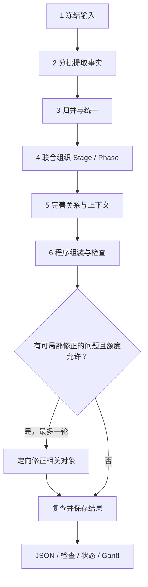

# 3 · 六步构建流程

导航：[总览](0-overview.md) · [输入与事实](1-input-and-facts.md) · [执行与恢复](4-execution-and-recovery.md)

六步是处理职责和依赖顺序，不是六次固定模型调用，也不是六次人工确认。用户确认范围和实际材料后，构建器可按顺序执行；各步保存检查点、使用有限预算，支持中断后恢复。

## 3.1 冻结任务输入

输入适配器核对目录身份、确认范围、实际 sample 正文和来源映射，保存输入、溯源和配置快照。来自公共搜索时同时固定实际交接 revision 与选择记录。任一 sample 缺少来源对应、身份与任务不一致或正文为空，应在调用模型前明确失败。

这里不重新筛选整个搜索结果，也不偷偷扩大正文预算。未交接的资料不算本次构建读过；已知缺口可作为任务说明，但不能当成事实。后续更换材料必须形成新的输入与运行身份。

## 3.2 分批提取动作与相关事实

按来源或连续正文区间组成批次，一起提取动作、相关上下文和来源明确表达的关系线索，保存主体、时间、原文与必要限定。批次不要先分成彼此隔离的“动作提取”和“上下文提取”，导致同一句话被重复理解而失配。

初始抽取覆盖本次**全部实际交接正文**。长资料按连续区间拆分并记录覆盖位置；允许有限重叠用于保留上下文。不能只检索若干 top-K 片段，却将其他已交接材料标为已处理。因预算未处理完的区间进入执行记录和检查结果。

模型负责读懂行为和相关事实；程序给来源与 sample 加稳定映射，定位引文、分配 ID、校验批次输出。无可定位引文的候选不静默升级为有效证据。一个批次可以产出多个动作，也可因没有范围内内容而产出空结果并说明原因。

## 3.3 归并事实与统一身份

程序先处理精确重复、引用和明显别名，再对真正有歧义的候选组进行语义归并。候选依据包括相同具体事项、参与实体、时间与行为内容，不以全文两两比较作为默认操作。

需区分：

- 同一次行为的不同报道：一个动作、多条证据。
- 不同时间的相似行为：分别保留，不能只按文本相似度合并。
- 他人/公司的独立行为：检验焦点人物归属；有关影响进入上下文。
- 一条过宽描述包含多项可区分行为：有据拆分，保留 lineage。
- 来源之间存在分歧：保留 alternatives 和证据，不以多数报道覆盖少数。

输出统一动作目录、相关 Context、关系线索、来源与 Evidence。模糊身份和未解决归属保留 pending。每条事实有保留、合并、排除或待定的去向，避免多轮摘要丢失重要材料。

## 3.4 联合组织 Stage 与 Phase

以统一事实的精简全局索引、相关上下文和边界证据为输入，在一个组织任务中同时考虑局面与行为模式。大事件可分批讨论候选边界，再统一检查，不要求整个正文反复进入每次调用。

组织结果只返回 Stage/Phase 描述、时间、边界理由、支持与动作归属映射，引用已有 ID；不重新生成动作正文和整份证据。程序验证成员、边界和映射，并保存组织检查点。

联合组织按局面变化优先判定 Stage，其起点同时是首个 Phase 的起点；仅在 Stage 内再次出现行为模式变化时增加 Phase，不因同一变化重复切分。起点和终点均需说明依据；研究范围截止不等于真实事项终结。完整图至少一个 Stage、每个 Stage 至少一个 Phase。Stage 数量和 Phase 数量由证据决定，不固定数量，不按自然月或资料批次切分。无法确定的边界保留时间未知或 Gap。确需拆分跨 Phase 的持续行为时，只修改相关条目并保存对应关系；窗口模糊不能成为编造两次动作的理由。

## 3.5 合批完善关系与上下文

每批任务共同处理有关动作的关系、Phase 基准和 Action 差量，使用同一份全局动作索引、候选关系和局部证据。角色可以按任务需要分工，但不能各自另造一套动作集合。

局部检索只针对本次冻结的资料和证据：

1. 先复用动作及边界已绑定的引文。
2. 缺少必要上下文时，在冻结 corpus 中检索相关片段，保留 sample/来源位置。
3. 将找到的证据关联到既有 ID；仍不足时说明 Gap，不凭常识补事实。

全局索引包含动作身份、时间、主体、对象和所属阶段等紧凑信息，用于发现跨 Phase/Stage 联系。候选关系来自明确线索、同一事项、对象或引用；不只比较相邻时间节点，也不穷举全部动作对。只有双方时间端点齐全且前提无冲突时，才由程序按区间规则推导时间先后；端点未知时不作区间推导。来源先后主张的冲突照常保留，检查无冲突视图及其传递闭包，不将原始主张强制变为无环图，具体见 [关系协议](2-graph-contract.md#25-action-之间的-relation)。

Context 按最小必要内容组织；Phase 共享基准，Action 保存特有差量。内容有证据和“它触发/约束该行为”有证据是两件事。知识来源需要人物当时已知的依据；事后材料能证明早先发生的事实，却不能证明人物早先已知后来才公开的信息。

## 3.6 组装、检查与有限局部修正

程序根据唯一归属生成图，不再调用模型重写全图。Event 的必要整体摘要以已形成的事实、阶段和证据为依据，可在组织或收尾批次中生成；已有合格结果可复用。

字段、引用和证据定位在每步交付时检查，最终再核对整体时间、归属、图组合和遗漏记录。程序能够确定的映射与组装问题由程序修正；涉及语义的局部问题只提交相关对象、错误信息和必要原文。

最终检查后最多执行**一轮**定向修正；该轮可覆盖一组局部问题，不能借分批变成反复全图重建。修正后重新检查所有受影响引用及全局约束，仍有问题就保存问题与结果。JSON 格式重试单独受次数和累计调用上限约束，不重置修正轮数。

没有足够材料、无法判断主体动机或语义关系，并不自动触发补搜。结构完成也不触发无限润色。停止规则、恢复与检查结果见 [第 4 章](4-execution-and-recovery.md) 和 [第 5 章](5-validation-and-output.md)。

## 3.7 上下文与工作量控制

| 工作 | 常规输入 | 不应重复的工作 |
| --- | --- | --- |
| 首次抽取 | 本批实际正文、固定范围、必要身份信息 | 每个角色重新读全部原文 |
| 语义归并 | 有歧义的候选组及其证据 | 每条事实都单独请求模型确认 |
| Stage/Phase 组织 | 全局精简事实、边界候选和必要证据 | 重新提取所有动作 |
| 关系与 Context | 全局索引、本批对象、按需取得的原文 | 全部 N² 动作对遍历 |
| 局部修正 | 具体检查项、相关对象及其依赖 | 无差别生成第二份整图 |

小任务可以合批；大任务按实际上下文长度拆分。组装、哈希、引用检查、进度与预算由程序负责。角色提示词应说明其输入、输出和修改范围，执行记录保存实际读取与返回内容，成本比较以真实账本为准。
