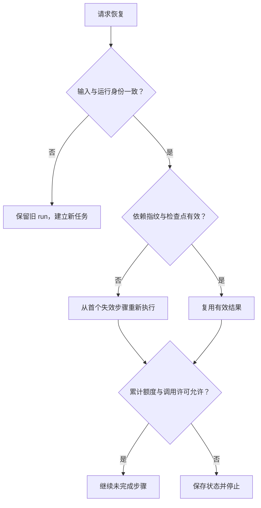

# 4 · 执行控制、预算与恢复

导航：[总览](0-overview.md) · [构建流程](3-construction-flow.md) · [检查与输出](5-validation-and-output.md)

## 4.1 配置与输入分开

构建配置独立于搜索配置，也独立于研究范围。同一模型可承担多个语义角色；需要不同配置时记录各角色实际配置，不将角色数量等同于 Agent 数量。

| 配置项 | 含义与控制要求 |
| --- | --- |
| 模型/provider | 构建实际使用的模型与端点标识；凭据不进入输入、图或日志 |
| 调用次数上限 | 整个 run 累计；包括格式重试、局部修正和恢复后的调用 |
| 每次输出 token 上限 | 约束一次模型响应，不能作为事实数量目标 |
| 每次上下文上限 | 约束一次实际请求；不得把字符数声称为精确 token 数 |
| 抽取批次大小 | 按连续正文范围分批，记录覆盖区间；不因此丢弃超长剩余内容 |
| 局部检索与证据额度 | 约束从冻结 corpus 返回的片段数/长度，保留定位，不调用外部搜索 |
| JSON 尝试次数 | 同一语义任务的格式/协议错误与提取、归并提案拒收共用有限额度；全部调用计入累计上限 |
| 单次超时 | 防止无限等待；传输失败不自动转成无限重试 |
| 最终修正轮数 | 首版最多一轮，可关闭；恢复不能重新获得一轮 |
| 并发度 | 多批执行仍共享同一预算与状态写入控制 |
| 调用许可 | 保存任务与离线检查不触发模型；实际执行显式允许调用 |

具体默认值集中由实现配置维护，操作界面显示实际值。本设计不把某个案例的额度写成所有人物的固定标准。参数适配到工作台时，保留模型、累计调用、上下文与输出限制等必要选项；普通使用不要求手动操作每个内部步骤。

## 4.2 累计调用与成本

请求发出前，在持久账本中原子登记调用 ID、步骤、输入指纹与额度占用。并发请求共用同一计数器，不能分别认为尚有余额而超额。响应回来后记录结果、用量、时长及 checkpoint 位置。

provider 已收到请求但本地超时，费用可能已经产生；调用保留为未知/失败，不退还次数并盲目重试。用户显式恢复时仍计入已用额度。没有实际发送的本地校验失败不记成模型调用，但记录失败原因。

账本区分实际返回 token、估算 token 和缺失用量；可取得价格依据时才计算带依据的成本估算。搜索成本与构建成本分别记录，不能将两者混为一个“模型成本”。日志不得保存密钥或认证头。

超过上限时保存有效结果和未完成项，停止新增调用。恢复时提高上限是修改额度，不是将已用量清零。不能自动改变模型、增加正文或提升预算来掩盖失败。

## 4.3 检查点与依赖

每个可复用检查点至少记录：

| 信息 | 用途 |
| --- | --- |
| run、步骤、批次、尝试 ID | 区分首次执行、重试和恢复 |
| 确切输入与依赖的哈希 | 确认读的是同一材料和上游结果 |
| 代码、协议、提示词与有效配置指纹 | 识别影响结果的环境变化 |
| 输出哈希及局部检查结果 | 拒绝损坏或未通过该步必要检查的产物 |
| 已处理 sample/正文范围 | 防止恢复重复处理或漏处理 |
| ID 映射与未完成项 | 保留事实归并、拆分和待定内容 |

语义任务按 [结果接收规则](3-construction-flow.md#38-读取工具与结果接收) 核对允许变更的对象与操作，并确认输入及上游依赖指纹仍然有效；并发任务返回结果也不能绕过这些检查。步骤结果先写临时文件，成功校验后由程序原子发布，再更新状态。部分写入文件不能作为已完成检查点。有效的前序步骤不因后续绘图或组织失败而被覆盖。

## 4.4 恢复的失效边界

| 变化 | 处理 |
| --- | --- |
| 人物/Event 身份、范围、sample 正文或来源版本变化 | 新任务/新 run；不在旧 run 内替换输入 |
| 文件损坏、哈希不一致、必要检查未通过 | 对应检查点不可复用；保留异常记录 |
| 某步骤提示词、模型配置或语义依赖变化 | 该步骤及受影响下游失效；不能仅凭文件存在继续复用 |
| 代码/协议变化且没有明确兼容依据 | 保守拒绝复用受影响结果，不自动转换或混合协议 |
| 仅提高累计调用上限 | 已用量保留；语义输入未变的有效检查点仍可复用 |
| 某个局部对象修正 | 更新其依赖引用并复查；不使不相关原文抽取失效 |
| 仅绘图失败或绘图参数变化 | 读取同一有效图重绘，不重新调用构建模型 |

依赖由实际读取内容决定，并保留指纹；不能声称“局部修正”却复用受到修改影响的旧边界和关系。首版可以采用较保守的下游失效策略，不必为精细缓存先建设复杂调度平台。

最终局部修正轮数持久化。JSON 尝试次数按语义任务累计，不能用进程重启规避。重试产生的回复与最终采用的回复有明确对应；不得将混合了两次不同前提的回复直接拼成一张图。

协议拒收按原回复持久记账，恢复回放同一回复不重复扣除尝试，也不补回额度。已采用的独立项先保存；有限修正沿用拒收对象的正式 ID，明确记录原拒收项与后续处理的对应。可复用的响应检查点仍须经过结果接收，响应格式通过不等于全部提案已采用。

## 4.5 异常与中断

输入错误在模型调用前报告。批次响应无法解析时执行有限格式修正；语义不确定保留缺口，不无限重试。某批失败不丢弃其余已完成事实，后续能否继续由依赖和完整性要求决定。

中断、超时或额度停止时保存账本、有效检查点和当前结果状态。无可用图时也应能查看已完成事实；不能为了输出文件存在而生成空壳“完成图”。图生成后绘图失败单独记录，保留 JSON 与检查结果。状态的精确定义见 [第 5 章](5-validation-and-output.md)。

## 4.6 协议切换与已有产物读取

本节规定协议兼容要求。新人物 Event 图使用 `person-event-1.0`、事实检查点使用 `person-event-facts-1.0`；历史产物使用 `person-epg-3.0`。它们是不同协议，不能通过改一个版本字符串、补几个空数组或替换全局常量完成迁移。

| 入口或资产 | 切换约定 |
| --- | --- |
| 新人物 Event 任务 | 在运行配置和 state 固定 `graph_schema_version=person-event-1.0`；各步骤检查点另固定事实/结果协议，生成与检查须匹配 |
| 已保存图及 Gantt | 按图内 `schema_version` 选择匹配的校验器、工作台读取投影和绘图器；原图及对应检查、哈希保留，不静默转换 |
| 旧任务缺少新版本字段 | 可从已保存图的明确协议标识路由历史读取；无法确定时提示不支持，不按当前默认协议猜测。无图的旧检查点也不能视为新协议结果 |
| 恢复执行 | 只复用同协议且满足 4.3/4.4 的检查点；旧协议任务不得进入新流程续跑。重新构建建立新 run，可复用校验通过的原始输入与来源，预算、产物和账本分别保存 |
| 展示与重新绘图 | 读取旧图不要求重新构建，也不因当前代码变化否定历史文件本身；用对应版本重绘时记录此次 renderer 与原图哈希，不改动图事实 |

输入仍为 `user_query + samples`，无需公共搜索直接生成新图对象。新输入适配器按 [1.1–1.2](1-input-and-facts.md#11-保留的输入入口) 合并任务 extras、传递已知来源元数据并校验冻结对应；普通事件的既有输入与构建入口继续使用自身协议。绘图和工作台适配依版本路由，不用新图字段直接读取旧表结构。

哈希按用途明确区分：

- 新运行的 `input_sha256 / graph_sha256 / artifact_hashes` 绑定最终写盘文件的确切字节；先确定写盘字节，再计算、保存与校验同一份内容。
- Evidence 的 `sample_sha256` 绑定未经 JSON 编码的 `sample.content` 的 UTF-8 字节。
- 配置和语义请求等对象指纹使用明确的规范序列化规则，并保存规则标识；对象指纹不能冒充文件字节哈希。
- 历史任务沿用其原协议的哈希含义校验。现有 `finmy.search.state.digest()` 对非 bytes 值计算 JSON 序列化摘要；传入字符串或对象的结果不能当作新协议的文本/文件字节哈希。新哈希计算须明确使用对应字节，不为这次人物协议切换全局改变公共搜索摘要函数。

新旧协议路由及哈希约定由程序维护，用户仍按“确认材料 → 构建 → 查看结果”操作，不新增人工转换步骤。
