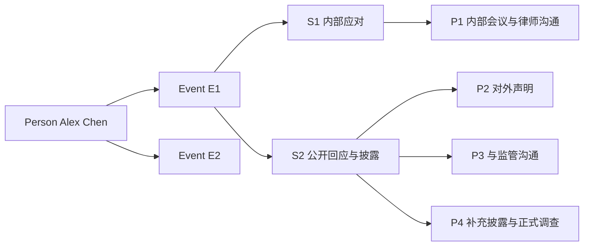
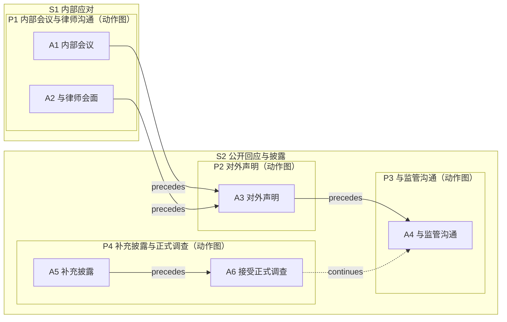
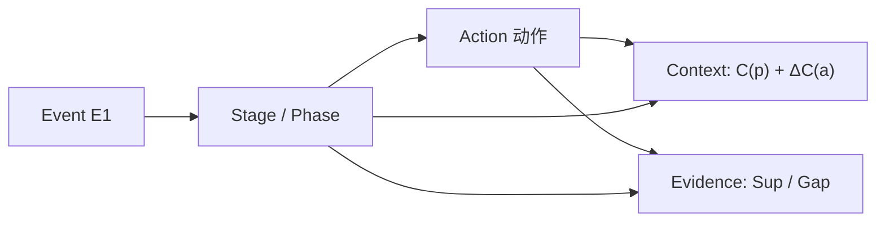

# 6 · 概念示例：从人物到 event 的完整描述

> 本篇用一个**虚构示例**说明结构怎么读、各层如何衔接；只谈概念，不写字段/JSON/实现。
> 示例人物与事件均为虚构，仅用于说明结构。
> 本示例是 8.7 形式化示例的“概念版”；两者使用同一套 Stage/Phase/Action 归属。

---

## 6.1 人物与事件系列

**人物**：Alex Chen，某科技公司前高管。

| Event | 名称 | 大致时期 | 与人物关系 |
|---|---|---|---|
| E1 | 监管调查事件 | 2020-01 至 2020-06 | 本人被调查、负责应对 |
| E2 | 公司融资事件 | 2020-07 至 2020-12 | 以顾问身份参与 |

> 人物层只做身份与事件索引；E1、E2 各自完整描述，不互相依赖。

---

## 6.2 展开 E1：监管调查事件

### 6.2.1 事件本身

- **事件**：监管机构对某科技公司展开调查，Alex Chen 负责应对。
- **时间**：事件与阶段范围为 2020 年 1 月至 6 月（月精度）；动作 A1/A2/A4/A5/A6 的日精度来自更具体的来源（如会议记录、报道日期）；没有更细来源的动作只保留月精度，不补日。
- **范围**：调查期间本人的内部决策、法律咨询、对外沟通、披露与配合；排除调查之外的经营与私人生活。
- **事件摘要**：从内部协调 → 对外声明 → 与监管沟通 → 补充披露与正式调查，呈现行为模式的演进。

### 6.2.2 局面阶段（stage）

| Stage | 局面 | 边界理由 |
|---|---|---|
| S1 内部应对 | 调查刚启动，外部尚未公开 | 2020-02-10 公司对外发布声明，调查进入公开回应阶段；此前以内部协调为主 |
| S2 公开回应与披露 | 调查公开，监管问询与媒体关注 | 本阶段是事件的最后阶段：2020-06 进入正式调查后事件收束，未再出现新的局面变化 |

> 边界依据是“局面变化”，不是文档发布日期或自然月。最后阶段也必须给出“为什么到此为止”的边界理由，不能留 `—`。

### 6.2.3 行为阶段（phase）与动作

| Phase | 所属 stage | 行为模式 | 动作 |
|---|---|---|---|
| P1 内部会议与律师沟通 | S1 | 内部协调、法律咨询 | A1 内部会议；A2 与律师会面 |
| P2 对外声明 | S2 | 公开回应 | A3 对外发布声明 |
| P3 与监管沟通 | S2 | 直接沟通、配合问询 | A4 与监管机构沟通 |
| P4 补充披露与正式调查 | S2 | 补充披露、接受正式调查 | A5 补充披露；A6 接受正式调查 |

**动作与关系（摘要）**

- A1 与 A2 都在 2020-01-21 发生，来源未说明先后 → **不可比**（不是“已确定并行”）；A1/A2 的结果指向后续公开声明。
- A3（2020-02-10）**回应** A1；A4（2020-02-15）**回应** A2（推断）；A3 与 A4 有明确先后（2 月 10 日 → 2 月 15 日）。
- A5（2020-04-20）**回应** A3、A4；A6（2020-06-01）**延续** A4 的监管沟通线，并在时间上晚于 A5。

> 每个动作唯一属于一个 phase；phase 图逐层组合为 stage/event 图。本示例没有把动作挂到多个 phase；A4→A6 的 `continues` 是**跨 phase 关系**，不是“一个动作跨两个 phase”。

### 6.2.4 时间线（半开区间）

| 区间 | Stage / Phase | 动作 |
|---|---|---|
| `[2020-01-01, 2020-02-10)` | S1 / P1 | A1、A2（2020-01-21，同日、不可比） |
| `[2020-02-10, 2020-02-11)` | S2 / P2 | A3（对外声明） |
| `[2020-02-11, 2020-04-01)` | S2 / P3 | A4（与监管沟通，2020-02-15） |
| `[2020-04-01, 2020-07-01)` | S2 / P4 | A5（2020-04-20）、A6（2020-06-01） |

> 区间为半开区间；端点相等是空区间，不能表示“某月/某日”。A1/A2 同日、来源未说明先后 → 不可比；A3→A4、A4→A5、A5→A6 的先后由日期推导（derived），不是来源明说。

### 6.2.5 动作图（概念）

> 图中 A1、A2 之间**没有连线**：二者不可比（同日、来源未说明先后），`A1 ∥ A2` 不是边；`precedes` 是时间关系，`continues` 是延续关系，不能混为一谈。`responds_to` 的方向为“回应者 → 被回应者”，见 8.7.3。每个 phase 有一张动作图 `G(p)`；stage/event 图由下层图组合。P1/P4 有多个动作，P2/P3 只有一个动作（允许，但已在表中说明）。

**结构—上下文—证据的挂接关系**

**读法**：事件展开为 stage/phase；phase 与动作分别挂上下文；动作与 phase 都挂证据。上下文与证据不是事件的“附属段落”，而是结构的横切层：读任何动作时，都能沿这两条线回到条件与来源。

### 6.2.6 上下文（phase 基准 + action 差量）

| 载体 | 环境 Env | 关系/他人 Rel | 人物状态 State | 支持模式/缺口 |
|---|---|---|---|---|
| `C(P1)` 基准 | 监管调查启动、媒体关注 | 委托李律师 | 目标：了解调查范围；约束：披露口径需律师审核 | `Sup={A}` |
| `ΔC(A1)` 差量 | — | 对象：公司管理层 | 目标：统一内部口径 | `Sup={A}` |
| `C(P2)` 基准 | 媒体持续关注、外部预期不稳 | 对象：媒体/公众 | 目标：稳定外部预期 | `Sup={A}` |
| `ΔC(A3)` 差量 | — | — | 知识：调查已公开 | `Sup={A}` |
| `C(P3)` 基准 | 监管问询公开化 | 监管机构 | 目标：直接回应问询 | `Sup={A}` |
| `ΔC(A4)` 差量 | — | 对象：监管机构 | — | `Sup={A}` |
| `C(P4)` 基准 | 调查进入披露/正式程序 | 监管机构 | 目标：完成披露、配合调查 | `Sup={A}` |
| `ΔC(A5)` 差量 | — | 对象：公众/监管 | — | `Sup={A}` |
| `ΔC(A6)` 差量 | 正式调查启动 | 监管机构 | — | `Sup={A}` |

> 读法：先读 phase 的基准，再读动作的差量；相同内容不重复。人物“稳定预期”的动机如果没有来源直接陈述，只能标“推断”，不能写成事实。

### 6.2.7 证据与未知

| 内容 | 支持模式/缺口 |
|---|---|
| 调查启动、内部会议、律师会面 | `Sup={A}`（有引文） |
| 对外声明内容 | `Sup={A}`（可复核） |
| A1 与 A2 的先后 | `Sup=∅ + Gap`（同日发生，来源未说明） |
| A3 → A4 的先后 | `Sup={I}`，关系 basis=`derived`（由有据日期按区间规则推导，保留前提与规则；不是来源明说“先后”） |
| 人物“稳定预期”的动机 | `Sup={I}`（由行为推断，来源未直接陈述） |
| 调查的全部内部细节 | `Sup=∅ + Gap`（公开资料未覆盖） |

---

## 6.3 这个示例说明了什么

1. **人物 → events**：人物层只做索引；E1 可独立阅读。
2. **event → stage**：stage 按“局面变化”切（内部应对 vs 公开回应）。
3. **stage → phase**：phase 按“行为模式”切（内部沟通 / 对外声明 / 监管沟通 / 披露与调查）。
4. **动作图**：动作之间允许不可比、先后、回应、延续；不是单链。
5. **上下文**：phase 基准 + action 差量；belief 与事后事实分开。
6. **证据**：每个关键内容有来源/引文或显式“推断/未知”；不宣称覆盖全部真实行为。

> 同一示例的形式化版本（集合、偏序、逐层组合、上下文、证据）见 [8-formal-model](8-formal-model.md) 8.7。
