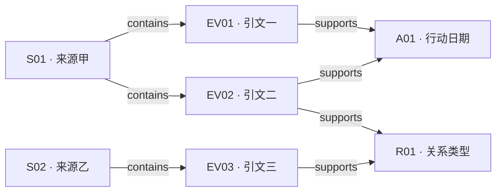

# 3 · 页面、证据与视口

[总览](0-overview.md) · [关系与 Context](2-relations-and-context.md) · [示例与验收](5-examples-and-checks.md)

## 3.1 单 Event 的页面组成

| 位置 | 内容与约束 |
| --- | --- |
| 页首 | 当前 Event、Stage 和 Phase 导航、图的结果状态、缩放与详情入口。跨 Phase 关系复用相同导航。 |
| Phase 主图 | Phase 基准背景、Action 及其时间轴、显式背景、参与者和本页的附加背景。展开内容可分行，Action 的归属始终取自图。 |
| Evidence 区 | 本页对象字段与关系用到的原文引文，按稳定 ID 查阅，同页只列一次。 |
| Sources 区 | 引文所对应的来源，可查标题、原始链接及已记录的出版信息。同一来源可对应本页多个引文。 |
| 详情 | 当前对象的字段、记录的关联、依据、原始时间、推断前提，以及相关的缺口与冲突。显示别名可用于导航，仍可回查原始 ID。 |

完整草稿中的每个 Action 只属于一个 Phase。部分结果如有未归属 Action，应单独标示并可查阅，禁止按时间相近把它挂到某个 Phase。已经归属但缺日期的 Action 仍留在原 Phase。没有 Phase 归属的事件级背景和未在各页使用的引文、来源可在事件背景页阅读。[层级与动作归属](../person-event-structures/1-hierarchy.md) · [部分结果与出图约定](../person-event-builder/5-validation-and-output.md)

页面通常从第一个有行动的页面打开。`Previous / Next`、Phase 选择器和 Stage 内的页签提供切换，`Stages and phases` 可展开导航。有跨页 Action 关系时，导航自动展开以露出对端页签。Event、Stage 和当前 Phase 的标题分别可打开其记录。事件背景页收纳待归属内容，仍可阅读该 Event 的摘要与依据。

未归属 Action 列在 `Event background`，只有归属已确定的行动才会显示 `Phase only`。在各自页面，单侧日历界限、相对锚点或纯 Phase 归属直接显示在行动区。`Relative order` 标示只有内部先后的行动链。带另一端未归属的关系可从 Action 详情查到，跨页页签线要求两端均有实际所属 Phase。

仅含一项 Action 的 Phase 将有效继承的条件或约束放入 `Actions and their context`。点击 `condition · Phase-wide` 或 `constraint · Phase-wide` 可直接查看该 Phase 引用的限定、字段支持与原文。其他阶段级用途照常显示实际端点。图中已经记录、但没有 Action 的 Phase 保留导航和原有说明或缺口。

## 3.2 从一个字段追到原始来源

`对象字段 → Support → Evidence → Source` 是阅读路径。若一项推断引用其他已记录前提，还可从 Support 沿 `premise_refs` 回查这些前提。该路径同样适用于 Action、Context、日期、Action 关系和背景的适用关联。[证据模型](../person-event-structures/4-evidence.md) · [公共证据与支持协议](../person-event-builder/1-input-and-facts.md)

1. 选择 Action、Context、Relation 或其字段，查看真正支持所选陈述的引文。Context 自身的事实与“它约束了某行动”是两个可分别检查的陈述。
2. 每份 Evidence 是一段引文，对应唯一 Source。一个字段可以引用同一 Source 的几段引文，也可以引用来自多个 Source 的引文。多个对象可共享同一段引文。界面分别显示引文 ID 和来源 ID，引用条数不能当作独立来源数。
3. 展示原文、已保存的片段和定位信息，以及支持方式。`O` 表示记录本身呈现的内容，`A` 表示来源对事实的陈述，`I` 表示基于前提的推断。推断展示所记录的理由与前提。缺乏字段级支持、引文无法定位、材料有冲突，应使读者看见相应状态。图上相邻字段的支持不能挪用。
4. 可用冻结构建输入时，校核引文与交接正文的位置。只持有图时，仍展示记录中的引文和出处，并区分可查阅的定位与已核验的定位。点击 Evidence 或 Sources 跳转到本页对应记录。

### 卡片分区和箭头方向

页内自上而下先读事实，再读 `Evidence`，最后读 `Sources`。Evidence 是原文的一小段，Source 是承载原文的文件或网页。一份直接的一手文件即可支持某项陈述。多份资料描述同一事实时，保留各字段用到的引文、限定和分歧。图中无需增加一层模型改写的“证据事实”。

下图画溯源箭头的方向。从事实出发核查时，可反向点击到出处。

这里行动日期有两段引文、一个来源。关系类型也有两段引文，却来自两个来源。其中 EV02 被两个字段共用。变化的是支持关系，页面中 EV02 始终是一份原文。

### 选中后能看到什么

| 从哪里开始 | 详情与图上的表现 |
| --- | --- |
| Action、Context 或一条字段 | 从 `Evidence by field` 展开陈述和支持记录，只追踪选定字段及其对应路径。上下文适用范围、来源提及的主体、参与者身份和角色均有各自的字段范围。只证实“引用了这项背景”时，详情保留身份或角色缺少单独依据的说明。 |
| 一条 Action 关系 | 点击线、关系标签或 Action 的 `Action relations`。详情分别展示 From、To、Type、`Recorded basis` 以及对应 Support。选中时，可见的引文线连到该关系线，跨页关系也可在本页查到其引文。端点行动各自有引文，不自动补成关系的依据。 |
| 一个 Evidence | 读完整原文、`sample_id`、半开字符范围 `[start, end)` 及已有定位，再点 `Source`。同段引文在本页支持多项记录时，可查看绿色溯源线或高亮。 |
| 一个 Source | 读 `Published / Retrieved / Origin`，有可用链接时点 `Open original source`。`Passages in this event` 列本事件该来源的引文，可点回各段。需要核查的另列 `References to review`。没有引文的来源保留来源记录。 |
| 推断、缺口或冲突 | `Source record / Source assertion / Inference` 对应 `O / A / I`。其中 `Inference` 可列理由和可点击的前提字段。`Gap` 和 `Conflict` 保留原因，冲突可展开备选说法与它们各自的支持。 |

### 引文定位与材料边界

本页的 Evidence 区汇集本页对象、Phase、所属 Stage 和相关 Action 关系用到的可展示引文。同一段在一页只出现一次。来源区按 Source 去重。整张图其他位置尚未用到的可展示引文和来源可以在事件背景页找到。单独打开一个来源的详情时，“本事件”指所有 Phase。

有冻结输入时校核来源、正文、偏移和冻结片段哈希。匹配到交接包拼装的日期或标题等元数据、原文无匹配、多处匹配或位置无法复核，均保留记录及提示，经字段或来源详情查阅，不作为已定位的引文卡。仅有保存图时提示定位来自已保存记录。位置匹配说明读者能找回这段话，内容审核还须判断这段话是否支持该陈述。[引文定位检查](../../finmy/person_epg/event/graph_evidence.py)

## 3.3 首屏与缩放

- **打开或切换 Phase。** `100%` 表示按当前可用宽度和高度看全该 Phase 的卡片，包含参与者、Evidence 和 Sources。每个 Phase 独立计算。密集页的字可能较小，`Reading size` 用于切换到可读字号。
- **放大与缩小。** `+ / −` 相对本页概览缩放。图面和分区按可用宽度展开，缩小后页面外侧不应出现贯穿整页的空带。分支之间、宽时间窗口之内可留有表达结构的空间。放大超出视口时允许在图内滚动。
- **尺寸改变。** 浏览器变窄、打开详情或切换缩放，均应保留已分配的 Action 逻辑行、列、范围和端点。Evidence、Sources 作为卡片清单，可依容器宽度自然换行。
- **端点随动。** 当前视口、缩放及滚动位置变化后，卡片、连线、箭头、标签和点击区域应使用同一坐标变换。单次选中或跳转不会改变行动顺序或其他卡片的语义归属。

## 3.4 输出与溯源

工作台嵌入预览、下载 HTML 和原生图的离线导出使用同一绘图约定。同一输入、同一绘图规则和自动布局应产生相同的逻辑行列、对象集合和连接。显示字号、折行位置可以随设备变化。需要保存手工排版时，通过已有显式布局入口绑定对应图的指纹。自动布局不要求给 `epg.json` 增加坐标字段。

HTML 或对应运行记录应能核对源图哈希。对已保存的原生构建，工作台先核对图和已保存的展示记录。旧展示可从已核对 JSON 预览，显式重绘后登记新 HTML 与哈希。文件内容一致可复用，出现错误时保留先前成功的结果。`Partial · content review pending` 与 `Draft · content review pending` 分别标示部分结果和待审草稿。导出、缩放或打开图不会使任务变为已收录。`--layout` 仅接受与该图指纹对应的手工布局，历史图版本使用其对应绘图器。[导出操作](../workflows/person-event-visualization.md) · [结果状态与资产绑定](../person-event-builder/5-validation-and-output.md)
