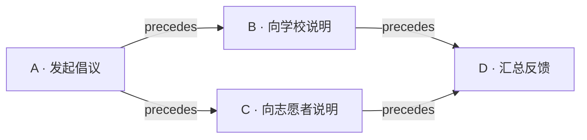

# 5 · 排布示例与验收

[总览](0-overview.md) · [Action 排布](1-action-layout.md) · [关系与 Context](2-relations-and-context.md) · [页面与证据](3-view-and-evidence.md)

验收看对象、相对位置、端点和依据。字号、留白与折线路径可随视口变化。以下图形说明读法，字母和别名只在各自示例内有效。

## 5.1 分叉与汇合

某项公益活动有四个行动。原图明确记录 A 先于 B、C，且 B、C 均先于 D。B 和 C 之间没有可用的先后路径，材料也未细分二者的日期。



A 占左列，B、C 在中列上下排，D 在右列汇合。B 在上或 C 在上不改变含义。四条已有边始终可见。A 到 D 的传递先后可在详情查到。若后续图中有独立依据证明 B 上午、C 下午，即使没有新增关系边，B 和 C 也应按时段分列。

## 5.2 同日细时间与日内未定

高盛案例 `PBUILD-cf4180d748cc` 的第一 Phase 有七个 Action。用同一冻结草稿离线重绘后，七张卡占六行。以下别名定位这一份输出，其他事件按同一套依据计算行列。

| 草稿中的行动 | 依据 | 实际排布与读法 |
| --- | --- | --- |
| A19 协商并传达拟议条款，A20 向 CNBC 表态 | 2008-09-23，A19 有“that afternoon”，A20 有“tonight” | 同日轴上依次显示下午、晚间。该图没有 A19 → A20 的 `precedes`，不为它们补画箭头。 |
| A17 公开支持、A18 提出高管持股条件、A21 作投资决定 | 同日，图中均只有日精度 | 三张卡归入覆盖 9 月 23 日的范围，读者可一眼看出各自的日内位置仍未确定。 |
| A13 出售部分持仓、A15 提供危机投资资金 | 两项均无可定位日期。A15 有一项外页上界，早于另一 Phase 的 A16。 | 同一轴下各占一行，分别显示 `Phase only` 和 `Before A16`。选中 A15 可追到另一 Phase 的原行动。 |

下面只画时间位置。点状括线标出可能发生的日期范围，卡片之间的留白没有时长含义。

```text
                      |------------ 23 Sep 2008 ------------|
                                       Afternoon     Evening
                                         [A19]        [A20]

Time within day       [................. A17 ...............]
unresolved            [................. A18 ...............]
                      [................. A21 ...............]

Action chronology            23 Sep · afternoon       evening
                      [A13 · Phase only]
                      [A15 · Before A16]
```

`A19 enables A21`、`A21 triggers A13`、`A20 responds_to A21` 是本页已有的过程关系。三条都应保留，不能把它们换算成相应的日期或三条 `precedes`。这组例子也检查页面是否允许“能读出过程，但部分时间仍未知”。

第五个 Phase 中，A01 的公开表态对齐 2013 年 3 月 26 日。A09 和 A10 的个人行动只确定到“不晚于 3 月 26 日”，因此在 A01 左侧同列上下排，虚线右端封到 3 月 26 日刻度。两项行动都可能发生在当天。图中可查到 A21 分别先于 A09 和 A10。A08 只知在外页 A21 之后，A11 只知属于本 Phase。

## 5.3 发生窗口与真实持续

- 两项探访都只知发生在 6 月。各有一张行动卡，可同列上下排，并显示 6 月的可能发生范围。不能据此得出两次探访在同一天。
- 两项活动各自有据持续于 `[6月1日, 6月10日)` 和 `[6月5日, 6月15日)`。各画自己的持续线并分行，共同覆盖 6 月 5 日至 9 日。若图中记录了 `overlaps`，再按原记录增加对称关系线。
- 两项行动的有效区间首尾相接，如前者止于排他的 6 月 10 日、后者始于 6 月 10 日。二者可确定先后。若前者只有开始日期、结束日期未知，则保留单侧界限，不能套用同一结论。

## 5.4 跨事件通用的验收用例

| 给定条件 | 应能观察到的结果 |
| --- | --- |
| 三个行动有可靠的连续先后 | 卡片沿同一行向右读。若原图只记录两条直接边，只显示这两条。 |
| 两支行动分叉再汇合，或两个互不连通的相对行动链 | 前者按第 5.1 节上下分支。后者各保留内部顺序，相同的拓扑深度不会变成共同日期。 |
| A 的可能窗口与 B 相交、B 与 C 相交，但 A 完全早于 C | 跨行保留各窗口，A 与 C 的先后仍可查。不能把三者都归为同时或全部未定。 |
| 同一天上午、晚间、只有日期的三项行动 | 前两项左右有序，第三项标明日内未定。缩窄窗口后仍保留相同的逻辑行与跨度。 |
| 时钟带不同时区、某一时钟缺可比的当地时间依据，或只有转载日期 | 确认时区的先换算。缺依据的保留原精度或未定。转载时间不能充当行动时间。 |
| A 与 C 同页，中间有据的先后路径经过另一页的 B | A 与 C 的位置遵守这条路径，可以追到 B。但本页不会凭空出现 A → C 的直接边，也不会复制 B。 |
| 两条先后相反，或“已知日期 → 无日期行动 → 更早日期”形成环 | 保留原主张、证据和争议标记，有冲突的约束退出确定排序。其他有独立依据的行动仍可排列。 |
| 同一背景由 Phase 及多个 Action 引用，另有一项有据排除 | 一页一张 Context 卡，保留显式连线。选中后按关联逐条应用排除，高亮其余实际继承者。 |
| 关系跨 Phase，或资料只支持其中一个端点的行动事实 | 跨页线连接本地卡与对端页签，标签仍写两个 Action。点击关系显示关系自身的字段依据或缺口。 |
| 一个字段用同一来源两段引文，另一字段还用第二个来源 | 每段引文各指向唯一 Source，读者能分别数清引文与来源，核对每个字段实际使用哪几段。 |
| 部分图有未归属 Action，同一 Phase 也有已归属但无日期的 Action | 前者在待归属位置可见，后者在原 Phase 可见。两者状态可以区分。 |
| 100% 首屏、放大缩小、开关详情、切页、工作台下载后独立打开 | 图内卡片及箭头端点无漂移，Action 不因宽度自动换行。新 Phase 的概览重新适配。嵌入与下载保留相同对象、逻辑行列与连接。 |

这份草稿六个 Phase 的 Action 逻辑行数依次为 **6、4、2、1、5、1**。这里按行动占用的行计数，背景、时间轴和证据区另算。验证时先核对每项行动的依据与归属，再核对行列、区间端点、真实连线和缩放行为。其他事件可以有不同的行数。

## 5.5 现有 HTML 的读图验收

以下用例适用于原生自动图。先检查引用与对象 ID，再在可独立打开的 HTML 中检查读者实际看见的行为。

| 检查对象 | 怎样判断符合设计 |
| --- | --- |
| Context 的范围、类别、视角 | 一张蓝底玫瑰条的卡能读作 Phase 共享的主体状态。把同一 Context 放到仅有 Action 引用的另一页，卡变奶油黄，类别和引文仍相同。备注 `Retrospective` 单独可辨。图例与卡片颜色对应，缩放后图例文字可读。 |
| 共享、例外与提及 | 为两个基准引用排除其一，另一项仍有效时行动保持高亮。两者均被排除则不高亮，有未决事项可在详情找到。共享卡提及某实体时，聚焦该实体才出现提及线。 |
| 单行动与多行动的基准 | 在高盛草稿 `PBUILD-cf4180d748cc` 第六个 Phase，C44 位于 A16 上方，条件线能追到 Phase 原引用。EV25 支持引用该背景，EV25、EV90 支持判为条件的推断。A16 → C31、C42 是两条结果线，C43 留在附加区。第一个 Phase 的 C58 则只出现一次，一条带谓词的主线分向七个行动。 |
| 阶段级端点 | 单行动 Phase 如果只记录阶段的触发、结果或某实体参与该阶段，箭头以 Phase 为相应端点。知识来源指向已知获知者。逐条排除继承不会删除原 Phase 引用及其证据。 |
| 角色与适用范围 | 同一实体以两种角色参与一项 Action，逐条查看角色和限定。知识来源的箭头止于已知的获知者。若收信人未确定，详情应说明这一点。 |
| 实线、虚线、点线 | 给定 `asserted responds_to`、`inferred responds_to` 和 `order_unknown`，依次看到紫实线有箭头、紫虚线有箭头、紫虚线无箭头。再打开 Context 和 Evidence，用文字图例能区分赭色背景线与绿色溯源点线。 |
| 分区和一源多引 | 打开第 3 章的“两来源三引文”组合，看到两个独立区域。选行动日期只追到 EV01、EV02 与 S01，选关系类型只追到 EV02、EV03 及 S01、S02。查看 S01 可列两段原文。 |
| 关系与字段的证据 | 从紫线进详情，能查看起点、终点、类型各自的支持。选择支持关系的引文时，屏幕内绿色点线可指向紫线本身。只有行动证据时不据此给关系增加支持。 |
| 定位异常与证据处置 | 交接元数据、位置多解、无法定位的记录可从字段或来源详情查看，并附相应提示。Source 只保存发表日期时，不能把该日期画成行动引文。 |
| 跨 Phase 与视口 | 从两页各自的入口检查同一条跨页关系，核对两个 Action 简称和箭头方向。在宽屏、窄屏、放大并横向滚动后，点线或标签仍指向原关系。用 `Go to / Back to` 和详情 `Back / Escape` 分别走完两条返回路径。 |
| 导出和重绘 | 核对工作台预览与下载对应同一图和状态。显式重绘保留图记录，失败时仍能读取此前成功的产物。 |

颜色和样式以[图例](4-visual-legend.md)为准。已有[图对象与连线测试](../../tests/test_person_event_graph_html.py)以及[渲染和浏览器测试](../../tests/test_person_event_rendering.py)可作回归入口，时间判定用例见 `test_person_event_chronology.py`。此表说明要验收哪些行为，其中组合情形也可用合成图复核。
