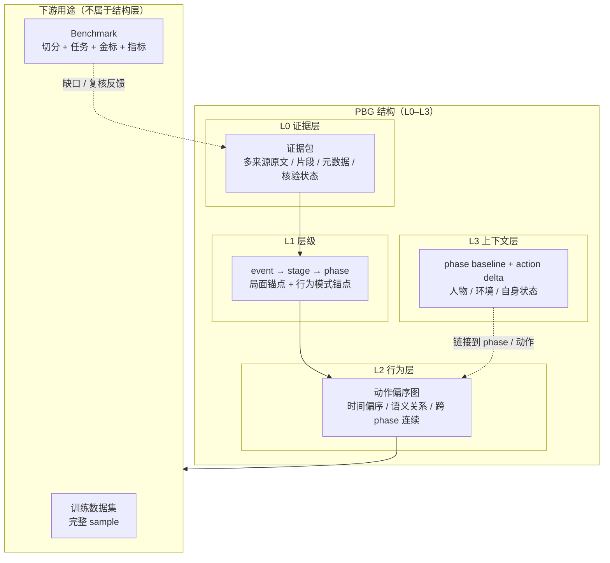

# 0 · 总览：人物行为图框架（PBG）

> 文档系列：**Person Behavior Graph (PBG) Framework**
> 版本：`v0.1`（框架基线草案，2026-11-12）
> 层级：**框架层**。本系列只定义结构、语义、规则、边界与用途；不定义字段级 schema、文件格式、接口或实现。
> 状态：讨论中，待最终确认后冻结为 `v1.0`。

---

## 0.1 一句话定义

**人物行为图（Person Behavior Graph, PBG）**是从“围绕一个人物与一个事件的证据包”中蒸馏出来的、以人物行为为中心的分层结构：

> `event → stage → phase → 动作偏序图`，外加一个横切的上下文层（环境 / 关系与他人 / 人物自身状态），所有节点、边与上下文链接都能回指证据。

一句话区分：**EventCascade 描述“事件怎么发展”，PBG 描述“这个人在这个事件里怎么行动、为什么这样行动”。**

---

## 0.2 为什么需要它

现有事件表示（`EventCascade` 等）以“事件过程”为中心：动作挂在 participant 下，层级是事件→阶段→片段，动作之间缺少显式的时间偏序、语义/过程关系、跨阶段连续关系，也缺少对行为条件的系统建模。人物模拟的训练与评测需要的是**行为中心**的结构：

1. 同一时期人物往往存在多个并发过程（如业务、资金、法律、舆论等），在偏序中表现为反链或互不可比的顶点集合；
2. 动作之间存在并发（concurrent）、链式先后（chain）、分叉/汇合（fork/join）、回应与跨 phase 连续；
3. 动作的解释依赖环境状态、相关他人、以及人物自身的目标、资源、约束与知识；
4. 结构必须能被**判分**（benchmark），也必须能追溯到**证据**（dataset）。

PBG 就是为这四个需求设计的最小框架。

---

## 0.3 目标与非目标

| | 内容 |
|---|---|
| **目标** | 单人物、单事件的行为结构；训练数据集 + benchmark 双用途；可追溯、可复核、可冻结；支持多任务派生（行为解释、下一步动作预测、图补全、阶段边界评估） |
| **非目标** | 不做情景 / 环境模拟；不做因果识别 / 反事实推断；不定义 transition function；不做全量社会或多人物模拟；不做通用事件知识图谱；本框架层不定义字段、接口、存储 |
| **建模对象** | 一个 **sample = 一个人物 × 一个事件**，基于一个**固定证据包**蒸馏 |

---

## 0.4 核心概念

| 概念 | 定义 |
|---|---|
| **event** | 一个可独立研究、有可解释边界的人物事项，有覆盖区间与研究范围 |
| **stage** | 事件中的一个“局面/情境”时期；边界是情境、主导目标、关系格局或资源约束的实质变化 |
| **phase** | 一个 stage 内一种相对稳定的“行为模式/子目标/活动簇”时期；边界是行为模式的变化 |
| **action** | 有证据支持的一个行为单元：一个主体、一个目标、一个有界时间、一个可陈述且可证据化的行为 |
| **动作图** | 以 action 为节点、以时间/语义/交互/连续关系为边的**偏序图**（partial order），允许并发（concurrent）与不可比（incomparable）结构，可含多条极大链 |
| **上下文** | 与动作直接相关的环境状态、关系与他人、人物自身状态；分 phase 基准与动作差量两层 |
| **证据包** | 围绕该人物与事件收集的多来源、可核验的信息集合；是一等公民，图是它的派生视图 |
| **PBG** | 上述层级 + 动作图 + 上下文链接的完整框架（结构本身只到 L0–L3） |
| **dataset（数据集）** | 一组 PBG sample 的集合，用于训练或分析；每个 sample 含证据包、结构、上下文 |
| **benchmark（评测协议）** | 在同一批 sample 上定义的任务 + 切分 + 金标 + 指标；不是另一种结构 |
| **下游用途（consumer）** | 使用 PBG 的训练 / 评测场景；不属于结构层（L4 只是用途标注） |
| **closed-world 完整性** | benchmark 中“找全行为”的判定，相对于**固定证据包**定义，而非真实世界 |
| **support status** | 节点/边/链接的证据状态：`observed` / `inferred` / `unknown` |

---

## 0.5 框架总图（范式）

**读法**：L0–L3 是 PBG 本身（结构层）；下面的“下游用途”**不是第四层结构**，而是同一结构的两种使用方式：

- **训练数据集**：完整 sample（证据 + 完整图 + 上下文），用于训练/微调；
- **Benchmark**：对同一批 sample 做时间切分，隐藏 T 之后的部分作为金标，输入只含 T 前信息——它是**评测协议**，不是另一套数据。

如果当前只关心结构，可以忽略“下游用途”这块。详见 [5-benchmark-and-dataset](5-benchmark-and-dataset.md)。

**图例约定**：实线箭头表示“产出/派生方向”；虚线箭头表示“链接/引用/反馈”；上下文层是横切维，不占层级。

---

## 0.6 框架规则（FR）

| 编号 | 规则 | 详见 |
|---|---|---|
| **FR-1** | 单案例图 = **证据支持的行为偏序图**；并发 = 区间重叠；顺序未知 = 不可比；允许多根多汇、多条极大链，不是单链 | [2-action-graph](2-action-graph.md) |
| **FR-2** | 层级 `event → stage → phase → 动作图`；stage 是“局面”层，phase 是“行为模式”层；stage 分区 event，phase 分区 stage；允许 unknown gap；边界必须有证据 + 理由 | [1-hierarchy](1-hierarchy.md) |
| **FR-3** | **动作准入四条必需**：主体相关、事件相关、过程相关、证据支持 | [2-action-graph](2-action-graph.md) |
| **FR-4** | **动作排除与去重**：背景/评价/心理/微观操作/无关私人活动/无证据传闻不入图；同一行为一个节点多证据；重复性动作用模式节点 | [2-action-graph](2-action-graph.md) |
| **FR-5** | **无孤点**：每个动作至少一条语义边连接事件过程（触发/条件/结果/回应/目标），否则不进图或降级为上下文 | [2-action-graph](2-action-graph.md) |
| **FR-6** | **动作原子性**：一个主体、一个目标、一个有界时间、一个可陈述可证据化的行为 | [2-action-graph](2-action-graph.md) |
| **FR-7** | **上下文两段式**：phase baseline + action delta；三类上下文（人物/环境/自身状态）；六种链接语义（参与/条件/触发/约束/结果/知识来源） | [3-context-model](3-context-model.md) |
| **FR-8** | **证据优先**：证据包是一等公民，图是派生视图且可重建；每个节点/边/上下文链接可回指证据；完整性相对证据包定义（closed-world） | [4-evidence-and-provenance](4-evidence-and-provenance.md) |
| **FR-9** | **知识边界**：人物“当时知道什么”（belief）与“事后事实”分离，防止未来信息泄漏 | [3-context-model](3-context-model.md) |
| **FR-10** | **用途边界**：同时服务 benchmark 与训练数据集；不做 transition function、不做情景/多人物模拟 | [5-benchmark-and-dataset](5-benchmark-and-dataset.md) |
| **FR-11** | **生产与复核**：顶级 LLM 负责提议与蒸馏，框架规则负责校验，人工负责判断与冻结；prompt/skill 是执行层，不是定义层；stage/phase 评测分开 | [6-production-review-and-validation](6-production-review-and-validation.md) |
| **FR-12** | **因果克制**：只记录时间关系、来源陈述的语义关系与显式标记的推断；不声称识别真实因果；语义环忠实保留，不做因果化排序 | [2-action-graph](2-action-graph.md) |

> 这 12 条是框架的“宪法”。每个文件给出展开定义、图示与反模式；后续任何 schema、prompt、标注指南都不得与之冲突。
>
> **术语纪律**：本系列中的图论/序理论术语按标准数学含义使用（偏序、链、反链、Hasse 图、诱导子图、商图、割边、SCC、宽度/高度等）；不使用“线程/主线/支线”等叙事化类比。新术语必须先在 [7-glossary-and-mapping](7-glossary-and-mapping.md) 定义后使用。

---

## 0.7 文档地图

| 文件 | 回答的问题 | 主要图 |
|---|---|---|
| [0-overview](0-overview.md) | 这个框架是什么、为什么、规则总览 | 框架总图 |
| [1-hierarchy](1-hierarchy.md) | event/stage/phase 如何定义、如何切、有什么不变量 | 层级图、时间线 |
| [2-action-graph](2-action-graph.md) | 动作图的形式化语义、相位分层、动作准入与去重 | 相位分层图、偏序图、准入流程图 |
| [3-context-model](3-context-model.md) | 环境/他人/自身状态如何挂到动作上、belief 与事实如何分开 | 两段式上下文图 |
| [4-evidence-and-provenance](4-evidence-and-provenance.md) | 证据包是什么、图和证据什么关系、完整性如何定义 | 证据流图 |
| [5-benchmark-and-dataset](5-benchmark-and-dataset.md) | 训练数据集与评测协议（同一结构的两种下游用法）、切分与防泄漏 | 任务派生图 |
| [6-production-review-and-validation](6-production-review-and-validation.md) | 生产流程、角色分工、校验清单、冻结与版本 | 生产流水线图、状态机 |
| [7-glossary-and-mapping](7-glossary-and-mapping.md) | 术语、与现有 EventCascade / person-epg 的关系、设计问答 | 表示映射图 |

---

## 0.8 设计原则（为什么是这些规则）

1. **证据优先**：先有证据包，再有图；图是解释与检索的投影，不是事实本身。
2. **偏序而非链**：同一时期多个动作并存是常态，强行线性化会伪造顺序与关系。
3. **语义锚点**：两级时间切分必须回答不同问题（局面 vs 行为模式），否则只是重复切分。
4. **准入而非全收**：动作图的价值取决于“什么不进来”；与事件/phase 无过程关系的动作只会制造噪声。
5. **两段式上下文**：phase 级共享背景 + 动作级差量，既避免重复，又保持可解释。
6. **belief 与事实分离**：行为由当时认知驱动，不能用事后信息解释当时动作。
7. **closed-world 判分**：benchmark 的“完整”相对证据包定义，才可复现、可比较。
8. **双用途同构**：训练数据与 benchmark 使用同一结构，靠切分与任务派生区分，不维护两套格式。
9. **因果克制**：观察性文档不足以识别真实因果；只记录时间关系、来源陈述的语义关系与显式标记的推断，不把推断包装成事实。

---

## 0.9 与现有表示的关系（简述）

- **EventCascade**（事件级）：以事件过程为中心，`event → stage → episode → participant/action/relation/transaction`；PBG 以人物行为为中心，增加 phase、动作偏序、上下文与证据准入。
- **person-epg-3.0**（人物级事实/组织）：已有实体、occurrence、action、transaction、时间、证据，以及 event/stage/activity 组织层；PBG 可视为在其事实与证据之上增加“**行为偏序图 + phase + 上下文**”的行为视图。
- 本框架**不修改**上述任何现有表示；映射与复用原则见 [7-glossary-and-mapping](7-glossary-and-mapping.md)。

---

## 0.10 版本与待定事项

- `v0.1`：框架基线（本系列）。待确认后冻结 `v1.0`。
- 待后续版本决定（不属于框架层）：动作类型词表、decision point 是否入正式版本、上下文变量集合、粒度阈值、多语言策略、跨人物/跨事件扩展。
- 变更记录：
  - `2026-11-12` 初稿：基于讨论形成 11 条框架规则与 8 份文档结构；同日补充 FR-12（因果克制），并形式化动作图与相位分层。
