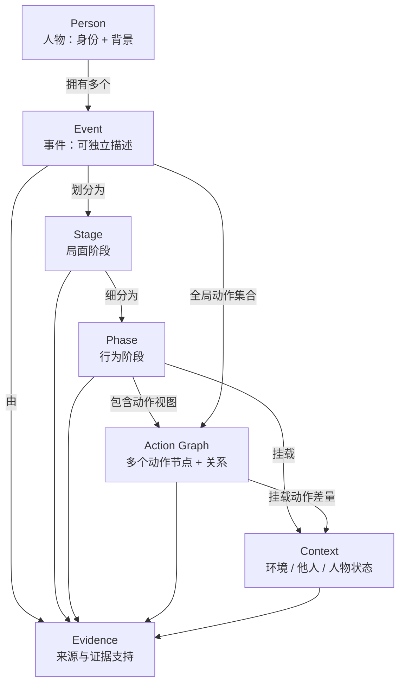
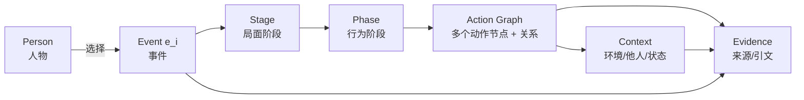

# 0 · 总览：人物—事件描述结构（设计层）

> **这份文档讨论的是“结构设计”，不是实现。**
> 结构 = 描述**一个人物**及其**一系列 events**时，内容应该如何组织；其中**每一个 event 要有一份完整、深入的描述**。
> 不讨论字段/schema/JSON、代码、存储、生产流程、模型、benchmark、评测。
> 版本：`v0.1`（设计稿，2026-11-12）。

---

## 0.1 我们到底要描述什么

**描述对象**：一个人物（Person），以及这个人物经历的一系列事件（Events）。

- 人物是主语：身份、别名、简要背景；
- 事件是描述单位：一个人物可以有多个 event，每个 event 独立、完整、可单独阅读；
- 每个 event 内部要回答：
  1. 这件事本身是什么（时间、范围、经过、结果）；
  2. 事情分几个**局面阶段**（stage）；
  3. 每个局面里人物的**行为模式**如何变化（phase）；
  4. 人物具体做了哪些**动作**（action），动作之间如何相连；
  5. 动作发生在什么**环境**、涉及**哪些人**、人物当时处于什么**状态**；
  6. 以上内容由什么**证据**支持。

一句话：**人物 → 一系列 events → 每个 event 的完整行为描述**。

**sample（本系列用语）**：一个人物 × 一个 event 的完整描述实例。一个人物可以有多个 sample（每个 event 一个）；本系列讨论的是“一个 sample 内部的结构”，跨 sample 的关系暂不展开。

### 0.1.1 顶级框架图（Paradigm）

```mermaid
flowchart TB
    P["Person<br/>身份 + 事件索引"]
    P -->|e₁ … eₙ| E["Event<br/>时间 / 范围 / 摘要"]
    E --> S["Stage<br/>局面阶段（按局面变化切）"]
    S --> PH["Phase<br/>行为阶段（按行为模式变化切）"]
    PH --> G["Phase 内动作视图 G(p)<br/>多个动作节点 + 关系"]
    G -.->|G(p) 是 G(e) 的视图| GE["Event 级动作图 G(e)<br/>全部动作 + 关系"]
    PH -->|基准 C(p)| C["上下文层<br/>环境 / 他人 / 人物状态"]
    G -->|差量 ΔC(a)| C
    E --> V["证据层<br/>来源 / 引文 / 支持模式 / 缺口"]
    S --> V
    PH --> V
    G --> V
    GE --> V
    C --> V
```

**这张图是结构设计的总范式**：

- 外层：人物拥有多个 event；每个 event 独立完整描述；
- 中层：event 内是 `Stage → Phase → 动作视图`；
- 内层：动作视图由多个动作节点与关系构成；phase 视图满足 `A(p) ⊆ A(e)`，并保留跨视图的边界引用；
- 横切：上下文（phase 基准 + action 差量）与证据（来源/引文/支持模式/缺口）挂在结构上。

---

## 0.2 设计对象模型



**读法**：

- `Person` 是顶层主语，拥有多个 `Event`；
- `Event` 是独立描述单位，内部有 `Stage → Phase → Action`；
- `Action` 是 event 级的**全局**行为集合；`Phase` 只是动作的分组/视图，不复制动作；
- `Context` 是横切层，挂在 phase（基准）和 action（差量）上；
- `Evidence` 支撑整棵结构，不是某一个层级的附属。

**关键澄清**：**每个 phase 内部不是“一个动作”，而是一组由多个动作节点与关系构成的动作视图**。动作是节点；动作之间有先后、并发/不可比、回应、延续等关系；phase 的动作视图满足 `A(p) ⊆ A(e)`，event 级动作图 `G(e)` 才包含该 event 的全部动作。phase 之间通过跨相位动作与关系相连（详见 [1-hierarchy](1-hierarchy.md) 1.1.2 与 [2-action-graph](2-action-graph.md) 2.5）。允许退化到单动作或空的 phase，但必须说明原因。

---

### 0.2.1 阅读路径（从人物到证据）



**读法**：先确定人物；在人物的事件索引中选择一个 event；进入 event 的 stage/phase/action；每个动作挂上下文与证据；最后回到证据包复核。

> 0.1.1、0.2、0.2.1 是同一结构的三张不同视图：总范式、对象模型、阅读路径；若只读一张，看 0.1.1。

### 0.2.2 符号约定（设计层）

| 符号 | 含义 |
|---|---|
| `P` | 人物（Person） |
| `E(P) = {e₁, …, eₙ}` | 人物的系列事件 |
| `S(e)` | 事件 e 的局面阶段集合 |
| `Ph(s)` | 阶段 s 的行为阶段集合 |
| `A(e)` | 事件 e 的动作集合（event 级全局） |
| `G(e)` | event 级动作图（动作 + 关系） |
| `G(p), G(s)` | phase / stage 的动作视图（不是单个动作） |
| `I(x) = [l, r)` | 对象 x 的时间区间（半开区间） |
| `a ≺ b` | 动作 a 先于 b（有证据的时间先后） |
| `a ∥ b` | a 与 b 不可比（无先后证据或区间重叠） |
| `C(p)` | phase p 的基准上下文 |
| `ΔC(a)` | 动作 a 相对基准的上下文差量 |
| `Ev(x)` | 对象 x 的证据集合 |
| `Sup(x) ⊆ {O, A, I}`；`Gap(x)` | 支持模式集合：`O`=记录内容、`A`=世界断言、`I`=推断；`Sup=∅` 且 `Gap` 记录即“未知” |

**时间精度与区间**：年/月/日精度必须写成半开区间 `[start, end)`：年 `YYYY` → `[YYYY-01-01, (YYYY+1)-01-01)`；月 `YYYY-MM` → `[YYYY-MM-01, 下月-01)`；日 `YYYY-MM-DD` → `[当日, 次日)`。端点相等是空区间，不能用来表示“某月/某日”。详见 [1-hierarchy](1-hierarchy.md) 1.7。

> 这些符号只用于表达结构关系，不绑定任何字段/存储格式。

---

## 0.3 各层要回答的问题

| 层级 | 回答的问题 | 不是做什么 |
|---|---|---|
| **Person** | 这个人是谁？他/她有哪些 events？ | 不是事件叙述本身 |
| **Event** | 这件“事”是什么？范围多大？完整经过如何？ | 不是一句话摘要；不是人物传记 |
| **Stage** | 事情处在什么**局面**？局面何时发生实质变化？ | 不是文档章节；不是简单按日期切 |
| **Phase** | 在这个局面里，人物的**行为模式**是什么？何时变化？ | 不是 stage 的同义词；不是动作列表 |
| **Action** | 人物具体**做了什么**？和哪些动作相连？ | 不是背景/评价/心理活动 |
| **Context** | 动作发生在什么环境、涉及谁、人物当时什么状态？ | 不是全量世界模型 |
| **Evidence** | 上述内容由什么来源、什么引文支持？ | 不是模型记忆或推断 |

---

## 0.4 设计原则

1. **人物是主语，event 是单位**：人物文档负责身份与事件索引；每个 event 独立完整描述，不依赖其他 event 才能读懂。
2. **层级回答不同问题**：stage 是“局面层”，phase 是“行为模式层”，action 是“具体行为层”。如果两层回答同一问题，就是冗余，应合并。
3. **动作是核心**：描述人物行为时，动作是可独立记录的最小单元；动作之间用关系连接，而不是强行排成一条链。
4. **关系显式化**：先后、同时、顺序未知、回应、触发、交互、延续等关系要显式表达；没有证据就不连，不为了图完整而编。
5. **上下文分层挂载**：phase 提供基准上下文（环境/他人/人物状态），action 只写特有的差量；避免每个动作重复写一遍环境。
6. **证据可追溯**：结构中的内容要能回指来源与原文；区分“记录内容（O）”“世界断言（A）”“推断（I）”，未知用 `Sup=∅ + Gap` 表示；不把推断包装成事实。
7. **未知显式**：不知道就标未知/缺口；不为了结构完整而编造时间、阶段、动作或因果。
8. **不声称因果**：观察性文档不足以识别真实因果；只记录时间关系、来源明确陈述的关系、以及显式标记的推断。

---

## 0.5 明确不在本结构里讨论的内容

| 不讨论 | 去哪里讨论 |
|---|---|
| 字段名、类型、JSON、schema、ID 格式 | 后续实现规范 |
| 代码模块、接口、存储、文件组织 | 项目架构/实现文档 |
| 模型、prompt、蒸馏流程、人工复核流程 | 生产/流程文档 |
| benchmark、评测指标、训练集切分 | 评测/数据集文档 |
| 具体项目代码（EventCascade / person-epg）的映射 | 单独的技术映射文档 |

> 本文档只回答：**描述一个人物及其 events 时，内容结构应该是什么样。**

---

## 0.6 文档地图

| 文档 | 讨论的设计问题 |
|---|---|
| [0-overview](0-overview.md) | 总体对象模型、层级职责、设计原则、边界 |
| [1-hierarchy](1-hierarchy.md) | Person / Event / Stage / Phase / Action 各层的定义、边界、时间包含、粒度 |
| [2-action-graph](2-action-graph.md) | 动作是什么、动作之间有哪些关系、如何组成图、如何归属 phase |
| [3-context-model](3-context-model.md) | 上下文（环境/他人/人物状态）如何设计、phase 基准与 action 差量、belief 与事实 |
| [4-evidence](4-evidence.md) | 证据包、溯源、支持模式、验证与冲突处理的设计原则 |
| [5-design-decisions](5-design-decisions.md) | 关键设计选择、替代方案与取舍、待定问题 |
| [6-illustrative-example](6-illustrative-example.md) | 一个概念性示例：从人物到 event 再到动作与上下文 |
| [7-specification](7-specification.md) | 设计规范：层级、动作视图、上下文、证据、未知处理的规范性要求与符合性检查 |
| [8-formal-model](8-formal-model.md) | 形式化模型、命题、视图定义与完整规范示例 |

### 0.6.1 文档阅读地图


**读法**：0 给总图与边界；1 定义层级；2 定义动作与关系；3/4 给上下文与证据；6 用示例把前四篇串起来；8 用形式化把定义写精确；7 把要求收成规范；5 记录为什么这样选、还有什么待定。

### 0.6.2 文档质量目标

本系列以“**可审阅的设计说明书**”为标准，而不是随手笔记：

| 目标 | 含义 |
|---|---|
| **准确** | 定义、符号、层级关系、偏序/视图语义一致；示例与定义不冲突 |
| **完整** | 人物/事件/阶段/行为阶段/动作/上下文/证据/规范/示例均有覆盖 |
| **深入** | 给出形式化定义、命题、边界判据、替代方案与代价，而不只是结论 |
| **可审阅** | 每篇有框架图/流程图/关系图；示例可逐步对照；规范有符合性检查 |
| **可扩展** | 明确设计层边界与待定问题，避免把实现细节写死 |

**建议阅读路径**：0（总览/顶级图）→ 1（层级）→ 2（动作图）→ 3（上下文）→ 4（证据）→ 6（概念示例）→ 8（形式化与示例）→ 7（规范）→ 5（设计取舍）。

---

### 0.6.3 设计问题索引

| 设计问题 | 主要回答位置 |
|---|---|
| 人物如何组织一系列事件？ | [1-hierarchy](1-hierarchy.md) 1.2–1.3 |
| 事件内部为什么分 stage / phase？边界怎么定？ | [1-hierarchy](1-hierarchy.md) 1.4–1.5 |
| 什么是动作？什么不算动作？ | [2-action-graph](2-action-graph.md) 2.2 |
| 动作之间有哪些关系？为什么不是一条链？ | [2-action-graph](2-action-graph.md) 2.4–2.5；[8-formal-model](8-formal-model.md) 8.3 |
| phase 与动作图是什么关系？ | [2-action-graph](2-action-graph.md) 2.5–2.6；[8-formal-model](8-formal-model.md) 8.4 |
| 动作发生的环境/他人/人物状态如何进入结构？ | [3-context-model](3-context-model.md) |
| 结构如何被证据支持、如何避免编造？ | [4-evidence](4-evidence.md) |
| 这些设计有哪些替代方案与代价？ | [5-design-decisions](5-design-decisions.md) |
| 一个完整例子怎么读？ | [6-illustrative-example](6-illustrative-example.md)、[8-formal-model](8-formal-model.md) 8.7 |
| 如何判断结构是否符合设计？ | [7-specification](7-specification.md) |

---

## 0.7 版本与状态

- 当前：`v0.1` 设计稿（2026-11-12）。
- 状态：讨论中；确认后冻结设计基线。
- 变更记录：
  - `2026-11-12`：确立“人物 → 一系列 events → 每个 event 完整行为描述”的设计层定位；后续文档围绕该定位展开。
  - `2026-11-12`：补充顶级框架图与设计规范（7-specification）；明确 phase 内是动作视图，而非单个 action。
  - `2026-11-12`：补充形式化模型与规范示例（8-formal-model）；统一 `G(e)/G(s)/G(p)` 视图与偏序语义。
