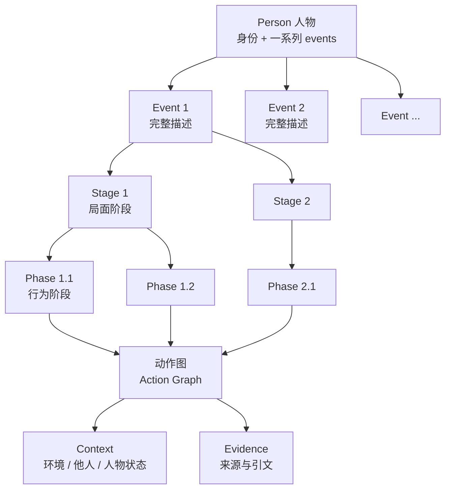

# 1 · 层级：人物 → 事件 → 阶段 → 行为阶段 → 动作

> 本篇讨论**描述结构的层级设计**：每一层是什么、回答什么问题、边界如何判断、层与层之间如何包含。
> 不涉及字段/schema/JSON/代码。
> 关联：[0-overview](0-overview.md) · [2-action-graph](2-action-graph.md) · [3-context-model](3-context-model.md)

---

## 1.1 五层结构



| 层级 | 是什么 | 回答的问题 | 包含关系 |
|---|---|---|---|
| **Person** | 被描述的人 | 这个人是谁？有哪些 events？ | 拥有 1..n 个 Event |
| **Event** | 一个可独立研究的事项 | 这件事是什么、覆盖什么范围、完整经过如何？ | 包含 1..n 个 Stage |
| **Stage** | 事件中的一个“局面/情境”时期 | 局面何时发生实质变化？ | 包含 1..n 个 Phase |
| **Phase** | stage 内一种相对稳定的“行为模式”时期 | 人物在这个局面里怎么做事？行为模式何时变化？ | 包含动作视图 |
| **Action** | 人物行为的最小记录单元 | 具体做了什么？和哪些动作相连？ | 属于 Event；在 Phase 中分组展示 |

**设计要点**：

- **Person 与 Event 是“拥有关系”**，不是包含在同一个文档里的层级；
- **Event 内部是三级结构** `Stage → Phase → Action`；
- **Action 是 event 级的全局集合**，phase 只是动作的分组视图（详见 [2-action-graph](2-action-graph.md)）。

---

## 1.2 Person（人物层）

人物层只做两件事：**身份**与**事件索引**。

| 设计要素 | 说明 |
|---|---|
| 身份 | 人物的规范姓名、别名、必要背景；用于区分“这个人”与其他人 |
| 事件索引 | 该人物的一系列 events，按时间/主题组织；每个 event 独立描述 |
| 边界 | 一个人物一个身份；不同人物不合并（除非有明确身份合并依据并记录） |
| 不做什么 | 不在人物层展开事件细节；不写事件叙述 |

**设计问题**：一个人物可以有多少 events？

- 不设固定上限；按公开资料中可独立研究的事项组织。
- 每个 event 应该有可解释的边界；不能把整个人生或整个职业生涯当作一个 event。
- 人物层的事件索引不等于“事件之间的因果/主题关系”；跨事件关系是后续设计问题（见 5-design-decisions）。

---

## 1.3 Event（事件层）

**定义**：一个可独立研究、有可解释边界的人物事项；一份完整的 event 描述应该**脱离其他 event 也能读懂**。

| 设计要素 | 说明 |
|---|---|
| 事件身份 | 名称、所属人物；一个 event 只属于一个人物 |
| 时间与范围 | 覆盖时间、纳入/排除范围；允许未知端点、未知时间 |
| 完整描述 | 不只是标题/摘要：要包含过程（stage/phase/action）、上下文、证据 |
| 边界 | 一个具体事项/过程，而不是“某个主题”或“某一年” |
| 独立性 | 不依赖其他 event 才能理解；必要时在描述中给出最小背景 |

**事件边界的设计问题**：

- 什么算“一个 event”？—— 有可独立研究的事项/过程，能说明“研究什么、哪个时期、排除什么”。
- 多个报道、多个年份、多个阶段：只要仍围绕同一事项，可属于同一 event；不同事项不应因为人物/公司相同就合并。
- 长事件可以只覆盖一个明确窗口，但要说明窗口与整个事项的关系；不要把窗口外的事实悄悄塞进来。

---

## 1.4 Stage（局面阶段）

**定义**：event 中一个“局面/情境”相对稳定的时期。

**边界锚点：局面发生实质变化**，例如：

- 外部环境改变（监管立案、市场崩盘、关键对手方变化）；
- 主要目标改变（融资 → 自救；扩张 → 收缩）；
- 关系格局改变（盟友变对手、控制权变化）；
- 资源/约束改变（资金耗尽、禁令生效）。

**不应作为 stage 边界的**：

- 文档发布日期、报道批次、章节标题；
- 自然月/季度；
- 同一局面的重复描述；
- 只是“时间过去了”。

**设计讨论**：

- stage 是**局面层**；它描述“人物面对什么”，不描述“人物怎么做”（后者是 phase）。
- stage 数量按事件复杂度定，不设固定数；通常 2–5 个。
- stage 之间允许存在未覆盖的时间缺口；缺口要说明，不为了连续而编边界。

---

## 1.5 Phase（行为阶段）

**定义**：stage 内一种相对稳定的“行为模式/策略/子目标”时期。

**边界锚点：行为模式发生实质变化**，例如：

- 从公开否认转为私下协商；
- 从集中买入转为分散减持；
- 从本人直接处理转为委托律师/代理人；
- 主要交互对象改变（与投资人 → 与监管）；
- 活动强度/节奏显著变化。

**不应作为 phase 边界的**：

- 同一行为的重复报道；
- 来源切换；
- 单篇文档的叙事分段；
- 与 stage 边界相同的切点（如果 phase 没有独立的行为模式变化，就不应重复切）。

**设计讨论**：

- phase 是**行为模式层**；它描述“人物在这个局面里怎么做”。
- stage 与 phase 的两级设计，是为了同时保留“局面”与“做法”两种粒度；如果两级总切在同一处，说明只需要一级，应合并。
- phase 数量通常每 stage 2–4 个；允许单 phase 的 stage，也允许单动作的 phase。

---

## 1.6 Action（动作层）

**定义**：人物行为的最小记录单元；“动作”不是一切言行，而是与这个 event 相关、可陈述、可证据化的行为。

**设计要点**：

- 动作是 event 级全局集合；phase 通过“分组视图”引用动作，不复制动作；
- 动作用关系连接（先后、同时、顺序未知、回应、触发、交互、延续），不是单链；
- 动作的粒度、准入和关系设计见 [2-action-graph](2-action-graph.md)。

**动作与上下文的衔接**：

- 动作本身只写“做了什么”；
- 环境、他人、人物状态作为上下文，挂在 phase 基准和 action 差量上（见 [3-context-model](3-context-model.md)）。

---

## 1.7 时间与包含关系

```text
Person
 └─ Event（各自独立的时间范围）
     └─ Stage（按时间顺序；在 event 时间范围内）
         └─ Phase（按时间顺序；在 stage 时间范围内）
             └─ Action（发生时间；可跨 phase 甚至跨 stage）
```

**设计规则**：

1. stage 按时间顺序排列；phase 按时间顺序排列。
2. stage 的时间应在 event 范围内；phase 的时间应在所属 stage 范围内；允许未知端点。
3. 动作的时间通常落在某个 phase 内；允许跨 phase，但动作只存一份，并标注跨相位归属。
4. 允许时间缺口与未知；**不为了连续而编造时间**。
5. 时间精度继承来源：年/月/日/未知；不得把粗粒度时间提升为精确日期。

---

## 1.8 多分辨率用途（为什么保留 Person/Event/Stage/Phase）

| 视角 | 主要用途 |
|---|---|
| **Person** | 人物级浏览、事件索引、身份区分 |
| **Event** | 完整案件/事项的描述与阅读单位 |
| **Stage** | 叙事分段、局面分析、粗粒度评估 |
| **Phase** | 行为模式分析、评审与细粒度描述 |
| **Action** | 行为细节、动作关系、下游分析 |

> 层级不是越细越好；每一层只解决一个问题，避免“同一件事在多个层级重复描述”。

---

## 1.9 设计层不变量

| 编号 | 不变量 |
|---|---|
| **L1** | 一个 event 只属于一个人物；人物可以有多个 event |
| **L2** | 每个 event 独立可读；不依赖其他 event 才能理解 |
| **L3** | stage/phase 边界必须有“局面变化/行为模式变化”的理由 |
| **L4** | 时间包含关系成立；允许未知与缺口，但不编造 |
| **L5** | 动作在 event 级只存一份；phase 是分组视图，不复制 |
| **L6** | 未知显式；不把推断伪装成事实 |
| **L7** | 结构的变化（层级、边界、归属）必须可解释、可复核 |

---

## 1.10 与其他文档的关系

- 动作与关系：[2-action-graph](2-action-graph.md)；
- 上下文：[3-context-model](3-context-model.md)；
- 证据：[4-evidence](4-evidence.md)；
- 设计取舍与待定问题：[5-design-decisions](5-design-decisions.md)；
- 概念示例：[6-illustrative-example](6-illustrative-example.md)。
