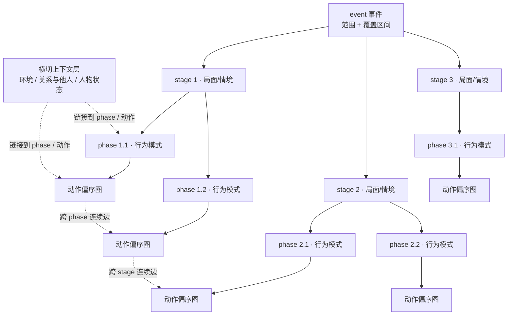
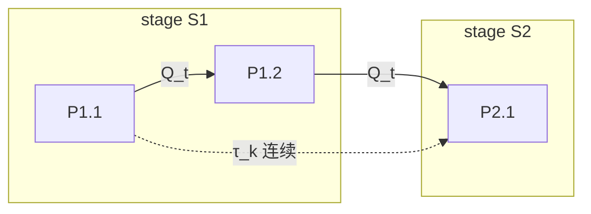

# 1 · 层级：event → stage → phase → 动作图

> 对应框架规则：**FR-2**、FR-5、FR-6。框架层定义，不含字段/schema。
> 关联：[0-overview](0-overview.md) · [2-action-graph](2-action-graph.md) · [3-context-model](3-context-model.md)

---

## 1.1 每一层回答什么问题

层级不是“越细越好”，而是**每一层回答不同的问题**。如果两层问同一件事，就说明只需要一层。

| 层级 | 回答的问题 | 边界锚点 | 时间 / 包含关系 | 典型数量（指引，非硬规则） |
|---|---|---|---|---|
| **event** | 这件“事”是什么，覆盖什么范围？ | 一个可独立研究、有可解释边界的人物事项 | 覆盖区间 + 研究范围（scope） | 1 个 / sample |
| **stage** | **局面/情境**怎么变？ | 外部情境、主导目标、关系格局、资源约束的实质变化 | stage **分区** event 的时间区间：有序、不重叠；允许显式未覆盖缺口 | 2–5 个 |
| **phase** | 在这个局面里，人物以什么**行为模式**做事？ | 行为模式 / 子目标 / 交互对象 / 活动强度的实质变化 | phase **分区**所属 stage 的时间区间；允许显式未覆盖缺口 | 每 stage 2–4 个 |
| **动作图** | 具体做了什么，动作之间怎么连？ | 有证据支持的行为单元及其关系 | **event 级唯一图**；phase 只是 M:N 归属视图，不是硬容器 | 每 phase 3–15 个动作（指引） |

> 关键设计：**stage 是“世界/局面层”，phase 是“人物行为模式层”**。两者的切点经常不同——stage 可能因监管立案而切，phase 可能因人物从“公开否认”转为“私下处置”而切。

---

## 1.2 层级图



> 注意：动作图是 **event 级** 的；图上每个动作可以通过 M:N 归属到若干 phase（“主归属 + 跨 phase 延续”），但动作节点本身只存一份。详见 [2-action-graph](2-action-graph.md)。

---

## 1.3 时间契约

```text
event   |==============================================================|
stage   |<----- stage 1 · 局面 A ----->|<---- stage 2 · 局面 B ---->|<-- stage 3 -->|
phase   |<- P1.1 ->|<- P1.2 ->|<- P1.3 ->|<-- P2.1 -->|<-- P2.2 -->|<-- P3.1 -->|
action  |  A1   A2     A2（跨 phase 延续）  A3   A4        A5    A6       A7      |
```

**不变量（INV-H）**

| 编号 | 不变量 |
|---|---|
| **INV-H1** | event 有明确的覆盖区间与研究范围；范围外的行为不进入该 sample |
| **INV-H2** | stage 按时间顺序排列并**分区** event 区间；stage 之间不重叠；允许“未覆盖缺口”，但必须给出原因 |
| **INV-H3** | phase 按时间顺序排列并**分区**所属 stage 区间；允许未覆盖缺口 + 原因 |
| **INV-H4** | 一个动作可以跨 phase 甚至跨 stage；归属是 M:N（主归属 + 延续/覆盖关系），不是物理复制 |
| **INV-H5** | 每个 stage/phase 边界必须有证据支持，并记录一条边界理由（为什么这里切） |
| **INV-H6** | 允许“未知/模糊”边界与缺口；**不允许为了连续而编造边界** |
| **INV-H7** | 时间精度继承来源：年/月/日/区间/未知均可；不得把粗粒度时间提升为精确日期 |

### 1.3.1 相位层是动作图的商（形式化摘要）

设事件区间为 `I_E`，stage/phase 的区间族构成一个**层族（laminar family）**：任意两个区间要么不相交，要么一个包含另一个。对动作顶点 `v` 定义归属映射与主归属投影：

```
μ(v) = { P : I(v) ∩ I_P ≠ ∅ }        // 集合值归属；跨相位顶点 |μ(v)| ≥ 2
π(v) ∈ Phases                         // 单值主归属，需在标注指南中固定规则
```

相位层可视为动作图 `G = (V, E, τ)` 按 `π` 的**商图（quotient graph）**：

- 块内顶点 `V_P = { v : π(v) = P }`，诱导子图 `G[V_P]`；
- 割边 `E_cut = { (u,v) ∈ E : π(u) ≠ π(v) }`；
- 商图 `Q = (Phases, E_Q)`，`(P_i,P_j) ∈ E_Q ⇔ ∃(u,v) ∈ E, π(u)=P_i, π(v)=P_j`。

若只取时间边 `τ_t`，`Q_t` 必须是 **DAG**，且 phase 的时间顺序必须是 `Q_t` 的一个**线性扩展**；跨相位顶点由 `μ` 保留；跨相位连续用 `τ_k` 表达，不进入时间偏序。完整定义、图示与验证规则见 [2-action-graph](2-action-graph.md) 的 2.4 / 2.5。



---

## 1.4 边界判据：什么算“真的变了”

边界判据是两级分层能否成立的核心。没有判据时，不同标注者/模型会切出完全不同的结构。

| 层级 | 好边界（应切） | 坏边界（不应切） |
|---|---|---|
| **stage** | 外部事件改变局面（监管立案、破产申请、关键交易对手更换）；主导目标改变（融资 → 自救）；关系格局改变（盟友变对手） | 文档发布日期；报道批次；自然月/季度；章节标题；同一局面的重复描述 |
| **phase** | 行为模式改变（公开否认 → 私下协商）；子目标改变（扩张 → 收缩）；主要交互对象改变（与投资人 → 与监管）；活动强度显著变化 | 同一行为的重复报道；来源切换；单篇文档的叙事分段 |

**检验问题（给 LLM/标注者的自检）**

1. 这个切点前后，人物面对的“局面”是否真的不同？（stage）
2. 这个切点前后，人物的“做法/子目标/对手方”是否真的不同？（phase）
3. 这个切点是否只在我们的文档里成立，而在人物真实经历中不成立？（若是，则不是边界）
4. 能否为这个边界给出一个“之前如何 / 之后如何”的一句话理由 + 证据？

---

## 1.5 粒度指引

- **stage 粗、phase 细**：stage 用于叙事、评估与全局检索；phase 用于行为分析、评审与样本切分。
- **典型规模**：2–5 个 stage，每个 stage 2–4 个 phase，每个 phase 3–15 个动作（指引值，可按事件复杂度调整）。
- **合并原则**：如果两个 stage 的边界理由是同一条，或两个 phase 的行为模式没有可陈述差异，就合并。
- **拆分原则**：只有当“局面变化”或“行为模式变化”能被证据支持、且对下游任务有区分意义时才拆；不要为了结构对称而拆分。
- **单 phase stage 是允许的**：如果某个局面下人物只有一种行为模式，stage 与 phase 可以一一对应。

---

## 1.6 多分辨率用途（为什么保留两级）

| 消费方 | 需要的分辨率 | 理由 |
|---|---|---|
| 数据集浏览 / 检索 | stage | 粗粒度叙事入口，便于人读 |
| 阶段边界评估 | stage + phase 分开评 | 两级语义不同，混评会掩盖错误类型 |
| 行为分析 / 训练 | phase + 动作图 | 需要具体行为与偏序结构 |
| 评审与标注 | phase | 以 phase 为单位分工、复核、返修 |

---

## 1.7 常见错误（反模式）

| 反模式 | 后果 | 修正 |
|---|---|---|
| stage 与 phase 实际上按同一判据切 | 两级冗余，标注成本翻倍 | 用“局面 vs 行为模式”两个锚点重切，或合并为一级 |
| 按文档结构切边界 | 结构反映的是来源，不是人物经历 | 只用“局面/行为模式变化”作锚点；文档只是证据 |
| 强行让 stage/phase 覆盖无缺口 | 编造边界，污染 benchmark | 允许 unknown gap + 原因；不编 |
| 把动作物理塞进某个 phase 数组 | 跨 phase 动作被复制，计数与证据混乱 | 动作全局唯一，phase 做 M:N 归属 |
| 一个事件切出十几个 stage | 结构碎片化，评审不可行 | 用粒度指引合并；stage 应反映大局面 |

---

## 1.8 与其他层的关系

- 上层：[0-overview](0-overview.md) 的框架规则 FR-2。
- 下层：[2-action-graph](2-action-graph.md) 的动作准入与偏序；phase 是动作图的**视图**，不是动作图的容器边界。
- 横切：[3-context-model](3-context-model.md) 的 phase baseline 直接挂在本层的每个 phase 上。
- 证据：[4-evidence-and-provenance](4-evidence-and-provenance.md) 要求每个边界可回指证据与理由。
