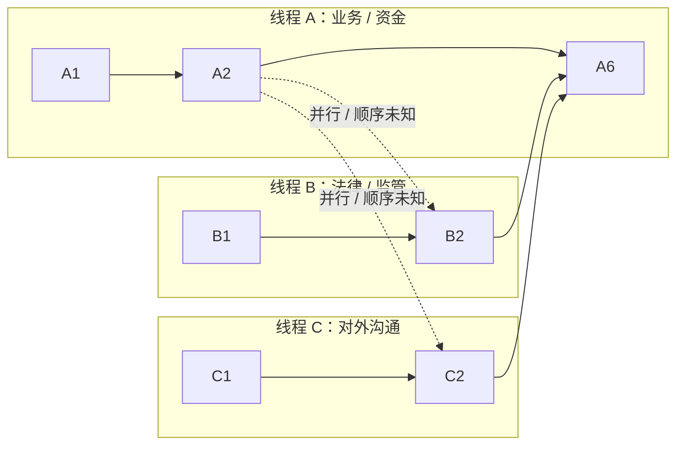
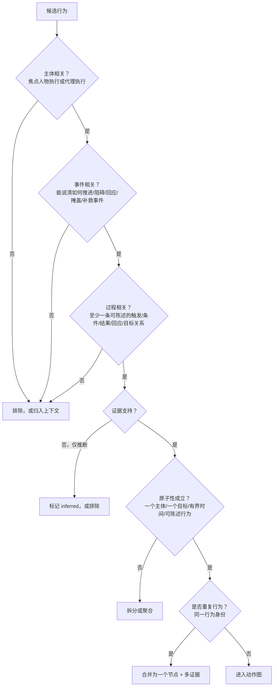

# 2 · 动作图：语义、并行与准入

> 对应框架规则：**FR-1、FR-3、FR-4、FR-5、FR-6**。框架层定义，不含字段/schema。
> 关联：[1-hierarchy](1-hierarchy.md) · [3-context-model](3-context-model.md) · [4-evidence-and-provenance](4-evidence-and-provenance.md)

---

## 2.1 图语义：单案例的行为偏序图

**定义**：动作图是对一个 sample（一个人物 × 一个事件）中人物行为的结构化表示：

> **节点 = 有证据支持的动作；边 = 时间、因果/过程、交互、连续关系。图是偏序（partial order），不是线性链，也不是可执行流程图。**

三条边界：

1. **单案例**：一张图对应一个 sample，不跨事件、不跨人物。
2. **证据支持**：每个节点/边都必须能回指证据包（或显式标记为推断）。
3. **非控制流模型**：单案例不套用 AND/XOR 等流程控制语义；真正的控制流属于跨案例的过程模型（不属于本框架）。

**为什么不是“单动作链”**：同一时期人物可能同时推进多条线程（业务、资金、法律、舆论、关系），动作之间有并行、顺序未知、合并、回应、跨阶段延续。线性的链会伪造顺序与因果，必须用图/偏序表达。

---

## 2.2 节点概念

| 节点类型 | 是否必需 | 说明 |
|---|---|---|
| **action（动作）** | ✅ 必需，主体 | 焦点人物的行为单元；框架的核心节点 |
| **context_event（上下文事件）** | 可选，但框架认可 | 他人的动作或外部事件，作为动作的触发/约束/回应对象；只收与动作直接因果相关的 |
| **decision_point（决策点）** | 预留，v1 再定 | 有多个备选方案的时点；用于“下一步动作预测”等任务 |
| **observation（观察/信息）** | 预留，v1 再定 | 人物当时获得的信息；支撑 belief 与知识边界 |

> 框架层先只要求 `action`；`context_event` 可按需使用；`decision_point`、`observation` 是后续版本的合法扩展，当前不强制。**不要因为预留概念而把图做复杂。**

---

## 2.3 边概念：四类关系

边必须**有类型**，不允许“相关（related_to）”式模糊边。框架层建议四类：

| 关系类 | 含义 | 推荐最小集合 |
|---|---|---|
| **时间（temporal）** | 动作之间的先后与共现 | `before`（先后可知）、`overlaps`（区间确实重叠）、`order_unknown`（共现但无法判定先后） |
| **过程/因果（semantic）** | 一个动作如何影响/回应另一个动作 | `responds_to`（回应）、`enables`（使之可行）、`triggers`（触发）、`prevents`（阻止） |
| **交互（interaction）** | 人物与他人/组织的互动 | `communicates_with`、`transacts_with`、`delegates_to`、`joint_action_with` |
| **连续（continuity）** | 同一目标/线程跨 phase 或 stage 的延续 | `continues`（延续）、`resumes`（中断后恢复）、`interrupted_by`（被中断） |

**关键区分**：`before` 是时间关系；`enables/triggers/responds_to` 是过程/因果解释。两者可以同时存在，但不能互相替代。

---

## 2.4 并行、串行与未知顺序

“并行”在单案例里有三种不同情况，必须分开记录：

| 情况 | 含义 | 图中表达 |
|---|---|---|
| **真并行** | 动作区间确实重叠（同一时期同时推进） | 区间重叠 + `overlaps` 边（或由图结构隐含） |
| **顺序未知** | 都发生在这个时期，但来源没给先后 | `order_unknown` 边；两者之间没有 `before` |
| **串行** | 有证据支持先后 | `before` 边（可传递） |

**不要做**：把“同一周内发生”直接当成“同时发生”；也不要把“顺序未知”强行排成一条链。两者都应在图里保持为**偏序**。

---

## 2.5 多线程示例

读法：线程内是有序动作；线程之间可能是并行或顺序未知；多个线程可以在某个动作处**汇合**（例如 A6 同时回应 B2 与 C2）。汇合不需要造“合并节点”，用多条入边表达即可。

---

## 2.6 图规则（Graph Rules）

| 编号 | 规则 |
|---|---|
| **GR-1** | 时间关系必须构成**无环偏序**；出现时间环视为标注错误 |
| **GR-2** | 图允许多根、多汇、多个连通分量；不要求单一起点/终点 |
| **GR-3** | 不强制全序：没有先后证据的动作之间保持 `order_unknown`，不得强行排序 |
| **GR-4** | 语义/因果边允许成环（如“施压 → 掩盖 → 再施压”），但必须标记为推断并给依据 |
| **GR-5** | 禁止孤立节点：每个动作至少一条语义边连接到事件过程（见 2.7 无孤点规则） |
| **GR-6** | 禁止重复节点：同一行为只保留一个节点，多来源合并为多证据（见 2.8） |

---

## 2.7 动作准入：什么有资格成为节点

这是控制“动作图过大”的核心。候选行为必须通过**准入测试**；不通过的不是“画小一点”，而是**不进图**。

**四条必需（全部满足）**

1. **主体相关**：由焦点人物执行，或由该人物以职务/代理身份执行；不是他人的独立行为。
2. **事件相关**：动作与 event 或 phase 的目标/范围有可陈述的关系。
3. **过程相关**：动作至少连接一条过程关系（触发/条件/结果/回应/目标），不是孤立事实。
4. **证据支持**：至少一个来源片段；纯推断必须显式标记，不能混入“已发生动作”。

**五条排除（防止噪声与冗余）**

| 排除对象 | 处理方式 |
|---|---|
| 背景描述、他人评价、纯心理活动 | 归入**上下文**，不是 action |
| 微观操作（会议每句话、邮件每句话） | 聚合为一个“沟通/会议”动作；操作层不进图 |
| 同一动作的多篇报道 | 合并为一个节点 + 多条证据（按行为身份去重） |
| 与 event/phase 无关的私人活动 | 不进图（除非其影响了事件，如健康/家庭变故） |
| 无证据的传闻/猜测 | 只能作 `inferred`/上下文，不能作 `observed` 动作 |

---

## 2.8 去重、聚合与连续性

| 规则 | 内容 |
|---|---|
| **一个行为一个节点** | 同一行为身份（不是描述相似）只出现一次；不同来源作为证据合并 |
| **重复性动作** | 例会、惯例、周期性操作 → 用“模式节点”（时间窗 + 频次/次数），不要一次一个节点；如果单次发生有独立因果意义，则单独建节点 |
| **跨 phase 连续** | 动作节点全局唯一；用 `continues / resumes / interrupted_by` 连接跨阶段动作；不要在每个 phase 复制节点 |
| **聚合层级** | 动作 →（可选）行为线程 → phase；线程是分组视图，不是新层级；用于评审与检索 |
| **合并 ≠ 同一** | 只有“同一行为身份”才合并；同一目标下的不同动作（如“谈判”与“签约”）不能合并 |

---

## 2.9 动作原子性

**定义**：一个动作 = **一个主体 + 一个目标 + 一个有界时间 + 一个可陈述、可证据化的行为**。

| 太细（应聚合） | 合适 | 太粗（应拆分） |
|---|---|---|
| “他拨了电话”“他说了第一句话”“他发送了邮件” | “他就并购条件与对方进行电话沟通” | “他推进了整个项目” |
| 会议中的每个发言 | 一次会议/一次沟通 | “他管理公司” |

判断辅助：如果去掉这个节点，事件过程的解释或证据链会明显缺失，它才值得成为独立动作；否则聚合。

---

## 2.10 反模式清单

| 反模式 | 问题 | 修正 |
|---|---|---|
| 单动作链 | 伪造顺序与因果 | 用偏序 + 多线程；`order_unknown` |
| 一篇报道一个节点 | 图爆炸、计数失真 | 行为身份去重，多证据合并 |
| 把所有言行都拆成节点 | 粒度失控、不可评审 | 原子性定义 + 聚合 |
| 孤立动作 | 与事件无关的噪声 | 无孤点规则；降级为上下文或删除 |
| 强行 AND/XOR 控制流 | 单案例证据不足，误导评测 | 控制流放跨案例过程模型；本层只留偏序/因果 |
| 跨 phase 复制动作 | 重复计数、证据分裂 | 全局唯一 + 连续边 + M:N 归属 |

---

## 2.11 与其他层的关系

- 上层：[0-overview](0-overview.md) FR-1/3/4/5/6；[1-hierarchy](1-hierarchy.md) 的 phase 是本图的视图。
- 上下文：[3-context-model](3-context-model.md) 为每个动作提供“条件/触发/约束/结果/知识来源”链接。
- 证据：[4-evidence-and-provenance](4-evidence-and-provenance.md) 要求节点/边可回指；推断/未知显式标记。
- 用途：[5-benchmark-and-dataset](5-benchmark-and-dataset.md) 从偏序图派生预测/补全/解释任务。
