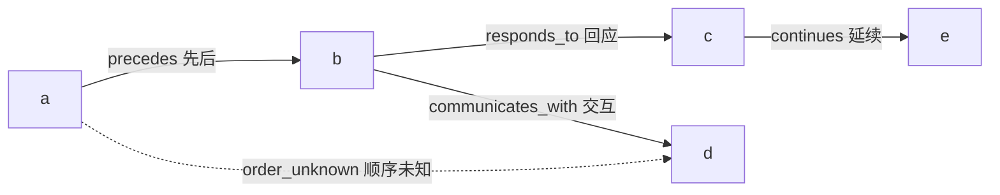
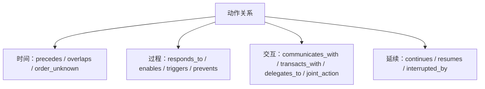
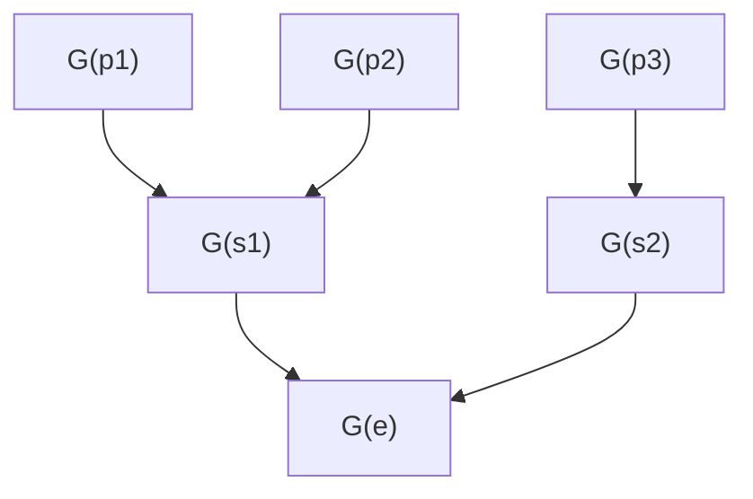
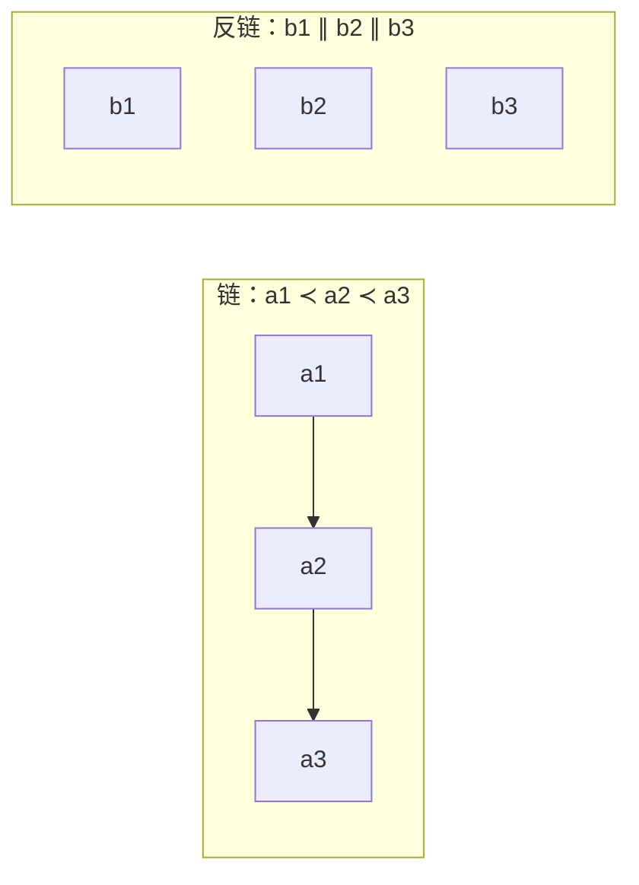
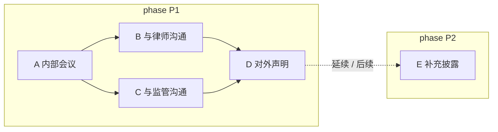

# 2 · 动作与动作图（Action Graph）

> 这一篇只回答一个问题：**描述一个人物在一个 event 里的行为时，动作怎么定义、记录什么、动作之间怎么连。**
> 不讨论生产流程、模型调用、benchmark；那些不属于“描述结构”。
> 关联：[0-overview](0-overview.md) · [1-hierarchy](1-hierarchy.md) · [3-context-model](3-context-model.md) · [4-evidence](4-evidence.md)

---

## 2.0 本篇要解决的设计问题

- **动作是什么**：人物行为的最小记录单元；什么算动作、什么不算？
- **动作之间有哪些关系**：先后、同时、顺序未知、回应、触发、交互、延续如何表达？
- **为什么要用“图”**：为什么不能把动作排成一条时间线？多个动作如何并存、分叉、汇合？
- **phase 与动作图什么关系**：phase 内为什么是动作图？stage/event 图如何由 phase 图组合？
- **如何避免图爆炸**：动作准入、粒度、去重、聚合的规则是什么？

## 2.1 这一篇在结构里的位置

```
event（一件可独立研究的事）
 └─ stage（局面/情境）
     └─ phase（行为模式）
         └─ 动作图：动作 + 动作关系
              └─ 每个动作挂上下文（见 3）
```

- **stage / phase 是时间与情境背景**（见 [1-hierarchy](1-hierarchy.md)）；
- **这一篇的核心是“动作”**：这个人物在这个 phase 里做了什么、和别的动作怎么连；
- **环境、他人、人物状态**是动作的上下文（见 [3-context-model](3-context-model.md)）；
- **证据**（来源、引文）挂在动作和关系上（见 [4-evidence](4-evidence.md)）。

一句话：**event/stage/phase 回答“什么时候、什么局面”；动作回答“这个人做了什么”。**

---

## 2.2 什么是动作

**定义**：动作是描述人物行为的**最小单元**——谁、做了什么、对谁/对什么、什么时候、有什么依据。

| 要素 | 含义 | 例子 |
|---|---|---|
| **谁** | 动作的执行者；焦点人物本人，或以其职务/代理身份执行 | 钱志敏、某公司 CEO、其代理律师 |
| **做什么** | 一个可陈述、可区分的行为 | 转账、开会、发布声明、与监管沟通 |
| **对谁/对什么** | 对象、对手方、协作者 | 向投资者、与律师、对监管机构 |
| **什么时候** | 发生时间或时间区间，允许“只知道年份/月份/未知” | 2014 年 6 月、2020 年 3 月上旬、未知 |
| **依据** | 哪段来源支持这个动作 | 某篇报道、某份公告、某段引文 |

**符号约定（设计层）**

| 符号 | 含义 |
|---|---|
| `a, b, c` | 动作（action） |
| `A(e)` | event e 的动作集合 |
| `I(a) = [l, r)` | 动作 a 的时间区间 |
| `a ≺ b` | a 先于 b（有证据的时间先后） |
| `a ≅ b` | a 与 b 时间区间重叠（并发的一种情形） |
| `a ∥ b` | a 与 b 不可比（无先后证据；包含并发与顺序未知两种情形） |
| `a ∈ A(p)` | 动作 a 属于 phase p（每个动作唯一属于一个 phase） |
| `C(p), ΔC(a)` | phase p 的基准上下文、动作 a 的差量上下文 |
| `Ev(a)` | 动作 a 的证据集合 |

> 符号只表达设计关系，不绑定字段/存储。

### 2.2.1 粒度规则

一个动作 = **一个主体 + 一个目标/对象 + 一个有界时间 + 一个可陈述的行为**。

| 太细（应合并） | 合适 | 太粗（应拆分） |
|---|---|---|
| “他拨了电话”“他说了第一句话”“他发了邮件” | “他就并购条件与对方电话沟通” | “他推进了整个项目” |
| 会议中的逐句发言 | 一次会议 / 一次沟通 | “他管理公司” |
| 同一动作在 5 篇报道里的 5 种写法 | 1 个动作 + 5 条证据 | — |

判断方法：**去掉这个动作，是否会影响对这段行为的理解？** 会，就保留；不会，就合并。若一个动作里同时包含多个不同目标/对象，就拆开。

### 2.2.2 什么不是动作

| 不是动作 | 应归到哪里 |
|---|---|
| 背景描述、环境状态 | 上下文（3-context-model） |
| 他人对这个人物的评价 | 上下文，不是本人的行为 |
| 纯粹的心理活动、没有外部表现的意图 | 不记录为动作；有来源陈述的“目标/动机”可作为动作的说明 |
| 会议里的每句话、邮件的每个句子 | 聚合成一个“沟通/会议”动作 |
| 与这个 event / phase 无关的私人活动 | 不进入该 sample |

> 动作描述的是“**这个人做了什么**”，不是“这个人是什么样的人”。

### 2.2.3 一个行为要成为“动作”，需要满足

1. **是这个人物做的**：本人，或以其职务/代理身份执行；
2. **与这个 event/phase 有关**：能说清它如何推进、阻碍、回应、掩盖或补救这件事；
3. **能和事件过程连上关系**：至少能说清对象、目标、前因、后果中的一项；
4. **有来源支持**：至少一段来源；如果是推断，必须明确标为推断。

不满足的：背景信息归入上下文；与事件无关的不进入这个 sample；没有证据的要么标未知，要么不记录。

**动作准入流程**


**读法**：先判断“是不是这个人做的、与事件有关”，再看“有没有关系可连、有没有来源”，最后才处理粒度和去重。任何一步不通过都不是“画小一点”，而是“不进动作图或降级为上下文”。

---

## 2.3 一个动作要记录哪些信息

这一节是**概念清单**，不是字段/schema；后续实现时再定具体格式。

| 信息 | 说明 | 是否必需 |
|---|---|---|
| **名称/类型** | 简短行为名（如“对外发布声明”），可带一个粗类型（沟通/交易/决策/执行等） | 必需 |
| **描述** | 一两句话说明这个动作具体是什么 | 必需 |
| **主体与身份** | 谁做的；以本人身份、职务身份还是代理身份 | 必需 |
| **对象/相关人物** | 对谁、与谁一起、谁受到影响 | 能确定时必需 |
| **时间** | 发生时间或区间；标明精度（年/月/日/未知） | 必需 |
| **目标/意图** | 如果来源明确说了目的/动机，就记录，并标明是来源陈述 | 可选 |
| **条件/触发/约束** | 这个动作为什么发生、受什么限制（简要，详见 3-context-model） | 可选 |
| **结果/影响** | 动作之后发生了什么（如果来源有） | 可选 |
| **证据** | 来源、引文/片段、支持模式（`O/A/I`）或缺口（`Sup=∅+Gap`） | 必需 |
| **所属 phase** | 唯一所属的 phase（不跨 phase） | 完整描述中必需 |

> 原则：**能确定就记录，不能确定就标未知；不要为了“完整”而编。**
> 一个动作可以由多篇来源共同支持（一个动作 + 多条证据），不是每篇来源一个动作。

---

## 2.4 动作之间有哪些关系

动作之间的关系不需要很多类型，先覆盖四组即可。下面的示意图把四组关系放在同一张局部图上：



> 同一对动作可以同时有多条不同类型的关系；时间关系与语义关系分开记录，不能互相替代。

**关系方向（from → to）**：

| 关系 | 读法 | 例子 |
|---|---|---|
| `responds_to` | from 回应 to | A3（声明）responds_to A1（内部会议） |
| `enables` / `triggers` / `prevents` | from 使能/触发/阻止 to | A1 使 A3 可行 |
| `continues` / `resumes` | from 延续/恢复 to | A6 延续 A4 |
| `interrupted_by` | from 被 to 打断 | A4 被 A5 打断 |
| `communicates_with` / `transacts_with` / `joint_action` | 对称关系 | A4 与监管沟通 |
| `precedes` / `overlaps` / `order_unknown` | from 相对 to 的时间关系 | A1 precedes A3 |

关系元组统一写作 `(from, to, type, basis)`；方向有语义，不能随意交换。

### 2.4.1 时间关系

| 关系 | 含义 | 例子 |
|---|---|---|
| **先后** | 有证据表明 A 发生在 B 之前 | 先内部会议，后对外声明 |
| **同时** | 两个动作的时间区间确实重叠 | 同一周既与律师沟通，又与监管沟通 |
| **顺序未知** | 两个动作都发生在这个时期，但来源没给先后 | 声明与监管沟通的先后无法确定 |

**`order_unknown` 的记录约定**：

- 它是 `R_t` 的一种关系类型，可记录为 `(a, b, order_unknown)`；它**不参与**偏序 `≺`，图上可用虚线表示；
- 若来源只支持“两个动作都发生了”、没有更多信息，也可以**不建关系**，在图中保持不可比（`a ∥ b`）；
- 两种表示择一使用，**同一对动作不得既记录 `order_unknown` 又声称“没有关系”**；无论是否记录，都必须显式说明“顺序未知”。

> “同一周发生”不等于“同时发生”，也不等于“有先后”；如果来源没说，就记“顺序未知”，不要强行排成一条链。

### 2.4.2 过程关系

| 关系 | 含义 | 记录要求 |
|---|---|---|
| **回应** | B 是对 A 的回应 | 来源明确说“回应/after/in response to”才记为回应 |
| **触发/引发** | A 促使 B 发生 | 来源明确说“导致/促使/triggered/led to”，或标注为推断 |
| **使能/条件** | A 使 B 成为可能 | 来源陈述或明确推断 |
| **阻止** | A 阻止/阻碍了 B | 来源陈述或明确推断 |

**重要纪律**：我们**不声称识别真实因果**。上面这些关系只记录两类东西：

1. **来源明确陈述**的关系（“因为…所以…”“in response to…”）——这是来源的主张，不是我们证明的因果；
2. **我们自己的推断**——必须标注“推断”，不能伪装成事实。

来源没说的关系，**宁可不连，也不要编**。详见 2.4.6。

### 2.4.3 交互关系

| 关系 | 含义 | 例子 |
|---|---|---|
| **沟通** | 与某人/某机构进行信息交流 | 与律师开会、向监管说明 |
| **交易** | 与某人/某机构发生资金或资产转移 | 向投资者转账、出售资产 |
| **委托/代理** | 让某人替自己做事 | 授权律师处理 |
| **共同行动** | 与其他人一起做同一件事 | 与合伙人共同签约 |

### 2.4.4 延续关系（phase 之间）

| 关系 | 含义 | 例子 |
|---|---|---|
| **延续** | 前一个 phase 的动作在后续 phase 由新动作继续 | phase 1 开始谈判，phase 2 新动作继续谈判 |
| **中断** | 行为被某事件打断 | 调查因更换律师暂停 |
| **恢复** | 中断后继续 | 更换律师后谈判恢复 |

> 每个动作只属于一个 phase；续接时用两个 phase 内的动作 + `continues` 关系，不把一个动作挂到多个 phase（见 2.6）。

### 2.4.5 关系类型矩阵

| 组 | 类型 | `from → to` 读法 | 对称？ | 参与 `≺`？ | 需要 basis |
|---|---|---|---|---|---|
| 时间 | `precedes` | from 先于 to | 否 | 是 | 是 |
| 时间 | `overlaps` | from 与 to 时间重叠 | 是 | 否 | 是 |
| 时间 | `order_unknown` | from 与 to 谁先谁后未知 | 是 | 否 | 是 |
| 过程 | `responds_to` | from 回应 to | 否 | 否 | 是 |
| 过程 | `enables` | from 使能 to | 否 | 否 | 是 |
| 过程 | `triggers` | from 触发 to | 否 | 否 | 是 |
| 过程 | `prevents` | from 阻止 to | 否 | 否 | 是 |
| 交互 | `communicates_with` | from 与 to 沟通 | 是 | 否 | 是 |
| 交互 | `transacts_with` | from 与 to 交易 | 是 | 否 | 是 |
| 交互 | `delegates_to` | from 委托 to | 否 | 否 | 是 |
| 交互 | `joint_action` | from 与 to 共同行动 | 是 | 否 | 是 |
| 延续 | `continues` | from 延续 to | 否 | 否 | 是 |
| 延续 | `resumes` | from 恢复 to | 否 | 否 | 是 |
| 延续 | `interrupted_by` | from 被 to 打断 | 否 | 否 | 是 |



**读法**：这张矩阵回答三件事——方向怎么读、是否对称、是否参与时间偏序 `≺`。只有 `precedes` 参与 `≺`；`overlaps` / `order_unknown` 只表达时间共存或未知，不参与先后；其他三组都不参与 `≺`。

**示例映射（取自 6/8.7）**：

| 关系 | 元组（from→to） | 读法 |
|---|---|---|
| `precedes` | `(a₁, a₃, precedes, derived)` | a₁ 先于 a₃ |
| `responds_to` | `(a₃, a₁, responds_to, asserted)` | a₃ 回应 a₁ |
| `continues` | `(a₆, a₄, continues, asserted)` | a₆ 延续 a₄ |

> 交互类关系（communicates_with / transacts_with / delegates_to）的对象是**人物/组织**，通常记录为动作的参与者/上下文；只有 `joint_action` 是两个动作共同组成的动作-动作关系。

### 2.4.6 关于“因果”的说明

从现实世界的文档里，我们**无法识别真实因果**，只能记录“来源怎么说的”和“我们怎么推断的”。所以：

- 不要把“来源说 A 导致 B”写成“A 导致 B”；
- 推断关系必须标 `inferred`（推断），并写依据；
- 没有陈述/证据的关系，不连；
- 动作之间的关系不是越多越好：**只记录有证据/来源陈述的关系**。每个动作至少要能说明它和这个 event/phase 的关系（推进、回应、阻碍等），否则它不属于这个 sample；
- **未记录关系 ≠ 没有关系**：只表示当前证据/建模未建立该关系，不得据此推断“两个动作没有关系”。

---

## 2.5 动作图怎么逐层组成

- **节点 = 动作**；
- **边 = 动作之间的关系**（时间/过程/交互/延续）；
- 每个 phase 有自己的动作图 `G(p)`；
- stage 图由 phase 图组合：`G(s) = G(p₁) ∪ … ∪ G(pₘ) + 跨 phase 边`；
- event 图由 stage 图组合：`G(e) = G(s₁) ∪ … ∪ G(sₙ) + 跨 stage 边`。

**逐层组合（示意）**



**读法**：phase 图是基本单位；stage 图 = 该 stage 的 phase 图 + 跨 phase 边；event 图 = 各 stage 图 + 跨 stage 边。`G(p) ⊆ G(s) ⊆ G(e)`，是子图组合；动作只属于一个 phase，不复制。

**注意**：`G(e)` **不要求连通**。phase/stage 之间可能没有关系，此时 `G(e)` 是多个互不相连的分支；也可能有跨 phase/跨 stage 关系，此时分支被连起来。是否相连由证据决定。

### 2.5.0 偏序视角：为什么用偏序、怎么读

**为什么不用线性时间线**：现实中同一时期常有多个动作并存；来源也常只支持“都发生了”，不支持“谁先谁后”。如果强行排成一条链，就会把“顺序未知”伪造为“已知顺序”，把“并发”伪造为“串行”。偏序的作用是**保留不确定性**：只记录证据支持的先后，其余保持不可比。

**怎么读**：链表示有依据的串行；反链表示并发或顺序未知；线性扩展只是“可能的读法”之一，不是唯一答案。

动作集合 `A(e)` 与时间先后关系 `≺` 构成一个**严格偏序（strict partial order）**（在冲突处理后的可用范围内）：

- **非自反**：不存在 `a ≺ a`；
- **传递**：`a ≺ b`、`b ≺ c` 可推出 `a ≺ c`；
- **不对称（asymmetric）**：`a ≺ b` 与 `b ≺ a` 不能同时成立（由非自反 + 传递推出）；
- **不可比**：`a ∥ b` 表示既非 `a ≺ b` 也非 `b ≺ a`（可能并发，也可能顺序未知）；
- **链（chain）**：两两可比的子集，对应严格串行的行为；
- **反链（antichain）**：两两不可比的子集，对应并发或顺序未知的行为；
- **线性扩展（linear extension）**：把偏序补成总序的一种方式；它只是多种可能之一，不能当作唯一顺序。



> 图中链与反链是**同一偏序的两种子集形态**，分开画即可，不用边连接。

**一个最小例子**：

```
a ≺ b,  a ≺ c,  b ∥ c,  b ≺ d,  c ≺ d
```

- `{a, b, d}` 是链：a 先于 b、b 先于 d；
- `{b, c}` 是反链：二者不可比（可能并发，也可能顺序未知）；
- `d` 是汇合点：b、c 都指向 d，但 b、c 之间没有先后；
- 这个偏序存在多个线性扩展（如 a,b,c,d 或 a,c,b,d），因此不能把其中一个当作唯一顺序。

> 图论术语只用于表达“可不可以用先后关系确定”；不引入实现层面的 schema。

### 2.5.1 三种常见形态



读法：

- **串行**：`A → B`（有先后证据）；
- **同时**：`B` 与 `C` 在同一个时期并行（区间重叠），不一定有先后；
- **汇合**：`B` 和 `C` 都影响 `D`（D 同时回应两边）；
- **跨 phase 延续**：`D` 到 `E` 是延续/后续，不是把 D 复制到 P2。

> 如果两个动作只有“都发生在这个 phase”，但来源没给先后，也**不要强行画箭头**；可以并排放置，或用“顺序未知”标注。

---

## 2.6 动作与 phase 的归属

- **每个动作唯一属于一个 phase**：`π: A(e) → Ph(e)` 是全函数；
- 归属依据：主要发生时间 / 主要目的 / 主要行为模式；
- `A(p)` 两两不交，`{A(p)}` 是 `A(e)` 的划分；
- **不允许“跨相位动作”**：如果行为跨两个 phase，拆成两个 phase 内的动作，用 `continues` / `responds_to` 等关系连接；
- **不得出现无 phase 的动作**：完整描述必须给每个动作确定 phase；无法确定说明描述未完成，先补 phase 判定。

| 情况 | 处理 |
|---|---|
| 动作完全在一个 phase 内 | 归入该 phase |
| 行为跨两个 phase | 拆成两个 phase 内的动作 + 跨 phase 关系；不把同一动作挂两处 |
| 行为跨两个 stage | 同上：拆成 stage 内动作 + 跨 stage 关系 |
| 暂时无法确定属于哪个 phase | 描述未完成；先补 phase 判定，不把动作留成无 phase |

## 2.7 Event 动作图 `G(e)` 的完整定义

> 这一节是 `G(e)` 的**唯一权威定义**：先给集合定义，再给图论定义，最后说明它与 Event/Stage/Phase/Action/Context/Evidence 的关系。其他文档涉及 `G(e)` 时以本节为准。

### 2.7.1 一句话

> **`G(e)` 是 event 内所有 phase 动作图按 stage 逐层组合得到的动作图；它不是新增层级，也不是额外事实源。**

### 2.7.2 集合定义

对 event `e`：

```
A(p) = { a ∈ A(e) : π(a) = p }        // phase p 的动作集
R(p) = { r : from(r), to(r) ∈ A(p) }  // phase 内记录的关系（两端都在 A(p)）
G(p) = (A(p), R(p))                    // phase 动作图
```

组合：

```
A(s) = ⊔_{p ∈ Ph(s)} A(p)              // 不相交并
R(s) = (⋃_{p ∈ Ph(s)} R(p)) ∪ R_crossphase(s)
G(s) = (A(s), R(s))                    // stage 动作图

A(e) = ⊔_{s ∈ S(e)} A(s)               // 组合恒等式（不是重新定义 A(e)）
R(e) = (⋃_{s ∈ S(e)} R(s)) ∪ R_crossstage(e)
G(e) = (A(e), R(e))                    // event 动作图
```

> `A(e)` 是给定的动作集合；`A(p)`、`A(s)` 由它派生。最后一行 `A(e)=⊔A(s)` 是**一致性恒等式**，表示组合结果不丢/不重动作，不是重新定义 `A(e)`。

其中：

```
st(a) = 包含 π(a) 的 stage
R_crossphase(s) = { r : from(r),to(r) ∈ A(s) 且 π(from(r)) ≠ π(to(r)) }
R_crossstage(e) = { r : from(r),to(r) ∈ A(e) 且 st(from(r)) ≠ st(to(r)) }
```

- `A(p)` 两两不交，`{A(p)}` 是 `A(e)` 的划分；
- `R_crossphase(s)`：同一 stage 内、不同 phase 的动作之间的关系；
- `R_crossstage(e)`：不同 stage 的动作之间的关系；
- 每个动作只属于一个 phase，**不复制动作**。

### 2.7.3 图论定义

`G(p)`、`G(s)`、`G(e)` 都是**带类型的有向多重图**：

- 节点集：动作；
- 边集：关系，每条边是 `(from, to, type, basis)`；
- 同一对动作可以有多条不同类型的边（多重图）。

它们之间是**子图 + 组合**关系：

```
G(p) ⊆ G(s) ⊆ G(e)
A(p) ⊆ A(s) ⊆ A(e)
R(p) ⊆ R(s) ⊆ R(e)
```

组合可以写成：

```
G(s) = (⊔_p A(p), (⋃_p R(p)) ∪ R_crossphase(s))
G(e) = (⊔_s A(s), (⋃_s R(s)) ∪ R_crossstage(e))
```

- 先组合 phase 图得到 stage 图，再组合 stage 图得到 event 图；
- 跨 phase 边只在 `G(s)` 补一次，跨 stage 边只在 `G(e)` 补一次；
- `G(e)` **不要求连通**：没有关系的 phase/stage 会形成独立分支。

### 2.7.4 与其他部分的关系

| 部分 | 与 `G(e)` 的关系 |
|---|---|
| **Event** | `G(e)` 属于 event，是 event 的动作/关系整体；event 还拥有 stage/phase/context/evidence |
| **Stage** | `G(s)` 是 `G(e)` 的子图；stage 是局面分段，不是图节点 |
| **Phase** | `G(p)` 是 `G(s)` 的子图；phase 是行为模式分段，不是图节点 |
| **Action** | 动作是 `G(e)` 的节点；每个动作唯一属于一个 phase |
| **Context** | 上下文挂在 phase/action 上，**不是 `G(e)` 的节点或边** |
| **Evidence** | 证据支撑 `G(e)` 中的动作/关系/**结构**，但证据本身不是图节点 |
| **Specification** | 7 的规范约束 `G(e)` 如何组合、如何标注 |

### 2.7.5 不变量

| 编号 | 不变量 |
|---|---|
| **AG-1** | `{A(p)}` 是 `A(e)` 的划分；每个动作唯一属于一个 phase |
| **AG-2** | `R(p) ⊆ R(s) ⊆ R(e)`，`R(p)` 只含 phase 内部关系 |
| **AG-3** | 跨 phase 边只在 `G(s)` 出现一次；跨 stage 边只在 `G(e)` 出现一次 |
| **AG-4** | `G(e)` 不要求连通；没有关系的阶段形成独立分支 |
| **AG-5** | 不得出现无 phase 的动作；不允许一个动作挂到多个 phase；跨 phase 行为拆成 phase 内的动作 + 关系 |

### 2.7.6 示例（沿用 6/8.7）

```
G(p₁) = ({a₁,a₂}, ∅)
G(p₂) = ({a₃}, ∅)
G(p₃) = ({a₄}, ∅)
G(p₄) = ({a₅,a₆}, {(a₅,a₆,precedes,derived)})

G(s₁) = ({a₁,a₂}, ∅)
G(s₂) = ({a₃,a₄,a₅,a₆}, {(a₅,a₆,precedes,derived)} ∪ R_crossphase(s₂))

G(e₁) = ({a₁..a₆}, R(e₁))
```

读法：

- `G(p)` 是基本单位；
- `G(s)` 加入跨 phase 边；
- `G(e)` 加入跨 stage 边；
- 同一批动作只出现一次，不是四张独立图。

### 2.7.7 读图规则

1. 节点是动作，不是 stage/phase；
2. 边是关系，不是“层级包含”；
3. stage/phase 只决定图的分组和组合层次；
4. context/evidence 不是节点/边，是横切信息；
5. `G(e)` 可以有多个互不相连的分支。

### 2.7.8 示例位置

为避免与 [6-illustrative-example](6-illustrative-example.md) 和 [8-formal-model](8-formal-model.md) 8.7 的完整示例重复，本篇不再另给第二个完整例子；关系类型见 2.4，偏序读法见 2.5.0，完整 Stage/Phase/Action 示例见 6.2.5 与 8.7。

---

## 2.8 写动作时的常见错误

| 错误 | 后果 | 正确做法 |
|---|---|---|
| 把背景、评价、心理活动当动作 | 图里混入非行为 | 归入上下文；动作只写“做了什么” |
| 一篇报道一个动作 | 重复、计数失真 | 同一行为合并为一个动作 + 多条证据 |
| 动作太细（每句话/每个操作） | 图爆炸、不可读 | 按粒度规则聚合 |
| 强行把动作排成一条链 | 伪造顺序 | 允许同时/顺序未知；不硬连箭头 |
| 来源说“因为”就当成自己证明因果 | 过度声称 | 记录为“来源陈述”，推断关系标 inferred |
| 一个动作挂到多个 phase | 重复、归属冲突 | 拆成 phase 内动作 + 跨 phase 关系 |
| 动作与 event/phase 无关 | 噪声 | 不进入该 sample |
| 没有证据 | 无法复核 | `Sup=∅ + Gap`，或删除；推断必须标注 |

---

## 2.9 与其他文档的关系

- [1-hierarchy](1-hierarchy.md)：event/stage/phase 怎么分、边界怎么定；
- [3-context-model](3-context-model.md)：动作发生时的环境、他人、人物自身状态；
- [4-evidence](4-evidence.md)：动作和关系的来源、引文、支持模式；
- [0-overview](0-overview.md)：整个框架的总览与规则表；
- [8-formal-model](8-formal-model.md)：动作图逐层组合的严格定义与规范示例。
