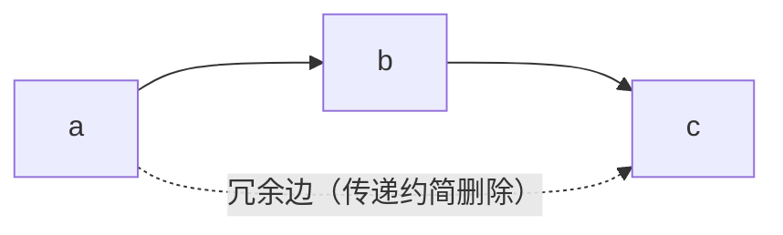
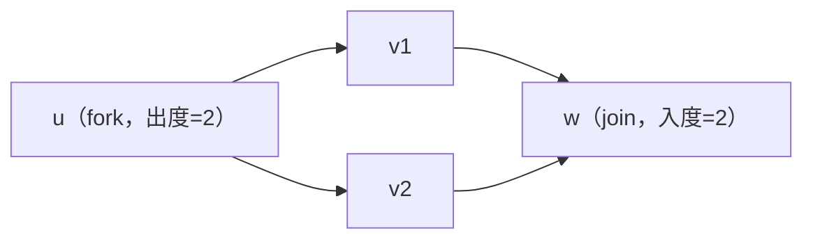
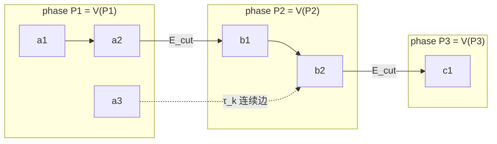
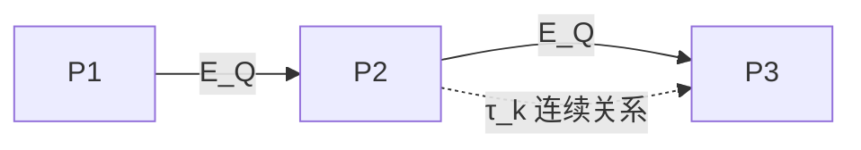
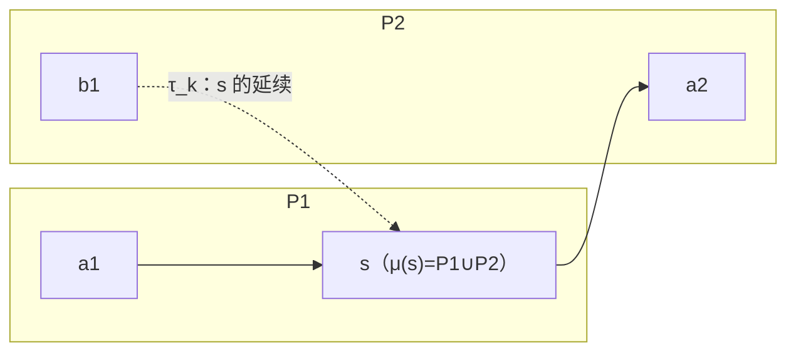
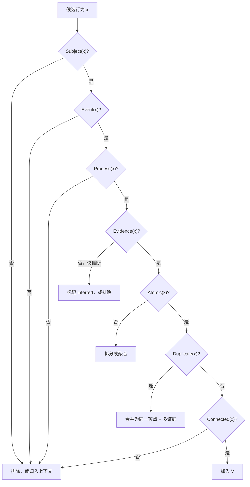

# 2 · 动作图：形式化定义与相位分层

> 对应框架规则：**FR-1、FR-3、FR-4、FR-5、FR-6**。框架层定义，不含字段/schema。
> 本文使用图论与序理论术语；记号在 2.1 统一约定。
> 关联：[1-hierarchy](1-hierarchy.md) · [3-context-model](3-context-model.md) · [4-evidence-and-provenance](4-evidence-and-provenance.md)

---

## 2.1 记号与基本对象

| 记号 | 含义 |
|---|---|
| `T` | 时间轴；`I = [l, r)` 为半开时间区间 |
| `V` | 动作顶点（vertex）集合；每个 `v ∈ V` 对应一个动作 |
| `I(v)` | 顶点 `v` 的**发生区间**（occurrence interval），`I(v) ∈ Int(T)` |
| `E` | 有向边集合；`(u,v) ∈ E` 表示从 `u` 到 `v` 的有向关系 |
| `τ: E → {τ_t, τ_c, τ_i, τ_k}` | 边类型函数：`τ_t` 时间、`τ_c` 因果/过程、`τ_i` 交互、`τ_k` 连续 |
| `G = (V, E, τ)` | **类型化有向图（typed directed graph）**，即动作图 |
| `≺` | 严格时间先序（strict precedence），由 `τ_t` 边及其传递闭包定义 |
| `P = (V, ≤)` | 由 `≺` 诱导的**偏序集（poset）**；`≤` 为 `≺` 的自反传递闭包 |
| `H` | `P` 的 **Hasse 图**（Hasse diagram）：`P` 的传递约简（transitive reduction） |
| `I_S, I_P` | stage 区间、phase 区间 |

### 2.1.1 基本定义（图论/序理论）

| 概念 | 定义 |
|---|---|
| **链（chain）** | `V` 的子集，其中任意两个顶点在 `≤` 下可比 |
| **反链（antichain）** | `V` 的子集，其中任意两个顶点在 `≤` 下不可比 |
| **高度（height）** | 最长链的顶点数；刻画链深度（chain depth） |
| **宽度（width）** | 最大反链的基数（Dilworth 定理）；刻画最大并发度 |
| **路径（path）** | 顶点序列 `v0, v1, …, vk`，每对相邻顶点间有同向边 |
| **可达（reachability）** | `u →* v`：存在从 `u` 到 `v` 的有向路径 |
| **分叉（fork）** | 出度 ≥ 2 的顶点 |
| **汇合（join）** | 入度 ≥ 2 的顶点 |
| **菱形（diamond）** | 两条内部不相交的有向路径共享起点与终点（分叉—汇合的典型局部结构） |
| **弱连通分量** | 忽略边方向后的连通分量 |
| **强连通分量（SCC）** | 任意两点互相可达的极大顶点子集；SCC 缩图（condensation）必为 DAG |
| **诱导子图（induced subgraph）** | 对 `U ⊆ V`，`G[U]` 保留 `U` 及两端均在 `U` 的边 |
| **割边（cut edge）** | 两端分属不同分区的边；对分区 `Π`、`block(v)` 表示 `v` 所属分区块，`E_cut = { (u,v) ∈ E : block(u) ≠ block(v) }` |
| **商图（quotient graph）** | `G/Π`：顶点为分区块，块间存在边当且仅当原图存在跨块边 |
| **线性扩展（linear extension）** | 与偏序一致的拓扑序（总序）；通常不唯一 |

### 2.1.2 时间关系：必要先序与可能先序

给定动作区间，用 `l(v), r(v)` 表示起止时间。若时间存在精度/不确定性，使用上下界 `l⁻, l⁺, r⁻, r⁺`：

- **必要先序（necessary precedence）**：`r⁺(u) ≤ l⁻(v)` 时，可断定 `u ≺ v`；
- **可能先序（possible precedence）**：`r⁻(u) ≤ l⁺(v)` 时，`u` 可能先于 `v`，但不能断定；
- **并发（concurrent，可能并发）**：`¬(r⁺(u) ≤ l⁻(v)) ∧ ¬(r⁺(v) ≤ l⁻(u))`，即存在一种区间实现使二者重叠；
- **不可比（incomparable，记 `u ∥ v`）**：既不能断定 `u ≺ v`，也不能断定 `v ≺ u`。

> `∥` 包含两种子情况：**并发**（区间重叠）与**顺序未知**（区间可分离但证据不足以定序）。框架中统一用“不可比”表述，不再使用“并行/线程”等非形式化说法。

**命题（区间序）**：当动作区间确定且 `≺` 定义为 `r(u) < l(v)` 时，`(V, ≺)` 是**区间序（interval order）**。区间序是偏序的一个特例；若区间存在不确定性，则使用上述必要先序构造偏序（仍是偏序，但不一定满足区间序的强区间表示性质）。

---

## 2.2 时间偏序与 Hasse 图

`τ_t` 边给出**证据支持的时间关系**；对其取传递闭包得到偏序 `≤`。动作图的标准表示是 `P` 的 **Hasse 图**：只保留覆盖关系（covering relation），删除可由传递性推出的冗余边。



**规则**

| 编号 | 规则 |
|---|---|
| **GR-1** | 时间子图 `(V, E_{τ_t})` 必须无环；否则视为标注错误 |
| **GR-2** | `P = (V, ≤)` 由 `τ_t` 的传递闭包定义；Hasse 图 `H` 是其传递约简，作为标准存储/展示形式 |
| **GR-3** | 不强制全序：`u ∥ v` 的顶点对保持不可比，不得强行加入 `≺` 边 |
| **GR-4** | 语义/因果边 `τ_c` 可以成环（如“施压→掩盖→再施压”）；应通过 SCC 缩图分析，环必须在 SCC/缩图层解释 |
| **GR-5** | 线性扩展对应一种“与偏序一致的全序化（serialization）”；它只是多种可能之一，不能当作唯一顺序 |

**结构量**：宽度 `w(P)` 与高度 `h(P)` 是刻画动作图“并发—链式”结构的两个基本指标；可作为数据集统计与 benchmark 分析量（见 2.8）。

---

## 2.3 局部结构：fork、join、diamond、SCC

动作图的局部形态可用图论结构精确描述：



- **fork（分叉）**：一个动作同时影响/引出多个后继动作；
- **join（汇合）**：一个动作同时受多个前驱动作影响；**不需要引入“合并节点”**，入度 ≥ 2 即可；
- **diamond（菱形）**：分叉—汇合的典型并发结构，两条路径可对应并发的行为过程；
- **SCC（强连通分量）**：`τ_c` 语义环的载体；对 SCC 缩图后得到 DAG，可在缩图层解释“相互强化的循环”；
- **路径/链**：严格链式（totally ordered）的行为序列；**反链**：没有先后证据的动作集合，可能并发，也可能顺序未知。

> 术语纪律：用“分叉/汇合/菱形/SCC”等结构词，不用“线程/主线/支线”等叙事词。

---

## 2.4 相位层的形式化（phase layer）

这是动作图与上层结构（event/stage/phase）的接口。相位层不是“动作的容器数组”，而是对动作图的一个**时间分区 + 商图**结构。

### 2.4.1 区间层族

设 event 区间为 `I_E`。stage 区间族 `{I_S}` 对 `I_E` 构成**分区（partition）**（允许显式缺口）；每个 stage 的 phase 区间族 `{I_P}` 对其构成**分区**。因此全体区间构成一个**层族（laminar family）**：

> 任意两个区间要么不相交，要么一个包含另一个。

```text
I_E   |===============================================================|
I_S   |<------ I_S1 ------>|<--------- I_S2 -------->|<--- I_S3 ---->|
I_P   |<-P11->|<-P12->|<-P13->|<-P21->|<-P22->|<-P23->|<-P31->|
V      a1 a2    a3      a4 a5   a6      a7      a8      a9
              ^ s：I(s) 跨越 P12/P13      ^ t：I(t) 跨越 P22/P23
```

### 2.4.2 顶点—相位归属

定义**归属映射（membership map）**：

```
μ: V → 2^{Phases},   μ(v) = { P : I(v) ∩ I_P ≠ ∅ }
```

- 若 `|μ(v)| = 1`，`v` 是该 phase 的**内部顶点（interior vertex）**；
- 若 `|μ(v)| ≥ 2`，`v` 是**跨相位顶点（spanning vertex）**；
- 需要一个**主归属投影** `π: V → Phases`（例如取与 `I(v)` 重叠最长、或起止点所在 phase；规则须在标注指南中固定），用于构造分区与商图。

> 严格说，由于跨相位顶点的存在，phase 动作集合 `{V_P}` 是 `V` 的一个**覆盖（cover）**，而不是严格分区。`π` 提供单值投影，`μ` 保留跨相位事实；两者同时存在，避免信息丢失。

### 2.4.3 诱导子图、内部边与割边

对每个 phase `P`：

```
V_P   = { v ∈ V : π(v) = P }                 // 主归属顶点集
G[V_P] = (V_P, E ∩ (V_P × V_P))              // 诱导子图
E_intra(P) = E ∩ (V_P × V_P)                // phase 内部边
E_cut     = { (u,v) ∈ E : π(u) ≠ π(v) }      // 跨相位割边
```



> 图中 `a3 → b2` 属于连续关系 `τ_k`，不是时间先序；它允许跨 phase 的行为关联，但不参与时间偏序 `P`。

### 2.4.4 相位商图

定义**相位商图（phase quotient graph）**：

```
Q = (Phases, E_Q),   (P_i, P_j) ∈ E_Q  ⇔  ∃ (u,v) ∈ E  s.t.  π(u)=P_i, π(v)=P_j
```

- 若只取时间边 `τ_t`，则 `Q_t` 是 **DAG**，且 phase 的时间顺序必须是 `Q_t` 的一个**线性扩展**；
- 若包含所有边类型，`Q` 可能出现环（来自 `τ_c` 语义环）；此时对 `Q` 取 SCC 缩图，得到相位层的 DAG 表示。



**分层图视角**：映射 `ℓ: V → {1,…,n}`（`ℓ(v) = π(v)` 的序号）给出一个**层状有向图（layered digraph）**；层内边与跨层边可以并存。相位层是对动作图按 `π` 做的一次**图粗化（graph coarsening）/商（quotient）**。

### 2.4.5 相位层要说明什么

| 相位层的问题 | 动作层的对应量 |
|---|---|
| 每个 phase 有多少动作？ | `\|V_P\|` |
| phase 内是链式还是含反链？ | `G[V_P]` 的宽度/高度 |
| phase 之间靠哪些动作连接？ | `E_cut` 与割边端点 |
| 哪些动作跨越 phase？ | `μ(v)`，`\|μ(v)\| ≥ 2` |
| phase 顺序是否与时间偏序一致？ | `Q_t` 的线性扩展约束 |
| 是否存在语义环？ | `τ_c` 的 SCC（在动作层，不在相位层） |

### 2.4.6 讨论：为什么用商图而不是“phase 内动作数组”

如果把 phase 当成动作的嵌套数组（`phase → actions[]`），会遇到三个结构性问题：

1. **跨相位顶点无法安放**：一个动作可能跨越多个 phase；放进任一数组都会在别的 phase 丢失，复制到多个数组又破坏顶点唯一性。
2. **相位间关系不可见**：数组只表达“属于”，不表达“哪个 phase 的动作指向另一个 phase 的动作”；商图用割边 `E_cut` 显式保留这些关系。
3. **相位顺序不可校验**：商图 `Q_t` 的线性扩展约束可以自动检查“phase 顺序是否与时间边一致”；数组没有这个约束。

商图的代价是丢失块内细节（`G[V_P]` 仍有内部结构，但只看 `Q` 看不到）；因此：

- **相位层**用于检索、评审、阶段边界评估、phase 级统计；
- **动作层**用于行为细节、偏序分析、预测/补全任务；
- 两层不是重复表示，而是同一动作图在不同粒度上的**商（quotient）**与**诱导子图（induced subgraph）**视图。

---

## 2.5 相位归属与跨相位连续

### 2.5.1 归属与连续性规则

| 编号 | 规则 |
|---|---|
| **PH-1** | `μ(v)` 由区间交集定义；`π(v)` 必须是单值、可复现的规则（标注指南固定） |
| **PH-2** | `\|μ(v)\| ≥ 2` 的顶点标记为跨相位顶点；不得在每个 phase 复制顶点 |
| **PH-3** | 跨相位连续性用 `τ_k` 边（`continues / resumes / interrupted_by`）表达；连续边不进入时间偏序 `P` |
| **PH-4** | 时间边不得违反 phase 顺序：若 `π(u)` 在 `π(v)` 之后，则不允许 `u →_{τ_t} v` |
| **PH-5** | 相位商图 `Q_t` 必须是 DAG；phase 的时间顺序必须是 `Q_t` 的一个线性扩展（等价地：不存在违反 phase 顺序的时间边） |

### 2.5.2 跨相位顶点示意



> `s` 只有一个顶点，同时属于两个 phase 的动作集合；`τ_k` 边表示行为关联，不表示 `s` 与 `b1` 的时间先后。

---

## 2.6 动作准入（形式化谓词）

对候选行为 `x` 定义准入谓词：

```
Admit(x) = Subject(x) ∧ Event(x) ∧ Process(x) ∧ Evidence(x) ∧ Atomic(x) ∧ ¬Duplicate(x) ∧ Connected(x)
```

其中：

| 谓词 | 含义 |
|---|---|
| `Subject(x)` | 由焦点人物执行，或以其职务/代理身份执行 |
| `Event(x)` | 与 event 或 phase 的目标/范围有可陈述关系 |
| `Process(x)` | 至少一条过程关系（触发/条件/结果/回应/目标）可陈述 |
| `Evidence(x)` | 至少一个来源片段支持；纯推断必须显式标记 |
| `Atomic(x)` | 原子性成立（见 2.7） |
| `Duplicate(x)` | 与已有顶点是同一行为身份 |
| `Connected(x)` | 至少一条语义边连接到事件过程（无孤点规则） |



### 2.6.1 排除条件（不属于动作顶点）

| 排除对象 | 处理 |
|---|---|
| 背景描述、他人评价、纯心理活动 | 归入上下文（[3-context-model](3-context-model.md)） |
| 微观操作（会议中的逐句发言、邮件逐句） | 聚合为更高层动作；操作层不建顶点 |
| 同一动作的多篇报道 | 同一行为身份 → 一个顶点 + 多证据 |
| 与 event/phase 无关的私人活动 | 不入图（除非其影响事件） |
| 无证据的传闻/猜测 | 只能 `inferred`/上下文，不能作 `observed` 顶点 |

---

## 2.7 去重、原子性与模式顶点

### 2.7.1 行为身份等价

对“提及（mention）”与“顶点（vertex）”建立规范化映射 `κ: Mentions → V`：

- 若两条提及指向同一行为身份（同一主体、同一对象、同一行为、同一时间窗），则 `κ` 映射到同一顶点；
- 不同来源作为该顶点的**证据多重集（multiset of evidence）**，不是重复顶点；
- 等价判定按“行为身份”，不按文本相似度。

### 2.7.2 原子性谓词

```
Atomic(x) ⇔ 一个主体 ∧ 一个目标 ∧ 一个有界区间 I(x) ∧ 一个可陈述行为 ∧ 可证据化
```

| 太细（应聚合） | 合适 | 太粗（应拆分） |
|---|---|---|
| “拨打电话”“说了第一句话”“发送邮件” | “就并购条件与对方电话沟通” | “推进整个项目” |
| 会议中的逐个发言 | 一次会议/一次沟通 | “管理公司” |

### 2.7.3 重复性行为：模式顶点

对周期性/重复性行为（例会、惯例操作），引入**模式顶点（pattern vertex）**：

- 顶点携带时间窗 `[l,r)` 与频次 `k`；
- 不按每次发生建 `k` 个顶点；
- 若单次发生具有独立因果意义，则单独建普通顶点，并在证据层面引用模式顶点。

> 模式顶点是**聚合表示**，不是新层级；它只改变顶点粒度，不改变图结构语义。

---

## 2.8 结构指标（用于统计与评测）

| 指标 | 定义 | 用途 |
|---|---|---|
| 宽度 `w(P)` | 最大反链基数 | 并发度上界 |
| 高度 `h(P)` | 最长链顶点数 | 链深度 |
| 分叉度 | fork 顶点比例 / 平均出度 | 行为分支程度 |
| 汇合度 | join 顶点比例 / 平均入度 | 行为汇聚程度 |
| 割边比例 | `\|E_cut\| / \|E\|` | 相位间耦合强度 |
| 跨相位顶点比例 | `\|{v: \|μ(v)\|≥2}\| / \|V\|` | 跨阶段连续性 |
| 语义 SCC 数 | `τ_c` 的强连通分量数 | 循环结构复杂度 |

> 这些量是**结构描述**，不等同于质量分数；可用于数据集统计、分层抽样与 benchmark 分析。

---

## 2.9 反模式（图论意义上的错误条件）

| 反模式 | 形式化错误 |
|---|---|
| 时间环 | `(V, E_{τ_t})` 不是 DAG，`≺` 不自洽 |
| 强制全序 | 对 `u ∥ v` 强行加入 `≺`，破坏偏序的证据基础 |
| 重复顶点 | 同一行为身份对应多个顶点，`κ` 不是单值映射 |
| 孤立顶点 | 存在 `v ∈ V` 使 `Connected(v) = false` |
| 跨相位复制 | `v` 在多个 phase 中重复出现，破坏 `μ` 的集合语义 |
| 相位倒退边 | `π(u)` 晚于 `π(v)` 却存在 `u →_{τ_t} v`，违反 PH-4 |
| 商图不一致 | `Q_t` 非 DAG，或 phase 时间顺序不是其线性扩展 |
| 语义环未标注 | `τ_c` 的 SCC 未在缩图层说明 |

---

## 2.10 与其他文件的关系

- 层级与区间：见 [1-hierarchy](1-hierarchy.md)；本文的 2.4 是它的图论展开。
- 上下文：见 [3-context-model](3-context-model.md)；本文只定义动作层结构，不定义上下文内容。
- 证据与支持状态：见 [4-evidence-and-provenance](4-evidence-and-provenance.md)；本文的顶点/边都可挂 `observed/inferred/unknown`。
- 用途：见 [5-benchmark-and-dataset](5-benchmark-and-dataset.md)；结构量（2.8）可作为数据集统计与评测维度。
