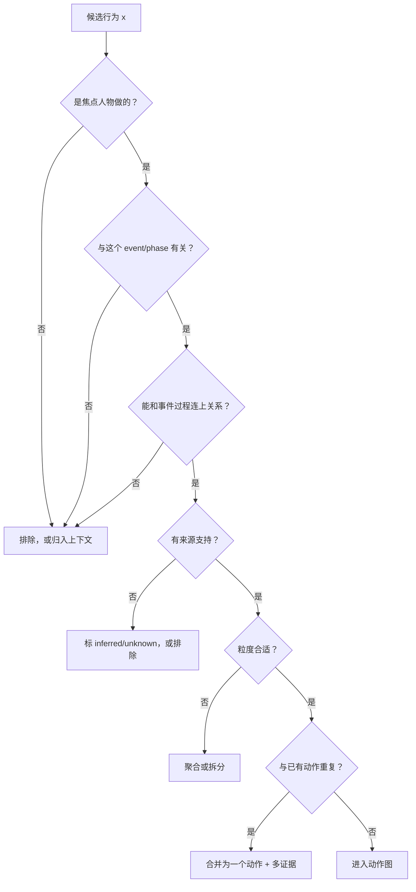
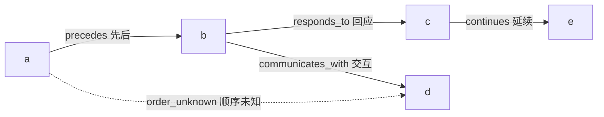
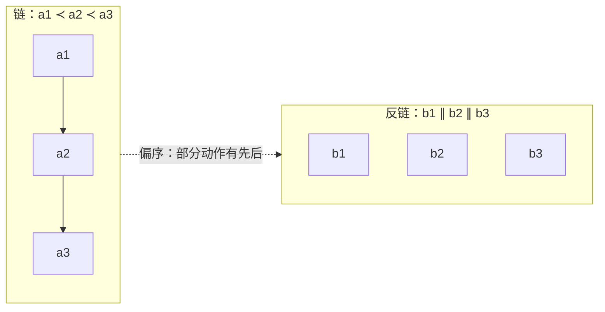
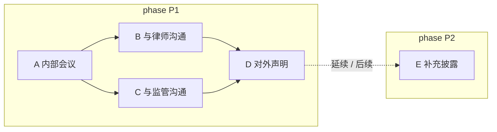

# 2 · 动作与动作图（Action Graph）

> 这一篇只回答一个问题：**描述一个人物在一个 event 里的行为时，动作怎么定义、记录什么、动作之间怎么连。**
> 不讨论生产流程、模型调用、benchmark；那些不属于“描述结构”。
> 关联：[0-overview](0-overview.md) · [1-hierarchy](1-hierarchy.md) · [3-context-model](3-context-model.md) · [4-evidence](4-evidence.md)
> 关联：[0-overview](0-overview.md) · [1-hierarchy](1-hierarchy.md) · [3-context-model](3-context-model.md) · [4-evidence](4-evidence.md)

---

## 2.1 这一篇在结构里的位置

```
event（一件可独立研究的事）
 └─ stage（局面/情境）
     └─ phase（行为模式）
         └─ 动作图：动作 + 动作关系
              └─ 每个动作挂上下文（见 3）
```

- **stage / phase 是时间与情境背景**（见 [1-hierarchy](1-hierarchy.md)）；
- **这一篇的核心是“动作”**：这个人物在这个 phase 里做了什么、和别的动作怎么连；
- **环境、他人、人物状态**是动作的上下文（见 [3-context-model](3-context-model.md)）；
- **证据**（来源、引文）挂在动作和关系上（见 [4-evidence](4-evidence.md)）。

一句话：**event/stage/phase 回答“什么时候、什么局面”；动作回答“这个人做了什么”。**

---

## 2.2 什么是动作

**定义**：动作是描述人物行为的**最小单元**——谁、做了什么、对谁/对什么、什么时候、有什么依据。

| 要素 | 含义 | 例子 |
|---|---|---|
| **谁** | 动作的执行者；焦点人物本人，或以其职务/代理身份执行 | 钱志敏、某公司 CEO、其代理律师 |
| **做什么** | 一个可陈述、可区分的行为 | 转账、开会、发布声明、与监管沟通 |
| **对谁/对什么** | 对象、对手方、协作者 | 向投资者、与律师、对监管机构 |
| **什么时候** | 发生时间或时间区间，允许“只知道年份/月份/未知” | 2014 年 6 月、2020 年 3 月上旬、未知 |
| **依据** | 哪段来源支持这个动作 | 某篇报道、某份公告、某段引文 |

**符号约定（设计层）**

| 符号 | 含义 |
|---|---|
| `a, b, c` | 动作（action） |
| `A(e)` | event e 的动作集合 |
| `I(a) = [l, r)` | 动作 a 的时间区间 |
| `a ≺ b` | a 先于 b（有证据的时间先后） |
| `a ≅ b` | a 与 b 时间重叠（并发） |
| `a ∥ b` | a 与 b 不可比（无先后证据/顺序未知） |
| `p ⊢ a` | 动作 a 属于 phase p 的视图（主归属或跨相位） |
| `C(p), ΔC(a)` | phase p 的基准上下文、动作 a 的差量上下文 |
| `Ev(a)` | 动作 a 的证据集合 |

> 符号只表达设计关系，不绑定字段/存储。

### 2.2.1 粒度规则

一个动作 = **一个主体 + 一个目标/对象 + 一个有界时间 + 一个可陈述的行为**。

| 太细（应合并） | 合适 | 太粗（应拆分） |
|---|---|---|
| “他拨了电话”“他说了第一句话”“他发了邮件” | “他就并购条件与对方电话沟通” | “他推进了整个项目” |
| 会议中的逐句发言 | 一次会议 / 一次沟通 | “他管理公司” |
| 同一动作在 5 篇报道里的 5 种写法 | 1 个动作 + 5 条证据 | — |

判断方法：**去掉这个动作，是否会影响对这段行为的理解？** 会，就保留；不会，就合并。若一个动作里同时包含多个不同目标/对象，就拆开。

### 2.2.2 什么不是动作

| 不是动作 | 应归到哪里 |
|---|---|
| 背景描述、环境状态 | 上下文（3-context-model） |
| 他人对这个人物的评价 | 上下文，不是本人的行为 |
| 纯粹的心理活动、没有外部表现的意图 | 不记录为动作；有来源陈述的“目标/动机”可作为动作的说明 |
| 会议里的每句话、邮件的每个句子 | 聚合成一个“沟通/会议”动作 |
| 与这个 event / phase 无关的私人活动 | 不进入该 sample |

> 动作描述的是“**这个人做了什么**”，不是“这个人是什么样的人”。

### 2.2.3 一个行为要成为“动作”，需要满足

1. **是这个人物做的**：本人，或以其职务/代理身份执行；
2. **与这个 event/phase 有关**：能说清它如何推进、阻碍、回应、掩盖或补救这件事；
3. **能和事件过程连上关系**：至少能说清对象、目标、前因、后果中的一项；
4. **有来源支持**：至少一段来源；如果是推断，必须明确标为推断。

不满足的：背景信息归入上下文；与事件无关的不进入这个 sample；没有证据的要么标未知，要么不记录。

**动作准入流程**



---

## 2.3 一个动作要记录哪些信息

这一节是**概念清单**，不是字段/schema；后续实现时再定具体格式。

| 信息 | 说明 | 是否必需 |
|---|---|---|
| **名称/类型** | 简短行为名（如“对外发布声明”），可带一个粗类型（沟通/交易/决策/执行等） | 必需 |
| **描述** | 一两句话说明这个动作具体是什么 | 必需 |
| **主体与身份** | 谁做的；以本人身份、职务身份还是代理身份 | 必需 |
| **对象/相关人物** | 对谁、与谁一起、谁受到影响 | 能确定时必需 |
| **时间** | 发生时间或区间；标明精度（年/月/日/未知） | 必需 |
| **目标/意图** | 如果来源明确说了目的/动机，就记录，并标明是来源陈述 | 可选 |
| **条件/触发/约束** | 这个动作为什么发生、受什么限制（简要，详见 3-context-model） | 可选 |
| **结果/影响** | 动作之后发生了什么（如果来源有） | 可选 |
| **证据** | 来源、引文/片段、支持状态（来源明说 / 推断 / 未知） | 必需 |
| **所属 phase** | 主要属于哪个 phase；是否跨 phase | 必需（至少主归属） |

> 原则：**能确定就记录，不能确定就标未知；不要为了“完整”而编。**
> 一个动作可以由多篇来源共同支持（一个动作 + 多条证据），不是每篇来源一个动作。

---

## 2.4 动作之间有哪些关系

动作之间的关系不需要很多类型，先覆盖四组即可。下面的示意图把四组关系放在同一张局部图上：



> 同一对动作可以同时有多条不同类型的关系；时间关系与语义关系分开记录，不能互相替代。

### 2.4.1 时间关系

| 关系 | 含义 | 例子 |
|---|---|---|
| **先后** | 有证据表明 A 发生在 B 之前 | 先内部会议，后对外声明 |
| **同时** | 两个动作的时间区间确实重叠 | 同一周既与律师沟通，又与监管沟通 |
| **顺序未知** | 两个动作都发生在这个时期，但来源没给先后 | 声明与监管沟通的先后无法确定 |

> “同一周发生”不等于“同时发生”，也不等于“有先后”；如果来源没说，就记“顺序未知”，不要强行排成一条链。

### 2.4.2 过程关系

| 关系 | 含义 | 记录要求 |
|---|---|---|
| **回应** | B 是对 A 的回应 | 来源明确说“回应/after/in response to”才记为回应 |
| **触发/引发** | A 促使 B 发生 | 来源明确说“导致/促使/triggered/led to”，或标注为推断 |
| **使能/条件** | A 使 B 成为可能 | 来源陈述或明确推断 |
| **阻止** | A 阻止/阻碍了 B | 来源陈述或明确推断 |

**重要纪律**：我们**不声称识别真实因果**。上面这些关系只记录两类东西：

1. **来源明确陈述**的关系（“因为…所以…”“in response to…”）——这是来源的主张，不是我们证明的因果；
2. **我们自己的推断**——必须标注“推断”，不能伪装成事实。

来源没说的关系，**宁可不连，也不要编**。详见 2.4.5。

### 2.4.3 交互关系

| 关系 | 含义 | 例子 |
|---|---|---|
| **沟通** | 与某人/某机构进行信息交流 | 与律师开会、向监管说明 |
| **交易** | 与某人/某机构发生资金或资产转移 | 向投资者转账、出售资产 |
| **委托/代理** | 让某人替自己做事 | 授权律师处理 |
| **共同行动** | 与其他人一起做同一件事 | 与合伙人共同签约 |

### 2.4.4 延续关系（跨 phase）

| 关系 | 含义 | 例子 |
|---|---|---|
| **延续** | 同一类行为从一个 phase 延续到下一个 phase | 谈判在 phase 1 开始，phase 2 继续 |
| **中断** | 行为被某事件打断 | 调查因更换律师暂停 |
| **恢复** | 中断后继续 | 更换律师后谈判恢复 |

> 延续不是“同一动作重复出现”；动作本身只存一份，跨 phase 用“延续/中断/恢复”标注（见 2.6）。

### 2.4.5 关于“因果”的说明

从现实世界的文档里，我们**无法识别真实因果**，只能记录“来源怎么说的”和“我们怎么推断的”。所以：

- 不要把“来源说 A 导致 B”写成“A 导致 B”；
- 推断关系必须标 `inferred`（推断），并写依据；
- 没有陈述/证据的关系，不连；
- 动作之间的关系不是越多越好：**只记录有证据/来源陈述的关系**。每个动作至少要能说明它和这个 event/phase 的关系（推进、回应、阻碍等），否则它不属于这个 sample。

---

## 2.5 动作怎么组成“图”

- **节点 = 动作**；
- **边 = 动作之间的关系**（时间/过程/交互/延续）；
- 图不是一条链：同一个 phase 里可以有几个动作**先后发生**、**同时发生**，也可以**汇合**到下一个动作；
- 跨 phase 的动作可以**延续**，但动作节点不复制；
- **stage 的动作视图 `G(s)`** 由该 stage 下多个 phase 的动作子图 + 跨 phase 动作组成；`G(p)` 是 `G(s)` 内的进一步分组，二者都是 `G(e)` 的视图。

### 2.5.0 偏序视角（数学记号）

动作集合 `A(e)` 与时间先后关系 `≺` 构成一个**偏序集（partially ordered set）**：

- **自反/传递**：`a ≺ b`、`b ≺ c` 可推出 `a ≺ c`；
- **反对称**：`a ≺ b` 与 `b ≺ a` 不能同时成立；
- **不可比**：`a ∥ b` 表示既非 `a ≺ b` 也非 `b ≺ a`（可能并发，也可能顺序未知）；
- **链（chain）**：两两可比的子集，对应严格串行的行为；
- **反链（antichain）**：两两不可比的子集，对应并发或顺序未知的行为；
- **线性扩展（linear extension）**：把偏序补成总序的一种方式；它只是多种可能之一，不能当作唯一顺序。



> 图论术语只用于表达“可不可以用先后关系确定”；不引入实现层面的 schema。

### 2.5.1 三种常见形态



读法：

- **串行**：`A → B`（有先后证据）；
- **同时**：`B` 与 `C` 在同一个时期并行（区间重叠），不一定有先后；
- **汇合**：`B` 和 `C` 都影响 `D`（D 同时回应两边）；
- **跨 phase 延续**：`D` 到 `E` 是延续/后续，不是把 D 复制到 P2。

> 如果两个动作只有“都发生在这个 phase”，但来源没给先后，也**不要强行画箭头**；可以并排放置，或用“顺序未知”标注。

---

## 2.6 动作与 phase 的归属

- 一个动作通常按**主要发生时间 / 主要目的**归入一个 phase（主归属）；
- 跨 phase 的动作只保留**一个动作**，标注主 phase 和“延续到哪个 phase”；
- 一个 phase 的动作集合 = 该阶段的主要行为，不是所有背景信息；
- **动作图是 event 级的一份**；phase 只是查看、评审、描述动作时的分组视图，不是把动作复制成多份的容器。

| 情况 | 处理 |
|---|---|
| 动作完全在一个 phase 内 | 归入该 phase |
| 动作跨两个 phase | 选主归属；另一处标“延续/跨阶段” |
| 动作跨 stage | 同上，标跨 stage；不复制 |
| 无法确定属于哪个 phase | 标“未归属”，并说明原因；不要硬塞 |

---

## 2.7 一个完整的小例子

**背景**：某公司高管应对一次监管调查；事件分为“内部应对”“公开回应与披露”两个 **stage**；每个 stage 下再分 phase。每个 phase 的动作视图是多个动作构成的子图（本例中 phase 内部动作较少，用于说明关系）。

| 动作 | 所属 phase | 时间 | 与谁/对谁 | 关系 | 证据 |
|---|---|---|---|---|---|
| A1 召开内部会议 | 内部沟通 | 周一 | 管理层 | 起点 | 来源 1 |
| A2 与律师沟通 | 内部沟通 | 周一 | 律师 | 与 A1 同时/顺序未知 | 来源 1、2 |
| A3 对外发布声明 | 对外声明 | 周二 | 媒体/公众 | 回应 A1、A2 | 来源 2 |
| A4 与监管沟通 | 监管沟通 | 周二 | 监管 | 与 A3 同时/顺序未知 | 来源 3 |
| A5 补充披露 | 披露 | 周三 | 公众/监管 | 汇合 A3、A4 | 来源 3 |
| A6 接受正式调查 | 正式调查（跨监管沟通） | 下一 phase | 监管 | 延续 A4 | 来源 4 |

读法：

- A1 与 A2 都是周一发生，但来源未说明先后 → **同时或顺序未知**；
- A3 是 A1/A2 之后的公开动作 → **回应**；
- A5 同时受 A3、A4 影响 → **汇合**；
- A6 在下一个 phase，延续 A4 的监管沟通 → **跨 phase 延续**。

---

## 2.8 写动作时的常见错误

| 错误 | 后果 | 正确做法 |
|---|---|---|
| 把背景、评价、心理活动当动作 | 图里混入非行为 | 归入上下文；动作只写“做了什么” |
| 一篇报道一个动作 | 重复、计数失真 | 同一行为合并为一个动作 + 多条证据 |
| 动作太细（每句话/每个操作） | 图爆炸、不可读 | 按粒度规则聚合 |
| 强行把动作排成一条链 | 伪造顺序 | 允许同时/顺序未知；不硬连箭头 |
| 来源说“因为”就当成自己证明因果 | 过度声称 | 记录为“来源陈述”，推断关系标 inferred |
| 跨 phase 复制动作 | 重复、证据分裂 | 一个动作 + 延续标注 |
| 动作与 event/phase 无关 | 噪声 | 不进入该 sample |
| 没有证据 | 无法复核 | 标 unknown 或删除；推断必须标注 |

---

## 2.9 与其他文档的关系

- [1-hierarchy](1-hierarchy.md)：event/stage/phase 怎么分、边界怎么定；
- [3-context-model](3-context-model.md)：动作发生时的环境、他人、人物自身状态；
- [4-evidence](4-evidence.md)：动作和关系的来源、引文、支持状态；
- [0-overview](0-overview.md)：整个框架的总览与规则表。
