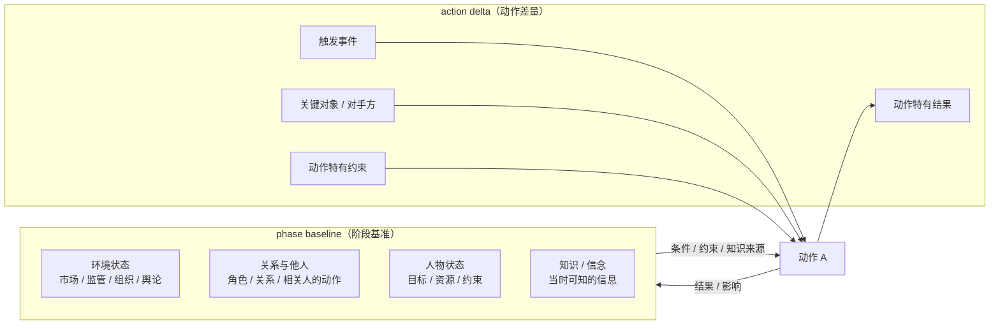
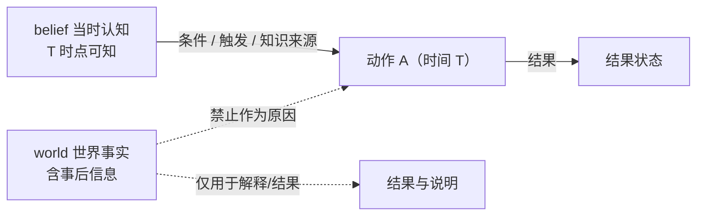

# 3 · 上下文：环境、他人与人物状态

> 本篇讨论上下文的设计，不涉及字段/schema/实现。
> 关联：[0-overview](0-overview.md) · [1-hierarchy](1-hierarchy.md) · [2-action-graph](2-action-graph.md) · [4-evidence](4-evidence.md)

---

## 3.0 本篇要解决的设计问题

- 动作并不是只由“人物性格”决定：它发生在具体环境、关系与自身状态中；这些信息怎么进入结构，才不丢失又不臃肿？
- 为什么不能把整段环境写在每个动作下？为什么需要 phase 基准 + action 差量？
- 人物“当时知道什么”（belief）与“事后才知道的事实”如何区分，避免用未来信息解释过去？
- 哪些上下文与动作直接相关、必须链接？哪些只是背景、不应链接？

## 3.1 定位：描述性上下文，不是世界引擎

本框架的上下文层回答三个问题：

1. 这个动作发生在**什么环境**里？
2. 与**哪些人/组织**有关，他们是什么角色？
3. 人物**当时**的目标、资源、约束与认知是什么？

**边界**：上下文只承担**描述、条件、验证**，不承担状态推演。本框架**不定义 transition function**，不做情景/环境模拟；也不要求为世界状态建完整模型。

一句话：**上下文用于解释和条件化行为，不用于计算下一步状态。**

---

## 3.2 两段式：phase baseline + action delta

如果每个动作都重复写一遍环境，上下文会爆炸；如果只写 phase 级，又丢动作特异信息。因此采用两段式：



> 图中“知识/信念”是人物状态的子项，只是为了阅读方便单独画出；它仍属于 `State`。

| 层 | 放什么 | 不放什么 |
|---|---|---|
| **phase baseline** | 该 phase 内相对稳定的环境、关系格局、人物状态、知识面 | 只对单个动作成立的细节 |
| **action delta** | 该动作特有的触发、关键对象/对手方、特有约束、特有结果、知识来源 | 与 baseline 重复的内容 |

评审时可先读 baseline，再读 delta，即可还原该动作的完整上下文。

**符号约定（设计层）**

| 符号 | 含义 |
|---|---|
| `C(p)` | phase p 的基准上下文（baseline） |
| `ΔC(a)` | 动作 a 的上下文差量（delta） |
| `C(a) = C(π(a)) ⊕ ΔC(a)` | 动作 a 的完整上下文（`π(a)` 为主归属 phase；组合不是简单相加） |
| `C = (Env, Rel, State)` | 上下文三类：环境、关系/他人、人物状态 |
| `Sup(c) ⊆ {O, A, I}`；`Gap(c)` | 上下文条目的支持模式：记录内容/世界断言/推断；`Sup=∅ + Gap` 为未知 |
| `t(a)` | 动作时点；`know(a)` 表示该时点人物可知的信息 |

> `⊕` 只表示“基准 + 差量”的组合关系，具体合并规则属于实现层。

---

### 3.2.1 一个具体例子

同一个 phase 内有两个动作：A1 “召开内部会议”、A2 “与律师会面”。

- **phase baseline `C(p)`**：监管调查已启动、媒体关注、委托李律师、披露口径需律师审核；
- **A1 的差量 `ΔC(A1)`**：触发=内部需要统一口径；对象=管理层；无新增约束；
- **A2 的差量 `ΔC(A2)`**：对象=李律师；知识=律师提供的应对建议。

因此 `C(A1) = C(p) ⊕ ΔC(A1)`，`C(A2) = C(p) ⊕ ΔC(A2)`：两者共享同一背景，只补充各自特有的信息。这样既避免重复写环境，又保留动作差异。

## 3.3 三类上下文

| 类别 | 关联什么 | 不关联什么 | 证据要求 |
|---|---|---|---|
| **人物上下文** | 动作对象/对手方、协作者、受影响者、监管者/权威、角色关系 | 同时存在但与该动作无关的人；全量人物名单 | 角色/关系需有来源或明确推断 |
| **环境上下文** | 该动作**依赖或改变**的环境状态：市场、法律/监管、组织财务、舆论、行业等 | 与该动作无关的全量宏观叙述 | 状态需能回指来源；未知显式标 |
| **自身状态** | 目标/意图、资源与能力、约束、知识/信念；（可选）风险/情绪/健康/声誉 | 与当前动作无关的个人特质清单 | 目标/信念需有来源或明确推断 |

### 3.3.1 人物上下文（相关他人）

- 以**动作为中心**，只链“参与 / 作用 / 被影响 / 约束”的人或组织。
- 每个链接要有**角色**（执行者、协同者、对手方、受影响者、监管者、代理人等）与关系。
- 本版**不把他人的独立动作建成动作节点**；若它触发/约束主体动作，只作为上下文条目（语义=条件/触发/约束）记录，并保留来源。是否引入他人动作节点见 [5-design-decisions](5-design-decisions.md) 5.8 的待定问题。

### 3.3.2 环境上下文

- 只收“动作所依赖或所改变”的环境变量；不要求全量环境建模。
- 同一 phase 内稳定的环境放在 baseline；动作特异变化放 delta。
- 环境状态允许粗粒度（如“监管趋严”“流动性紧张”），但必须标明是**当时状态**还是**事后判断**。

### 3.3.3 人物自身状态

- **目标/意图**：这个动作服务于什么目标（可以是阶段性子目标）。
- **资源与能力**：资金、权限、团队、时间、信息渠道等。
- **约束**：法律、合规、合约、时间窗口、他人授权等。
- **知识/信念**：人物**当时知道什么、相信什么**——这是行为解释的关键，见 3.5。

---

## 3.4 六种链接语义

上下文与动作/phase 之间的链接必须**有类型**。框架层定死六种，禁止“相关”式模糊链接：

| 语义 | 方向 | 含义 | 例子 |
|---|---|---|---|
| **参与（participation/role）** | 人物 → 动作 | 谁以什么角色参与 | 对手方、协作者、监管者 |
| **条件（condition）** | 环境/状态 → 动作 | 背景状态使动作可行/合理 | 市场恐慌、公司现金充裕 |
| **触发（trigger）** | 事件/观察 → 动作 | 直接促发动作 | 收到起诉书、被媒体曝光 |
| **约束（constraint）** | 状态 → 动作 | 限制/排除了某些选项 | 合规禁令、资金缺口 |
| **结果（result）** | 动作 → 状态 | 动作改变了什么 | 声誉受损、控制权变化 |
| **知识来源（knowledge-source）** | 信息 → 人物 | 人物当时获得/知道的信息 | 内部报告、会议通报、公开报道 |

> 注意：“动作 → 结果”写回 baseline 时，必须区分**当时已发生的结果**与**事后才知道的结果**（见 3.5）。

---

## 3.5 belief 与事实分离（防泄漏）

**核心区分**：

- **世界事实（world）**：我们作为研究者事后知道的完整事实；
- **人物认知（belief）**：人物在动作发生时**实际知道/相信**的信息；
- **事后事实（post-hoc）**：动作之后才出现、人物当时不可能知道的信息。

人物行为由 **belief** 驱动，而不是由 world 驱动。

**理由与代价**：行为依据的是人物当时可获得的信息；如果用事后才知道的事实解释当时动作，就会产生后见之明偏差，把“结果”当成“原因”。代价是：部分动机/认知无法从公开材料确认，只能记 `Sup=∅+Gap` 或标 `I`，不能为了叙述完整而补成事实。

框架规则：

1. 动作的“条件/触发/知识来源”只能使用**动作时点可知**的信息。
2. 事后才知道的事实可用于解释结果、写研究说明，但**不能作为该动作的原因/条件**。
3. 无法判断“当时是否知道”时，记 `Sup=∅+Gap`，不要默认按 world 处理。



---

## 3.6 上下文规则（CTX Rules）

| 编号 | 规则 |
|---|---|
| **CTX-R1** | 两段式：phase baseline + action delta；不重复写相同内容 |
| **CTX-R2** | 每个上下文链接必须归属六种语义之一，禁止模糊“相关” |
| **CTX-R3** | 最小化：只链“会改变对该动作解释或判断”的信息；无关人物/状态不链 |
| **CTX-R4** | 证据化：每个链接要么可回指证据，要么标 `I` 或 `Sup=∅+Gap`；无证据不链 |
| **CTX-R5** | 防泄漏：动作条件/触发/知识来源只能使用当时可知信息；事后事实只用于结果说明 |
| **CTX-R6** | 未知显式：无法确认的状态记 `Sup=∅+Gap`，不默认补齐 |
| **CTX-R7** | 未归属 phase 的动作没有 phase 基准 `C(π(a))`；只能记录动作级上下文或标未知，不虚构基准 |

---

## 3.7 与动作图、phase 的关系

- **phase** 持有 baseline 的默认上下文；每个 phase 至少应有“环境 + 关系 + 人物状态”的最小 baseline，或 `Sup=∅+Gap`。
- **action** 持有 delta：触发、关键对象、特有约束、特有结果、知识来源。
- 动作图（2）与上下文层（3）是正交视图：动作图回答“动作之间怎么连”，上下文回答“动作为什么/在什么条件下发生”。

```mermaid
flowchart LR
    subgraph CTX["上下文层"]
        ENV["环境 Env"]
        REL["关系/他人 Rel"]
        ST["人物状态 State<br/>目标/资源/约束/知识"]
    end
    PH["phase p"] -->|基准 C(p)| CTX
    A["action a"] -->|差量 ΔC(a)| CTX
    CTX -->|条件 / 触发 / 约束 / 知识来源| A
    A -->|结果（仅描述性）| CTX
```

**读法**：phase 给出“这个局面下的默认背景”；action 只补“这个动作特有的条件/触发/约束/知识”；两者组合成该动作的完整上下文。

---

## 3.8 反模式

| 反模式 | 问题 | 修正 |
|---|---|---|
| 每个动作重复整段环境描述 | 上下文爆炸、评审冗余 | phase baseline + delta |
| 用“相关”代替六种语义 | 无法解释、无法比较 | 强制类型化链接 |
| 把全量人物名单挂到动作上 | 噪声、图不可读 | 只链角色相关者 |
| 用事后才知道的信息解释当时动作 | 时序倒置、用未来信息解释过去 | belief/world 分离 |
| 为每个动作建完整世界状态模型 | 工作量爆炸、违背非目标 | 只收相关环境变量 + unknown |
| 上下文无证据 | 变成模型臆测 | 证据化或标 inferred |

---

## 3.9 与其他文件的关系

- 总览与层级：[0-overview](0-overview.md)、[1-hierarchy](1-hierarchy.md)。
- 动作节点/边：[2-action-graph](2-action-graph.md)。
- 证据要求：[4-evidence](4-evidence.md)。
- 设计取舍与待定问题：[5-design-decisions](5-design-decisions.md)；
- 形式化模型：[8-formal-model](8-formal-model.md)。
