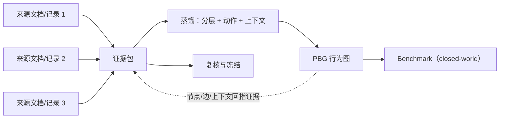

# 4 · 证据包与溯源：图是派生视图

> 对应框架规则：**FR-8**（并支撑 FR-3、FR-9）。框架层定义，不含字段/schema。
> 关联：[0-overview](0-overview.md) · [2-action-graph](2-action-graph.md) · [5-benchmark-and-dataset](5-benchmark-and-dataset.md) · [6-production-review-and-validation](6-production-review-and-validation.md)

---

## 4.1 核心原则

> **证据包是一等公民；PBG 是证据包的派生视图。**

三条推论：

1. **可追溯**：图上的每个节点、每条边、每个上下文链接都要能回指到证据（或显式标记为推断/未知）。
2. **可重建**：图可以从证据包 + 蒸馏规则重新生成；图修订不丢失证据。
3. **可验证**：复核、评测、审计都基于证据包，而不是基于图的说辞。

**反过来的边界**：证据包不是“所有网页的堆积”，而是**经过采集、选择、核验与范围冻结**的信息集合；范围外的材料不进入该 sample。

---

## 4.2 证据包应包含什么（概念层）

| 组成 | 说明 |
|---|---|
| **来源清单** | 有哪些文档/记录，类型（报道、公告、访谈、监管文件、数据库记录等） |
| **原文与片段** | 保留原始文本或可定位片段；不做不可逆改写 |
| **元数据** | 发布时间、作者/发布者、来源类型、语言、原始链接/标识 |
| **阅读深度** | 全文 / 部分 / 仅摘要或标题（直接影响可支持的结论强度） |
| **核验状态** | 单来源 / 多来源印证 / 存在冲突 / 无法核验 |
| **冲突记录** | 不同来源对同一事实的矛盾说法与处理方式 |
| **覆盖与缺口** | 该证据包覆盖的时间/主题范围，以及已知空白 |
| **证据—图链接** | 每个图元素引用了哪些证据（见 4.3） |

> 证据包不要求“完美”，但要求“诚实”：**未知就是未知，缺口就是缺口**。

---

## 4.3 证据到图的链接

每个图元素都要有支持状态（support status）：

| 状态 | 含义 | 要求 |
|---|---|---|
| `observed` | 有来源直接支持 | 至少一条可定位证据（原文/片段/偏移） |
| `inferred` | 由证据推断，但不是直接陈述 | 必须有推断依据 + 理由；不得伪装成 observed |
| `unknown` | 无法确认 | 显式记录；不得用默认值填充 |

**链接粒度**：动作节点、边、上下文链接都可以各自挂证据；同一条证据可以支持多个元素（例如一段引文同时支持一个动作与一个结果），但必须**逐一登记**，不能“整段挂一次、到处复用而不说明”。

---

## 4.4 closed-world 完整性

**问题**：从真实世界收集信息，永远无法证明“找全了这个人的所有行为”。因此不能把图当作真实世界的完整真值。

**解法**：benchmark 的判定世界定义为**固定证据包**（closed-world）：

> 任务：“给定这批证据，重建此人的行为图。”
> 完整性 = 相对于**这批证据**是否找全，而不是相对于真实世界。

| 概念 | 定义 |
|---|---|
| **closed-world** | 评测上下文固定为某个证据包；模型只能使用包内信息 |
| **完整性** | 金标图（在该证据包上人工/规则确认）中的行为是否被找回 |
| **soundness（可靠性）** | 图中每个元素是否被证据支持 |
| **coverage（覆盖）** | 该证据包覆盖的时间/主题范围，以及已知缺口 |
| **open-world 声明** | 数据集明确说明“不代表真实世界全部行为”，只代表证据支持的部分 |

这样 benchmark 可判分、可复现；同时数据集保持诚实。

---

## 4.5 如何把“经过验证”操作化

“verified”不能只是口号。框架层建议至少记录以下维度：

| 维度 | 取值示例 | 作用 |
|---|---|---|
| 来源类型 | 一手（监管文件/公告/访谈）/ 二手（报道/评论） | 决定支持强度 |
| 阅读深度 | 全文 / 部分 / 仅摘要 | 决定可支持结论的范围 |
| 印证情况 | 单源 / 多源一致 / 多源冲突 / 无法核验 | 决定可信度 |
| 时间精度 | 精确日期 / 月 / 年 / 区间 / 未知 | 防止精度升级 |
| 冲突处理 | 保留多值 / 选取主值 + 理由 / 待核 | 防止静默覆盖 |

---

## 4.6 冲突与缺口的处理

| 情况 | 处理 |
|---|---|
| 多来源矛盾 | 保留多个候选值或描述，记录来源；可标“主值 + 理由”，不得静默丢弃 |
| 只有片段/摘要 | 标 `partial`，不当作全文证据；关键结论需要更直接来源时标为待补 |
| 时间不一致 | 保留候选时间与精度；不强行统一成精确日期 |
| 完全缺失 | 显式 `unknown`/`gap`；不推断为“未发生” |
| 来源不可访问 | 记录访问状态（如“仅摘要/受限”），不用模型记忆替代 |

---

## 4.7 证据规则（EV Rules）

| 编号 | 规则 |
|---|---|
| **EV-R1** | 证据包先于图存在；图不得引入包外事实 |
| **EV-R2** | 每个节点/边/上下文链接可回指证据，或显式 `inferred/unknown` |
| **EV-R3** | 支持状态三值化：observed / inferred / unknown；禁止把推断伪装成观测 |
| **EV-R4** | 完整性相对证据包（closed-world）；数据集另记 coverage/gap |
| **EV-R5** | “验证”按 4.5 的维度记录，不使用无操作的“verified”标签 |
| **EV-R6** | 证据包与图都版本化；图修订不丢失原始证据 |
| **EV-R7** | 冲突保留、缺口显式；禁止静默覆盖 |

---

## 4.8 反模式

| 反模式 | 问题 | 修正 |
|---|---|---|
| 只有片段/摘要就当全文证据 | 支持强度被高估 | 记录阅读深度；关键结论标待补 |
| 单来源支撑关键事实 | 无法核验 | 标明单源；尽量补第二来源 |
| 冲突静默取一个值 | 丢失不确定性 | 保留多值 + 理由 |
| 图改完证据不留 | 不可复核 | 证据包独立留存、版本化 |
| 用模型记忆补证据 | 幻觉来源 | 要么证据，要么 inferred/unknown |
| 宣称“完整还原” | 真实世界不可证 | closed-world + coverage 声明 |

---

## 4.9 与现有表示的衔接

- **person-epg-3.0** 已有 source_document / evidence_span / evidence_set / evidence_link 等证据结构，可作为本框架的底层证据模型参照。
- **EventCascade** 的 `VerifiableField`（值 + 原文 + 理由 + 置信度）提供了“字段级证据”的思路；PBG 将证据要求扩展到**节点、边、上下文链接**三个层面。
- 本框架不要求立即复用具体表结构；后续实现层再决定映射（见 [7-glossary-and-mapping](7-glossary-and-mapping.md)）。

---

## 4.10 与其他文件的关系

- 规则来源：[0-overview](0-overview.md) FR-8。
- 动作准入/推断：[2-action-graph](2-action-graph.md)。
- 时间切分与防泄漏：[3-context-model](3-context-model.md)、[5-benchmark-and-dataset](5-benchmark-and-dataset.md)。
- 复核与冻结：[6-production-review-and-validation](6-production-review-and-validation.md)。
