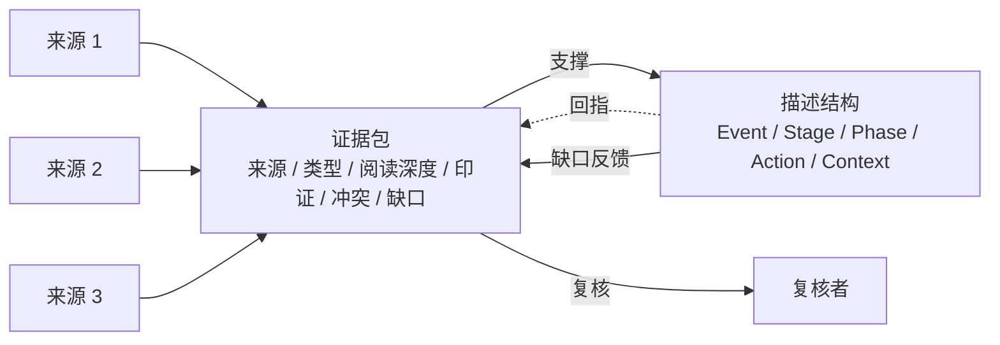
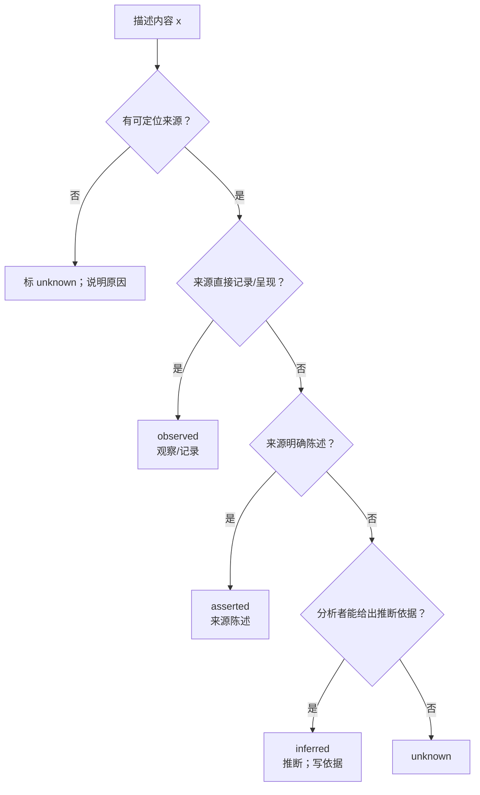
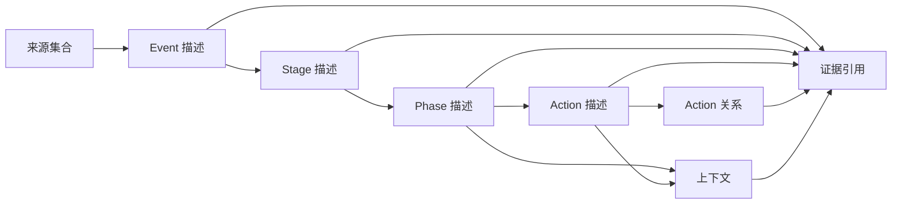

# 4 · 证据与溯源（设计层）

> 本篇讨论**证据在描述结构中的位置与原则**：来源是什么、如何支撑描述、如何区分事实/陈述/推断、如何处理冲突与缺口。
> 不讨论字段/schema/JSON、数据库、生产流程或评测。
> 关联：[0-overview](0-overview.md) · [1-hierarchy](1-hierarchy.md) · [2-action-graph](2-action-graph.md) · [3-context-model](3-context-model.md)

---

## 4.1 核心原则

> **描述结构建立在证据之上；结构是证据的投影，不是事实本身。**

三条设计推论：

1. **可追溯**：描述中的每个事件、阶段、动作、关系、上下文，都应能回指到具体来源与原文，或明确标记为“推断/未知”。
2. **可复核**：读者/复核者能沿着“描述 → 来源 → 原文”的链条检查，而不是只能相信描述。
3. **可修订**：证据补充或修正时，结构可以随之更新，而不是把描述当成不可改的事实。

---

## 4.2 证据包（Evidence Package）

围绕一个人物/一个 event 收集的证据，构成一个**证据包**。证据包不是“所有网页的堆积”，而是经过采集、选择、核验与范围冻结的信息集合。

设计上，一个证据包应能回答：

| 问题 | 说明 |
|---|---|
| **来源有哪些** | 文档、报道、公告、访谈、监管文件、数据库记录等 |
| **来源是什么类型** | 一手/二手、官方/媒体/个人陈述、全文/摘要 |
| **读到了什么程度** | 全文、部分、仅标题/摘要；这决定能支持多强的结论 |
| **是否多源印证** | 单一来源、多源一致、多源冲突、无法核验 |
| **有哪些冲突** | 不同来源对同一事实的矛盾说法与处理方式 |
| **覆盖范围与缺口** | 时间/主题覆盖到哪里，哪里空白 |
| **证据与描述如何对应** | 哪段证据支撑哪个事件/阶段/动作/关系/上下文 |

> 证据包不要求“完美”，但要求“诚实”：**未知就是未知，缺口就是缺口**。

### 4.2.1 证据包的结构图

**符号约定**

| 符号 | 含义 |
|---|---|
| `Ev(x)` | 对象 x 的证据集合 |
| `supp(x) ∈ {O, A, I, U}` | 支持状态：观察/记录、来源陈述、推断、未知 |
| `Src(x)` | 支撑 x 的来源集合 |
| `Gap(x)` | 对象 x 的已知缺口（可为空） |
| `Conflict(x)` | 对象 x 的冲突记录（可为空） |

> 这些符号表达证据关系，不绑定字段/存储。

---

## 4.3 支持状态（描述与证据的关系）

描述中的内容按证据强度分为四类（设计层约定）：

| 状态 | 含义 | 设计要求 |
|---|---|---|
| **观察/记录（observed）** | 来源直接记录/呈现（公告、文件、记录等） | 必须有具体来源与可定位引文 |
| **来源陈述（asserted）** | 来源明确陈述（报道、访谈、声明等） | 必须有引文；是“来源这样说”，不是“已被证明” |
| **推断（inferred）** | 分析者根据证据提出的推断 | 必须说明推断依据；不得伪装成观察/陈述 |
| **未知（unknown）** | 无法确认 | 显式记录，不用默认值填充 |

**设计纪律**：

1. 不要把“来源陈述”写成“事实”；
2. 不要把“推断”混入“已发生动作”；
3. 同一内容可以由多条证据支持；多来源冲突时保留冲突，不静默取一个；
4. 没有证据的内容，要么标未知，要么不进入描述。

**支持状态判定流程**

> 四态是**描述与证据关系**的分类，不是质量评分；不能因为标了 `observed` 就认为内容一定真实，它只表示“来源这样记录”。

---

## 4.4 证据挂在哪些位置

- 证据不是“只挂在事件级的总引用”；关键层级都需要能回指。
- 同一段引文可以支撑多个对象，但每个对象都要能说明“哪段证据支撑我”，不能只靠全局引用。
- 证据引用应尽量包含**可定位信息**（章节、段落、页码、偏移等），便于复核；没有定位信息时说明原因。

---

## 4.5 如何判断“证据够不够”

设计层不规定固定门槛，但建议按以下维度判断：

| 维度 | 问题 |
|---|---|
| **来源类型** | 一手还是二手？官方文件、当事人陈述、媒体报道、匿名消息？ |
| **阅读深度** | 读了全文还是只看了摘要/标题？ |
| **印证情况** | 单一来源还是多源一致？是否有独立来源？ |
| **冲突** | 是否存在矛盾说法？矛盾是否已记录？ |
| **时间精度** | 来源支持到什么时间精度？是否被提升？ |
| **可定位性** | 引文能否定位回原文？ |

**原则**：证据强度决定描述的“确定性用词”（确定 / 据称 / 推断 / 未知），而不是反过来用确定语气掩盖证据不足。

---

## 4.6 冲突与缺口

| 情况 | 设计处理 |
|---|---|
| 多来源矛盾 | 保留多个说法，记录来源与差异；可给出主说法+理由，但不得静默丢弃 |
| 只有片段/摘要 | 标为“部分来源”；关键结论需要更直接来源时标待补 |
| 时间不一致 | 保留候选时间与各自精度；不强行统一成精确日期 |
| 完全缺失 | 显式“未知/缺口”；不推断为“未发生” |
| 来源不可访问 | 记录访问状态（仅摘要/受限）；不用模型记忆替代原文 |
| 引文无法定位 | 说明原因；不把无法核验的引文当作强证据 |

---

## 4.7 设计原则（不变量）

| 编号 | 不变量 |
|---|---|
| **E1** | 描述中的内容可回指来源/引文，或显式标记推断/未知 |
| **E2** | 来源陈述 ≠ 已被证明；推断 ≠ 事实 |
| **E3** | 冲突保留、缺口显式；不静默覆盖 |
| **E4** | 引文不得改写/概括冒充原文；翻译需另标 |
| **E5** | 时间精度继承来源，不提升精度 |
| **E6** | 结构描述的是“证据支持的行为”，不宣称覆盖真实世界全部行为 |
| **E7** | 证据补充/修正时，描述可修订；旧版本/旧证据保留可追溯 |

---

## 4.8 设计问题（后续讨论）

- 证据需要细化到什么粒度：对象级（一个动作一条证据）还是陈述级（动作内每个细节各自有证据）？
- 引文与定位信息需要多强？是否要求偏移/页码，还是允许段落级？
- 多来源冲突时，描述层如何呈现“主说法/异说”而不丢失信息？
- 证据的“覆盖缺口”是否需要成为结构的一等对象（Gap），还是只写在说明中？
- 二手来源的转述是否可以支撑动作，还是必须追溯到一手来源？

> 这些问题属于设计选择，见 [5-design-decisions](5-design-decisions.md)；形式化定义见 [8-formal-model](8-formal-model.md)。
