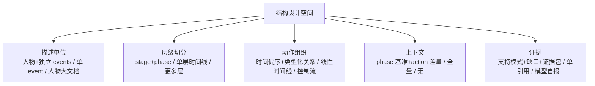
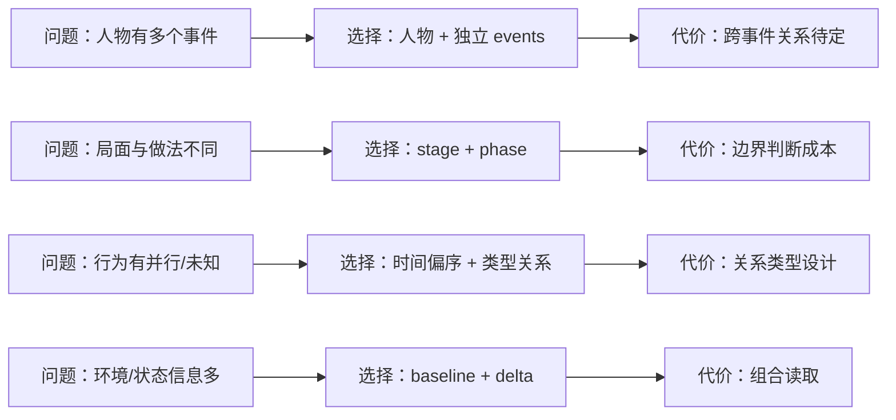

# 5 · 设计选择与待定问题

> 本篇记录**结构设计层面的关键选择**：我们选了什么、为什么这样选、有哪些替代方案与代价、还有哪些问题待定。
> 不涉及字段/schema、代码、实现流程、benchmark、评测。

## 5.0 设计空间

每一节讨论一个轴：选了什么、替代方案、代价、待定问题。

---

**选择—代价链（读图）**

**读法**：每一行是“问题 → 选择 → 代价”；设计说明不只是列选择，还要说明代价。下面各节分别展开这些选择与替代方案。

## 5.1 描述单位：人物 + 独立 events

**选择**：以人物为顶层，人物拥有多个 event；每个 event 是一份独立、完整的描述。

| 替代方案 | 优点 | 缺点 |
|---|---|---|
| 一个人物一个大文档，所有 event 混在一起 | 人物全景连续 | 难以独立阅读/复用；event 边界模糊；体量过大 |
| 只描述单个 event，不建人物层 | 简单 | 丢失“人物一系列事件”的视角；无法做人物级组织 |
| 人物层 + 独立 event（当前） | 既有person视角，又保留 event 独立性 | 需要设计事件索引与跨事件关系（当前暂不展开） |

**待定**：跨事件的关系（主题、时间、因果链等）是否、以及如何进入结构？当前版本只保证 event 独立描述。

---

## 5.2 层级切分：stage + phase 两级

**选择**：event 内部采用 `Stage（局面阶段）→ Phase（行为阶段）→ Action` 两级时间切分。

| 替代方案 | 优点 | 缺点 |
|---|---|---|
| 单一时间线（不分成 stage/phase） | 简单 | 无法表达“局面”与“行为模式”两种粒度 |
| event → stage → action（无 phase） | 层级更少 | 大 stage 内行为模式变化无法表达 |
| event → stage → phase → action（当前） | 同时保留局面与行为模式 | 边界判断有主观性；标注成本更高 |
| 任意深度的时间分段 | 灵活 | 结构不稳定，难以比较 |

**为什么保留两级**：stage 回答“局面怎么变”，phase 回答“人物怎么做”；两者切点经常不同。如果两级总切在同一处，应合并。

**待定**：

- stage / phase 的边界判据需要更细的操作说明；
- 是否允许 phase 跨 stage（当前设计假设 phase 属于一个 stage）；
- 事件复杂度差异很大时，是否允许“只有一个 stage/phase”的退化结构（当前允许）；
- 层级数量是否需要按事件类型调整（例如特别长的事件是否增加一层子阶段）。

---

## 5.3 动作图：时间偏序 + 类型化关系（语义关系可成环）

**选择**：动作是节点，动作关系是边；其中**时间关系 `≺` 是偏序**，允许并发与顺序未知，不强行排成一条链；完整动作图是类型化有向图，语义关系可以成环。

| 替代方案 | 优点 | 缺点 |
|---|---|---|
| 线性时间线 | 简单直观 | 伪造顺序，丢失并发/未知 |
| 流程图/控制流（AND/XOR） | 可执行语义 | 单案例证据不足；会把推断当事实 |
| 因果 DAG | 表达因果 | 观察性文档无法识别因果；容易过度声称 |
| 动作图（时间偏序 + 类型化关系，当前） | 忠实记录时间/陈述/交互/延续，语义关系可成环 | 关系类型需要设计；图结构对读者有学习成本 |

**设计约束**：

- 时间关系（先后/同时/顺序未知）与语义关系（回应/触发/使能/阻止）分开；
- 语义关系只记录“来源陈述”或“显式推断”，不声称识别真实因果；
- 语义关系允许成环（来源陈述的相互强化/反馈、推断循环），不强行 DAG 化；
- 没有证据/陈述的关系不连。

**待定**：

- 关系类型的最小集合与扩展规则；
- 动作粒度阈值（什么算一个动作、何时聚合）；
- 环/循环在描述层如何呈现最清晰；
- 是否需要“决策点/观察”等动作之外的节点类型（当前未纳入）。

---

## 5.4 动作全局存储 + phase 视图

**选择**：动作在 event 级只存一份；phase 通过“分组视图”引用动作，不复制。

| 替代方案 | 优点 | 缺点 |
|---|---|---|
| 每个 phase 内嵌动作数组 | 结构直观 | 跨 phase 动作会重复/丢失；证据与关系分裂 |
| 每个 phase 独立一张图 | 局部清晰 | 跨 phase 连续性丢失；全局关系难表达 |
| 动作全局 + phase 视图（当前） | 唯一动作身份；跨 phase 连续可表达 | 读取时需要“phase → 动作”的间接引用 |

**待定**：跨 phase 动作的“主归属”规则（按时间、按主要目的、按动作开始/结束）；当前规定主归属优先，无法确定时允许显式“未归属”（不进入 phase 视图，但保留在 event 动作图中）。

---

## 5.5 上下文：phase 基准 + action 差量

**选择**：phase 提供基准上下文（环境/他人/人物状态）；action 只记录与基准不同的差量。

| 替代方案 | 优点 | 缺点 |
|---|---|---|
| 每个动作重复写完整上下文 | 单动作自包含 | 大量重复；结构臃肿 |
| 只写 phase 级上下文 | 简洁 | 动作特有触发/对象/约束丢失 |
| 基准 + 差量（当前） | 去重且保留动作特异信息 | 读取时需组合两层 |

**设计约束**：区分“世界事实”与“人物当时所知（belief）”；不能用事后信息解释当时动作。

**待定**：

- 上下文变量集合按领域如何定义（金融/公司/个人等）；
- 在证据不足时，上下文允许“未知”到什么程度；
- 人物状态（目标/情绪/风险偏好等）的边界与可证据化程度。

---

## 5.6 证据：记录内容 / 世界断言 / 推断 + 缺口

**选择**：描述内容按支持模式分为“记录内容（O）、世界断言（A）、推断（I）”；未知用 `Sup=∅ + Gap` 表示；不把断言当事实，不把推断当观察。

| 替代方案 | 优点 | 缺点 |
|---|---|---|
| 只写“有来源” | 简单 | 无法区分直接记录与二手陈述、推断 |
| 让模型自报置信度 | 省事 | 不可核验，容易虚假精确 |
| 支持模式 + 缺口 + 证据包（当前） | 诚实、可复核、可表达多源 | 标注成本较高 |

**待定**：证据粒度（对象级 vs 陈述级）、引文定位强度、二手来源是否可支撑动作、冲突如何呈现。

---

## 5.7 覆盖与完整性

**选择**：结构描述“证据支持的行为”，不宣称覆盖真实世界的全部行为；缺口显式化。

**理由**：从公开文档无法证明“找全了”；把“证据支持”与“真实完整”混为一谈，会制造虚假的完整性。

**待定**：覆盖缺口是否需要成为结构中的一等对象（显式 Gap），还是只作为说明文字。

---

## 5.8 人物系列与跨事件

**选择（当前版本）**：每个 event 独立描述；人物层只做事件索引。

**待定**：

- 跨事件关系（因果、主题、时间线）是否需要进入结构；
- 同一人物多个事件之间的“背景复用”如何避免重复；
- 多人物/多人交互事件是否进入当前结构（当前以单人物为主语）。

---

## 5.9 待定问题总表

| 编号 | 问题 | 影响 |
|---|---|---|
| Q1 | 动作粒度的具体阈值 | 图的规模与可比性 |
| Q2 | 动作类型的最小分类体系 | 下游分析/标注一致性 |
| Q3 | stage/phase 边界判据的操作化 | 标注一致性 |
| Q4 | 事件边界与事件数量 | 人物系列的组织 |
| Q5 | 跨事件关系是否进入结构 | 人物全景 vs 事件独立 |
| Q6 | 上下文变量集合与领域模板 | 可维护性与覆盖率 |
| Q7 | 证据粒度与定位强度 | 可复核性 vs 成本 |
| Q8 | 真实人物与合成人物的结构差异 | 数据来源与伦理 |
| Q9 | 多语言/多来源的术语统一 | 跨语言一致性 |
