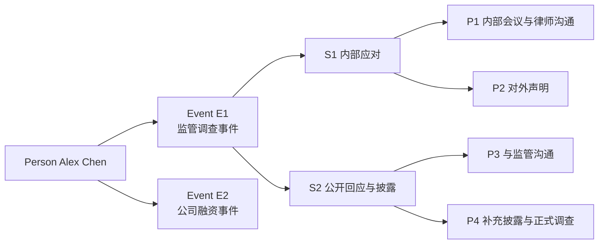
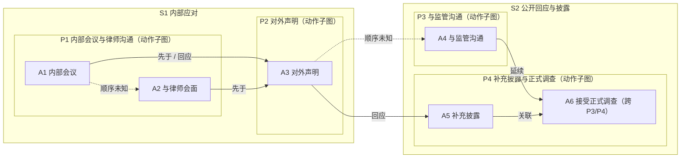

# 6 · 概念示例：从人物到 event 的完整描述

> 本篇用一个**虚构示例**说明结构怎么读、各层如何衔接；只谈概念，不写字段/JSON/实现。
> 示例人物与事件均为虚构，仅用于说明结构。

---

## 6.1 人物与事件系列

**人物**：Alex Chen，某科技公司前高管。

这个人物的 events（示例）：

| Event | 名称 | 大致时期 | 与人物关系 |
|---|---|---|---|
| E1 | 监管调查事件 | 2020-01 至 2020-06 | 本人被调查、负责应对 |
| E2 | 公司融资事件 | 2020-07 至 2020-12 | 以顾问身份参与 |

> 人物层只做身份与事件索引；E1、E2 各自完整描述，不互相依赖。



---

## 6.2 展开 E1：监管调查事件

### 6.2.1 事件本身

- **事件**：监管机构对某科技公司展开调查，Alex Chen 负责应对。
- **时间**：2020 年 1 月至 6 月（来源只能支持到月精度）。
- **范围**：调查期间本人的内部决策、法律咨询、对外沟通、披露与配合；排除调查之外的经营与私人生活。
- **事件摘要**：从内部协调 → 对外声明 → 与监管沟通 → 补充披露 → 正式调查，呈现行为模式的演进。

### 6.2.2 局面阶段（stage）

| Stage | 局面 | 边界理由 |
|---|---|---|
| S1 内部应对 | 调查刚启动，外部尚未公开 | 2020 年 2 月起，调查公开化，人物压力从内部协调转为对外回应 |
| S2 公开回应与披露 | 调查公开，监管问询与媒体关注 | —（事件在此后进入正式调查） |

> 边界依据是“局面变化”，不是文档发布日期或自然月。

### 6.2.3 行为阶段（phase）与动作

**S1（内部应对）**

- **P1 内部会议与律师沟通**（2020-01）
  - A1：召开内部会议，了解情况、统一口径。
  - A2：与李律师会面，讨论应对与披露方案。
  - 关系：A1 与 A2 均发生在 1 月，来源未说明先后 → **顺序未知**；二者的结果指向后续对外声明。

**S2（公开回应与披露）**

- **P2 对外声明**（2020-02-10）
  - A3：公司对外发布声明，回应调查、说明配合态度。
  - 关系：A3 **回应** A1/A2；A3 与监管沟通同日发生，来源未说明先后 → **顺序未知**。
- **P3 与监管沟通与披露**（2020-02 至 2020-06）
  - A4：与监管机构电话沟通，回应问询。
  - A5：补充披露相关交易信息。
  - A6：接受监管正式调查（跨 P3/P4；主归属在后期阶段）。
  - 关系：A4 与 A5 均与调查推进有关；A6 **延续** A4 的监管沟通线。

> 动作在 event 级只存一份；phase 只是“这个阶段看哪些动作”的视图。

### 6.2.4 时间线示意

```text
Event E1  |==============================================================|
Stage     |<------ S1 内部应对 ------>|<------ S2 公开回应与披露 ------>|
Phase     |<-P1 内部协调->|<P2 声明> |<-P3 监管沟通->|<-- P4 披露 -->|
Action    |  A1   A2     |   A3     |   A4        |  A5     A6     |
              └─ 顺序未知 ─┘              └── 跨 phase 延续 ──┘
```

### 6.2.5 动作图（概念）



> 图中 A6 只画一次：主归属 P4，同时在 P3 的动作视图中出现；不是复制动作。每个 phase 的动作视图是子图，可以包含多个动作（P1 有 A1/A2，P4 有 A5/A6），也可以只有一个动作（P2/P3）。

读法：

- 有明确先后的用实线箭头；
- 同日/同期但无法确定先后的用虚线“顺序未知”；
- `回应`、`延续` 是语义关系，不是时间先后；
- 不把“同一周发生”强行排成一条链。

### 6.2.6 上下文

- **环境**：监管调查公开化、媒体关注、外部预期不稳定。
- **相关他人**：李律师（代理/法律咨询）、监管机构（问询方）、公司（被调查主体）。
- **人物状态**：目标（稳定外部预期、配合调查）、约束（披露口径需律师审核）、知识（当时已知的调查范围；事后才知道的结论不写入“当时认知”）。
- **证据**：以上内容分别由来源 1/2/3 的报道、公司声明、监管公告支持；无法确认的部分标“未知”。

### 6.2.7 证据与未知

| 内容 | 证据状态 |
|---|---|
| 调查启动、内部会议、律师会面 | 来源陈述（有引文） |
| 对外声明内容 | 来源陈述 + 公司声明（可复核） |
| A3 与 A4 的先后 | **顺序未知**（同日发生，来源未说明） |
| 人物“稳定预期”的动机 | **推断**（由行为推断，来源未直接陈述） |
| 调查的全部内部细节 | **未知/缺口**（公开资料未覆盖） |

---

## 6.3 这个示例说明了什么

1. **人物 → events**：人物层只做索引；E1 可独立阅读。
2. **event → stage**：stage 按“局面变化”切（内部应对 vs 公开回应）。
3. **stage → phase**：phase 按“行为模式”切（内部协调 vs 对外声明 vs 沟通披露）。
4. **动作图**：动作之间允许顺序未知、回应、延续；不是单链。
5. **上下文**：环境/他人/人物状态挂在 phase 与动作上；belief 与事后事实分开。
6. **证据**：每个关键内容有来源/引文或显式“推断/未知”；不宣称覆盖全部真实行为。

> 这个示例是“结构怎么读”的说明，不是数据格式；具体字段与存储属于实现层，见后续实现规范。
