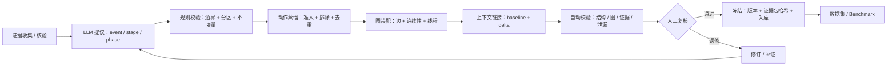
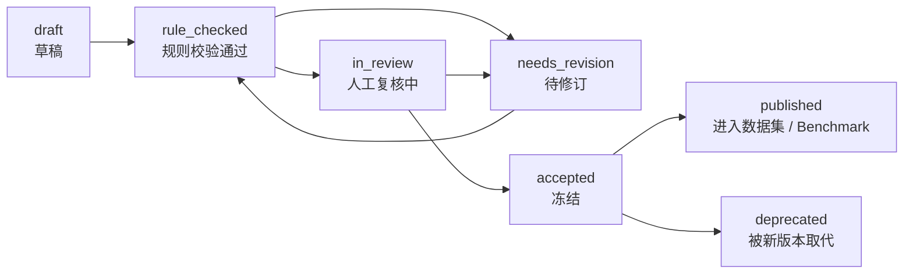

# 6 · 生产、复核与校验

> 对应框架规则：**FR-11**（并落实 FR-2/3/4/5/7/8/9）。框架层定义，不含字段/schema。
> 关联：[2-action-graph](2-action-graph.md) · [3-context-model](3-context-model.md) · [4-evidence-and-provenance](4-evidence-and-provenance.md) · [5-benchmark-and-dataset](5-benchmark-and-dataset.md)

---

## 6.1 生产流水线（概念级）

**原则**：LLM 负责**提议与蒸馏**（效率与覆盖），规则负责**约束与校验**（一致性），人工负责**判断与冻结**（质量与责任）。三者缺一不可。

---

## 6.2 角色分工

| 角色 | 做什么 | 不做什么 |
|---|---|---|
| **顶级 LLM** | 从证据包提议 stage/phase 边界、抽取候选动作、提出上下文链接 | 不定义规则；不自行决定“已验证”；不隐藏不确定性 |
| **框架规则 / 自动校验** | 检查边界分区、动作准入、无孤点、去重、上下文语义、证据可回指、防泄漏 | 不判断语义质量；不替代人工裁决 |
| **人工复核** | 判断边界是否成立、动作是否合理、上下文是否最小且相关、冲突/缺口处理 | 不逐字重写全部图；聚焦争议点与抽样 |
| **prompt / skill** | 执行规则的**执行层**：把边界判据、准入规则、上下文语义编码成可操作指令 | 不是定义层；规则必须先写在本系列文档中，再进入 prompt/skill |

> 结论：**规则在框架里，prompt/skill 只是执行**。这样换模型、换提示版本时，标注规则与 benchmark 金标保持可比。

---

## 6.3 生命周期状态机

| 状态 | 含义 | 允许的下一步 |
|---|---|---|
| draft | 初步生成，未校验 | 规则校验 |
| rule_checked | 自动校验通过 | 人工复核 / 返修 |
| needs_revision | 有问题待修 | 修订后重新校验 |
| in_review | 人工复核中 | 通过 / 返修 |
| accepted | 冻结，可作为金标/样本 | 发布 / 弃用 |
| published | 进入数据集或 benchmark | 只读；变更需新版本 |
| deprecated | 被新版本替代 | 只读归档 |

> **冻结即不可变**：accepted/published 后的图不原地修改；修订产生新版本并记录父版本。

---

## 6.4 校验清单（逐项检查）

### 6.4.1 结构校验（自动）

| 检查 | 通过标准 |
|---|---|
| 分区 | stage 分区 event；phase 分区所属 stage；有序、不重叠 |
| 缺口 | 未覆盖区间有原因；不允许静默缺口 |
| 边界理由 | 每个 stage/phase 有 `boundary_reason` + 证据引用 |
| 引用 | 所有 ID 存在；无悬空引用 |
| 时间 | 动作区间落在 event 覆盖内；时间精度不被提升 |
| 归属 | 动作的 phase 归属与区间一致；跨 phase 动作有延续/覆盖关系 |

### 6.4.2 动作图校验（自动）

| 检查 | 通过标准 |
|---|---|
| 准入 | 四条必需均满足（主体/事件/过程/证据） |
| 无孤点 | 每个动作至少一条语义边连到事件过程 |
| 去重 | 同一行为身份无重复节点 |
| 时间层 | 无时间环 |
| 语义层 | 环必须标记 inferred 且有依据 |
| 连续性 | 跨 phase 动作未被复制；延续边指向正确 |

### 6.4.3 上下文校验（自动 + 抽样）

| 检查 | 通过标准 |
|---|---|
| 两段式 | baseline/delta 不重复；phase 有 baseline 或显式 unknown |
| 语义 | 每个链接属于六种语义之一 |
| 最小化 | 无明显无关人物/状态堆砌（抽样） |
| 证据 | 链接可回指或显式 inferred/unknown |
| 防泄漏 | 条件/触发/知识来源只含当时可知信息 |

### 6.4.4 人工复核清单

- 边界是否真的对应“局面变化/行为模式变化”？
- 动作是否准确、非冗余、与事件/phase 相关？
- 上下文是否“最小且够用”，有无过度或缺失？
- 冲突/缺口是否处理且记录？
- 该 sample 是否达到进入数据集/benchmark 的质量门槛？

---

## 6.5 一致性评估（IAA）

框架层要求至少对以下对象做一致性检查（阈值后续版本定）：

| 对象 | 方法 |
|---|---|
| stage 边界 | 两位标注者独立切分 → 边界距离/匹配率 |
| phase 边界 | 同上，分开统计 |
| 动作集合 | 按行为身份匹配 → P/R/F1 |
| 边关系 | 抽样核对类型与方向 |
| 上下文链接 | 抽样核对类型与对象 |

未达阈值的样本进入 `needs_revision`，不直接进入 benchmark。

---

## 6.6 版本与冻结

| 版本对象 | 说明 |
|---|---|
| **框架版本** | 本系列文档的版本（当前 v0.1） |
| **标注指南版本** | 规则的操作化说明（后续定义） |
| **sample 版本** | 每个 sample 的图与证据包版本；冻结后不可原地改 |
| **证据包哈希** | 冻结证据集合的标识，保证可复现 |
| **父版本** | 修订链，支持回溯 |

**冻结内容**：证据包、层级结构、动作图、上下文、评审记录、标注指南版本、模型/提示版本（如用于生成）。任何后续改动产生新版本。

---

## 6.7 质量声明（必须随数据集一起声明）

- 图是**证据支持的行为视图**，不是真实世界全部行为；
- 完整性相对**固定证据包**（closed-world）定义；
- `observed / inferred / unknown` 三值支持状态必须可查；
- 边界、动作、上下文均可能含推断，需由复核状态标识；
- 本框架**不做情景模拟**，不声称可预测世界状态。

---

## 6.8 变更控制与待定事项

- 框架规则变更需更新本系列文档并记录变更；不得只改 prompt/skill。
- 待后续版本决定（不属于框架层）：标注指南细节、IAA 阈值、字段/存储/schema、动作类型词表、decision point 是否纳入、上下文变量集合、多语言策略。
- 任何与本系列冲突的实现或 prompt，应以本系列为准，或提出框架修订。
