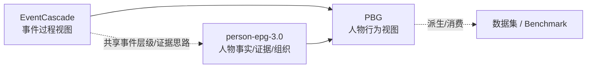

# 7 · 术语、与现有表示的关系、设计问答

> 收口文档。关联：[0-overview](0-overview.md) 及全部前序文件。

---

## 7.1 术语表

| 术语 | 定义 |
|---|---|
| **event（事件）** | 一个可独立研究、有可解释边界的人物事项；sample 的研究对象 |
| **stage（阶段）** | 事件中的一个“局面/情境”时期；边界是情境、主导目标、关系格局或资源约束的实质变化 |
| **phase（行为阶段）** | stage 内一种相对稳定的行为模式/子目标/活动簇时期；边界是行为模式的变化 |
| **action（动作）** | 有证据支持的行为单元：一个主体、一个目标、一个有界时间、一个可陈述且可证据化的行为 |
| **action graph（动作图）** | 以动作为节点、以时间/因果/交互/连续关系为边的偏序图 |
| **partial order（偏序）** | 只定义部分元素之间的先后；允许并行与顺序未知；不要求全序 |
| **parallel（并行）** | 动作共现且无确定先后；包含真重叠与顺序未知两种情况 |
| **order_unknown（顺序未知）** | 两个动作都发生但来源不足以判断先后 |
| **behavior thread（行为线程）** | 同一方向/目标下的一组动作；可作为 phase 内可选的分组视图 |
| **pattern action（模式动作）** | 对重复性/周期性行为的聚合表示（时间窗 + 频次），避免一次一个节点 |
| **context（上下文）** | 与动作直接相关的环境、他人、人物自身状态；分 phase baseline 与 action delta |
| **phase baseline** | 一个 phase 内相对稳定的上下文 |
| **action delta** | 单个动作特有的触发、对象、约束、结果、知识来源 |
| **belief（信念/认知）** | 人物在动作发生时实际知道/相信的信息，区别于世界事实 |
| **post-hoc fact（事后事实）** | 动作之后才出现/公开、人物当时不可能知道的信息 |
| **evidence package（证据包）** | 围绕人物与事件采集、选择、核验并冻结的信息集合 |
| **support status** | `observed` / `inferred` / `unknown`，表示节点/边/链接的证据状态 |
| **closed-world** | 评测世界限定为固定证据包；完整性相对证据包定义 |
| **IAA** | 标注者间一致性（inter-annotator agreement） |
| **no-orphan rule（无孤点）** | 每个动作至少一条语义边连接到事件过程，否则不进图 |
| **atomicity（原子性）** | 动作的粒度定义：一个主体、一个目标、一个区间的可陈述行为 |

---

## 7.2 与现有表示的关系

### 7.2.1 三者定位

| 表示 | 中心 | 结构 | 本框架如何使用 |
|---|---|---|---|
| **EventCascade** | 事件怎么发展 | event → stage → episode → participant/action/relation/transaction | 借鉴“事件层级 + 证据字段”的思想；但不直接采用：其动作是 participant 附属，缺少偏序/并行/上下文 |
| **person-epg-3.0** | 人物事实与证据 | 事实层（entity/occurrence/action/transaction/evidence/time）+ 组织层（event/stage/activity/relation） | 作为**事实与证据底座**；PBG 在其之上增加 phase、动作偏序图、上下文与准入规则 |
| **PBG（本框架）** | 人物在这个事件里怎么行动 | event → stage → phase → 动作偏序图 + 上下文层 | 训练数据 + benchmark 的行为结构 |

### 7.2.2 概念映射（供后续实现参考）

| PBG 概念 | person-epg-3.0 中的相近概念 | EventCascade 中的相近概念 | 说明 |
|---|---|---|---|
| event | event | EventCascade | 层级含义相近；PBG 的事件是 sample 范围 |
| stage | stage | EventStage | PBG 的 stage 锚定“局面变化”；boundary_reason 思路可复用 |
| phase | 无直接对应（可由 occurrence/activity 聚合） | Episode（但语义不同） | **phase ≠ episode**：phase 是人物行为模式段，episode 是事件过程子段；不要混用 |
| action（节点） | action / activity | Participant.actions / Action | PBG 增加准入、去重、偏序、上下文链接 |
| 动作边 | activity_relation（precedes/overlaps/…） | 无显式动作图 | PBG 增加并行/未知顺序、连续性、交互语义 |
| 上下文（环境/他人/自身状态） | entity / entity_relation / 部分 occurrence 信息 | participant/relations | PBG 增加“三类上下文 + 六种链接语义 + belief 分离” |
| 证据包 | source_document / evidence_span / evidence_set / evidence_link | VerifiableField（值+证据+理由） | PBG 要求证据包整体成为一等公民 |

> 实现层建议（非本框架强制）：不要复制 schema；优先在现有事实/证据之上做“行为叠加视图”，保持事实层与行为层分离。详见 [4-evidence-and-provenance](4-evidence-and-provenance.md)。

---

## 7.3 设计问答（FAQ）

**Q1：为什么不是线性链？**
真实人物在同一时期常有多条行为线程，来源也常无法确定先后。线性链会伪造顺序与因果；偏序图能保留并行与未知。

**Q2：为什么不在单案例里做 AND/XOR 控制流？**
单案例的证据只能支持“先/后/重叠/未知”，不足以支持“与/或”逻辑。控制流属于跨案例的过程模型，不属于单个 sample。

**Q3：为什么需要 stage 和 phase 两级？**
两级回答不同问题：stage 是“局面怎么变”，phase 是“人物怎么做”。如果只切一级，会丢失行为模式层；如果两级同判据，则冗余，应合并。

**Q4：为什么不直接复用 EventCascade / person-epg？**
它们各自以事件过程 / 事实证据为中心；PBG 需要行为中心、偏序、上下文与准入。复用它们的层级思路、证据与时间模型，而不是复用其结构本体。

**Q5：为什么不做 transition function / 情景模拟？**
目标是对“这个人物”的行为建模与评测，不是模拟世界。上下文只做描述/条件/验证，保持结构轻量；这也是本框架与 ABM/世界模拟的边界。

**Q6：为什么强调证据包与 closed-world？**
真实世界的“完整”不可证；只有把评测限定在固定证据包上，benchmark 才可判分、可复现；数据集也才能诚实声明覆盖与缺口。

**Q7：LLM 能不能直接做 stage/phase 和动作抽取？**
可以“提议”，不能“定义”。规则必须在框架里写死；LLM/prompt/skill 是执行层，产出必须带边界理由、证据与不确定性标记，再经规则校验与人工复核。

**Q8：一个 sample 是什么？**
一个人物 × 一个事件，基于一个固定证据包；包含分层结构、动作偏序图、上下文、证据与评审记录。跨人物、跨事件扩展不属于本版本。

---

## 7.4 边界与未来扩展

**本版本（框架层）明确不做：**

- 不做情景/环境模拟与 transition function；
- 不做多人物/社会模拟；
- 不做通用事件知识图谱；
- 不定义字段/schema/存储/接口；
- 不做跨事件的人物全局聚合（一个 sample 一个事件）。

**后续版本可讨论：**

- `decision_point` / `observation` 是否纳入正式版本；
- 动作类型词表与领域扩展；
- 上下文变量集合与领域模板；
- 粒度阈值与 IAA 阈值；
- 与 person-epg 事实层的具体映射/工具链；
- 多语言与跨文化行为标注；
- 跨事件的人物行为聚合（作为新层级，而非本框架的扩展）。

---

## 7.5 文档状态与变更记录

- 系列版本：`v0.1`（框架基线草案，2026-11-12）
- 状态：讨论中；确认后冻结 `v1.0`。
- 变更记录：
  - `2026-11-12`：建立 0–7 文档；确立 FR-1..FR-11；定义层级、动作图、上下文、证据、用途、生产复核、术语与映射。
- 任何与本系列冲突的实现、prompt 或标注指南，应以本系列为准或提交框架修订。
