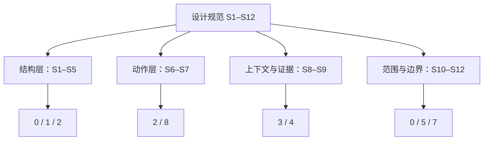
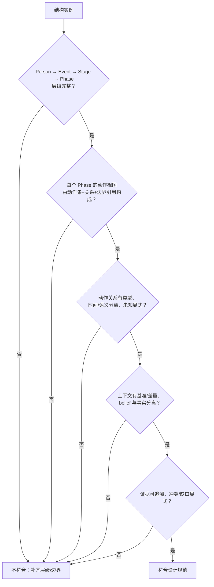

# 7 · 设计规范：人物—事件描述结构

> **规范对象**：一个人物及其一系列 events 的描述结构；每个 event 的完整、深入描述。
> **规范层级**：设计层。只规定“结构应当是什么、必须满足什么”，不规定字段、类型、JSON、存储、接口、生产流程、benchmark、评测。
> 关联：[0-overview](0-overview.md) · [1-hierarchy](1-hierarchy.md) · [2-action-graph](2-action-graph.md) · [3-context-model](3-context-model.md) · [4-evidence](4-evidence.md) · [5-design-decisions](5-design-decisions.md)

---

## 7.1 目的与效力

本规范把前面几篇的设计讨论收拢为一组**可检查的规范性要求**，用于：

1. 判断一个“人物—事件描述结构”是否**结构完整、语义一致**；
2. 作为后续实现/蒸馏/标注的共同依据（但不在本规范中定义实现细节）；
3. 在出现争议时，区分“结构设计问题”与“实现问题”。

**用语约定**：

- **必须 / 不得**：设计上不可违反；
- **应当 / 不应**：默认要求，偏离时需说明理由；
- **可以**：允许的选择。

---

## 7.2 核心对象（设计定义）

| 对象 | 设计定义 |
|---|---|
| **Person** | 被描述的人；具有身份与一个事件索引，拥有 1..n 个 Event |
| **Event** | 一个可独立研究、有可解释边界的人物事项；一份完整描述，可脱离其他 Event 阅读 |
| **Stage** | Event 中一个“局面/情境”相对稳定的时期；边界由局面实质变化决定 |
| **Phase** | Stage 内一种相对稳定的“行为模式/子策略”时期；边界由行为模式变化决定 |
| **Action** | 人物行为的最小记录单元；动作之间的先后/过程/交互/延续关系构成**动作图** |
| **Action Graph** | Event 级动作图 `G(e)`：动作是节点，关系是边；Phase 的动作视图 `G(p)` 是其分组视图（动作集 + 内部关系 + 边界引用），不是单个动作 |
| **Context** | 动作/阶段发生时的环境、他人、人物状态；分 Phase 基准 `C(p)` 与 Action 差量 `ΔC(a)` |
| **Evidence** | 支撑描述内容的来源、引文与支持模式；描述结构由证据派生 |

---

**规范条款与文档的对应**

**读法**：S1–S5 管“人物—事件—Stage—Phase—动作”的结构；S6–S7 管动作与关系；S8–S9 管上下文与证据；S10–S12 管范围、人物系列和设计层边界。右边是展开这些条款的文档。

## 7.3 规范性要求

### S1 · 人物层

- **必须**以人物为顶层主语，包含身份信息与事件索引；
- **必须**拥有至少一个 Event；
- **不得**在人物层展开事件细节；人物层只做身份与索引。

### S2 · 事件层

- **必须**让每个 Event 可独立阅读：不得依赖其他 Event 才能理解；
- **必须**说明事件的覆盖时间与纳入/排除范围；
- **必须**提供事件的完整摘要与内部结构（Stage/Phase/Action/Context/Evidence），不得只有标题；
- **不得**把“某一年”“某主题”直接当作一个 Event；Event 必须是有边界的具体事项/过程。

### S3 · 局面阶段（Stage）

- **必须**属于一个 Event，并按时间排列；
- 边界**必须**对应“局面/情境的实质变化”（外部环境、主要目标、关系格局、资源/约束等）；
- **必须**记录边界理由，并能回指证据；
- 端点已知时，相邻 Stage 之间**不得**重叠；端点未知时标“未验证”，不得假装可核验；允许未覆盖时间缺口，但**必须**说明；
- **不得**用文档发布日期、报道批次、自然月/章节等非局面变化作为边界。

### S4 · 行为阶段（Phase）

- **必须**属于一个 Stage，并按时间排列；
- 边界**必须**对应“行为模式/子目标/主要交互对象/活动模式”的实质变化；
- **必须**记录边界理由，并能回指证据；
- 端点已知时，相邻 Phase 之间**不得**重叠；端点未知时标“未验证”，不得假装可核验；允许未覆盖时间缺口，但**必须**说明；
- 如果 Stage 与 Phase 边界总在同一处、Phase 没有独立语义，**应当**合并或说明为何仍需两级。

### S5 · 动作视图（Phase 内）

- 每个 Phase 的动作视图**必须**由“动作集 + 内部关系 + 边界引用”构成（通常包含多个动作节点与关系；允许单动作或空，但必须说明），**不得**把 Phase 等同于单个 Action；
- 动作节点**必须**是 Event 级全局动作集合 `A(e)` 的成员；Phase 只是视图，**不得**复制动作对象；
- 每个动作**应当**有主归属 Phase；若无法确定，**必须**显式标“未归属”并说明原因，**不得**硬塞进某个 Phase；未归属动作**不得**进入 Phase 动作视图，但**必须**保留在 Event 动作图中；若跨 Phase/Stage，**必须**以“跨相位/跨阶段”标注，而不是复制；
- Phase 的动作视图**可以**包含一个动作或为空，但**必须**在描述中说明原因（例如该阶段无记录行为）。

### S6 · 动作（Action）

- 动作**必须**满足：焦点人物执行（或职务/代理）、与 Event/Phase 有关、能与事件过程连上关系、有证据或标 `I` / `Sup=∅+Gap`；
- 动作**必须**是“一个可陈述、可区分的行为”，不得把背景/评价/心理活动当动作；
- 粒度**必须**稳定：同一行为身份在 Event 内只出现一次，多来源合并为多证据；
- 动作**必须**有可定位的时间（允许未知/区间/精度）；时间精度**不得**被提升。

### S7 · 动作关系

- 关系**必须**显式分类：时间（先后/重叠/顺序未知）、过程（回应/使能/触发/阻止）、交互（沟通/交易/委托/共同行动）、延续（延续/中断/恢复）；
- 每条关系**必须**带 `basis`（observed / asserted / inferred / derived）；时间关系与语义关系**必须**分开记录，不得互相替代；
- 时间关系 `≺` **应当**表达为偏序，**不得**强行排成一条全序链；完整动作图是类型化有向图，语义关系可以成环，**不得**把整个图宣称为“偏序图”；
- 语义关系**必须**区分“来源明确陈述”与“分析者推断”；**不得**把来源陈述当已证明的事实；
- **不得**声称识别真实因果；语义关系允许成环，**不得**为了图美观强行 DAG 化。

### S8 · 上下文

- 每个 Phase **应当**有基准上下文 `C(p)`（环境/他人/人物状态），缺失时**必须**记 `Sup=∅+Gap`；
- 动作**可以**有差量上下文 `ΔC(a)`，只记录与基准不同/新增的特有信息；
- 上下文链接**必须**属于六种语义之一：参与、条件、触发、约束、结果、知识来源；**不得**使用模糊“相关”；
- 上下文**必须**最小化：只链会改变对该动作解释/判断的信息；
- **必须**区分人物当时可知信息（belief）与事后事实；事后事实**不得**作为动作原因/条件；
- 上下文**应当**可回指证据，或标 `I` / `Sup=∅+Gap`。

### S9 · 证据

- 描述结构**必须**建立在证据包之上，并保留“来源 → 引文 → 描述”的可追溯关系；
- 描述内容**必须**标注支持模式：记录内容（`O`）、世界断言（`A`）、推断（`I`）；未知用 `Sup=∅ + Gap` 表示；
- `O`、`A` 的内容**必须**有可定位来源**且**引文可定位；
- `I` **必须**说明推断依据，**不得**伪装成事实；
- 冲突**必须**保留并说明，**不得**静默取一个；
- 缺口**必须**显式化；**不得**把“没有找到”当成“没有发生”。

### S10 · 范围与完整性

- 结构描述的是“**证据支持的行为**”，**不得**宣称覆盖真实世界的全部行为；
- 每个 Event **必须**声明纳入/排除范围；范围外的内容**不得**进入该 Event；
- 允许未知时间、未知阶段、未知关系；**不得**为了结构完整而编造。

### S11 · 人物系列与跨事件

- 一个人物**可以**有多个 Event；每个 Event **必须**独立完整描述；
- 当前版本**不要求**表达跨事件关系；跨事件关系属于待定设计（见 [5-design-decisions](5-design-decisions.md) Q5）；
- 若后续引入跨事件关系，**不得**破坏 Event 的独立性。

### S12 · 设计层边界

- 本规范**不得**用于规定字段名、类型、JSON/schema、ID 格式、存储、接口；
- 本规范**不得**用于规定模型、prompt、蒸馏流程、人工复核流程、benchmark、评测；
- 上述内容属于实现/流程/评测文档，不属于本设计规范。

---

## 7.4 结构完整性的最低要求（设计层）

一个“结构完整”的 Event 描述，至少应能做到：

| 检查 | 要求 |
|---|---|
| 人物—事件索引 | 人物能定位到该 Event；Event 能回指人物 |
| 事件独立性 | 单独读该 Event 能理解背景、过程、结果 |
| 局面阶段 | 有 Stage 划分与边界理由 |
| 行为阶段 | 每个 Stage 内有 Phase 划分与边界理由 |
| 动作视图 | 每个 Phase 的动作视图由动作集 + 内部关系 + 边界引用构成（允许单动作/空但需说明） |
| 动作关系 | 有类型化关系；时间/语义分开；未知显式 |
| 上下文 | Phase 基准 + Action 差量；三类上下文；belief/事实分离 |
| 证据 | 关键内容可回指来源/引文；支持模式（`O/A/I`）与缺口显式 |
| 未知/缺口 | 显式记录，不编造、不静默 |

**“关键内容”的最低范围**（这些内容必须有证据或显式未知/推断）：

- stage/phase 的边界理由；
- 动作的主体、时间、对象/目标、所属 phase；
- 动作之间的关系；
- 上下文链接（尤其条件/触发/约束/知识来源）；
- 人物目标/动机（若写入描述）。

---

## 7.5 符合性检查流程

**读法**：这是设计层的**符合性检查**，不是质量评分；任何一步“否”都先补结构/补证据，而不是用更确定的措辞绕过。允许单动作/空 phase，但必须说明原因。

---

## 7.6 符号与术语

完整符号表见 [1-hierarchy](1-hierarchy.md) 1.1.1 与 [0-overview](0-overview.md) 0.2.2。关键符号：

| 符号 | 含义 |
|---|---|
| `P` | 人物 |
| `E(P)` | 人物的事件集合 |
| `S(e), Ph(s)` | Event 的 Stage 集合、Stage 的 Phase 集合 |
| `A(e)` | Event 的动作集合（全局） |
| `G(e), G(s), G(p)` | Event 级动作图、Stage 动作视图、Phase 动作视图 |
| `I(·)` | 时间区间 |
| `a ≺ b` | a 先于 b |
| `a ∥ b` | 不可比（并发或顺序未知） |
| `C(p), ΔC(a)` | Phase 基准上下文、Action 差量上下文 |
| `Sup(x) ⊆ {O,A,I}`；`Gap(x)` | 记录内容 / 世界断言 / 推断；`Sup=∅+Gap` 为未知 |

---

## 7.7 与其他文档的关系

- 为什么这样设计：[5-design-decisions](5-design-decisions.md)；
- 层级与边界：[1-hierarchy](1-hierarchy.md)；
- 动作与关系：[2-action-graph](2-action-graph.md)；
- 上下文：[3-context-model](3-context-model.md)；
- 证据：[4-evidence](4-evidence.md)；
- 概念示例：[6-illustrative-example](6-illustrative-example.md)；
- 形式化模型与规范示例：[8-formal-model](8-formal-model.md)。

---

## 7.8 规范版本

- 当前：`v0.1`（与 0-overview 同步，2026-11-12）。
- 修改任一规范性要求，必须同步更新本文件与对应设计文档；不得只改其中一处。
