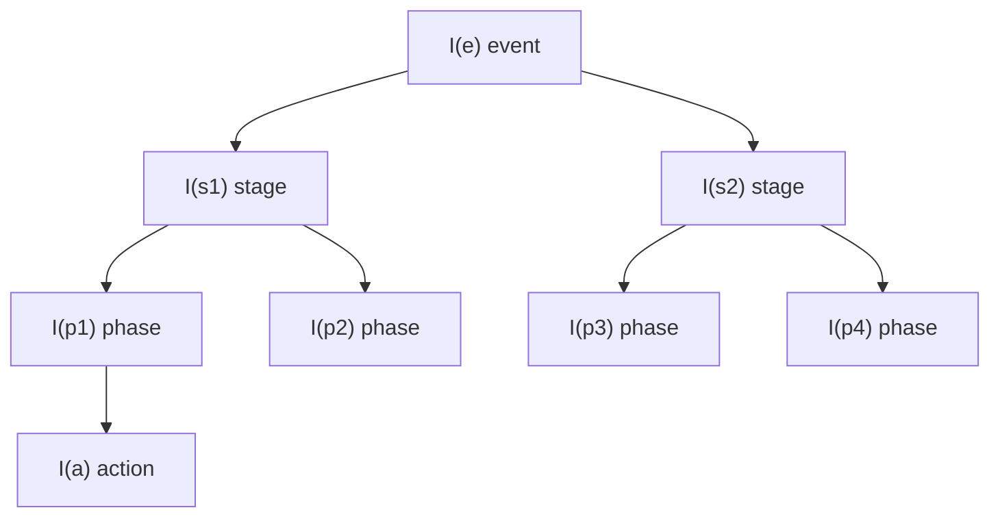
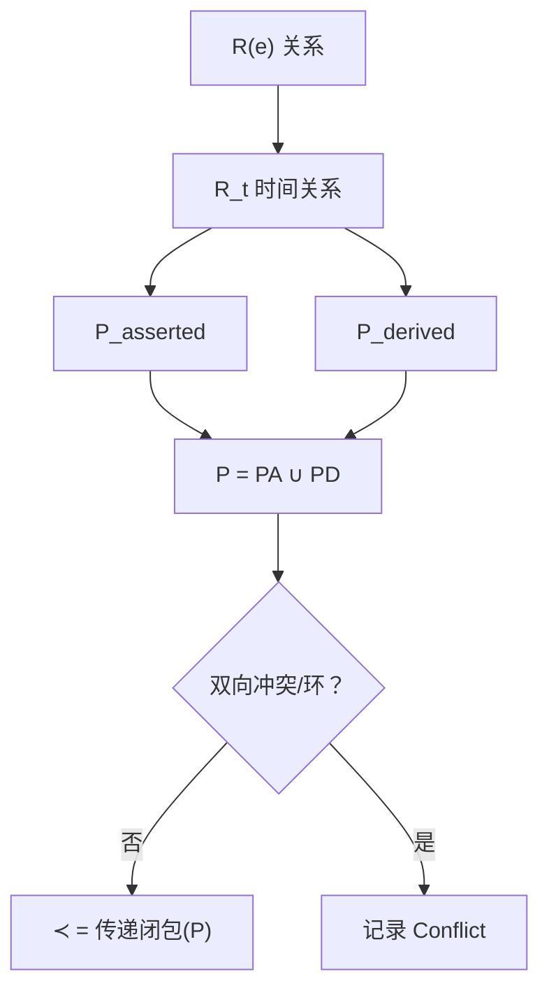
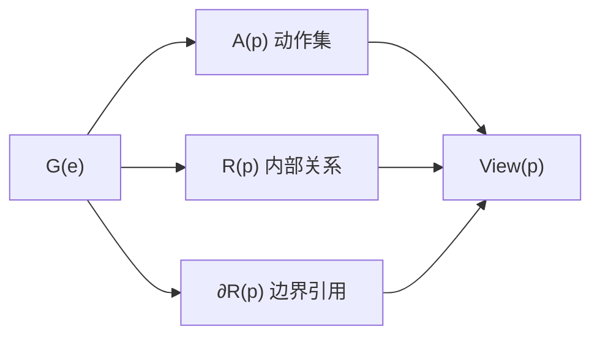
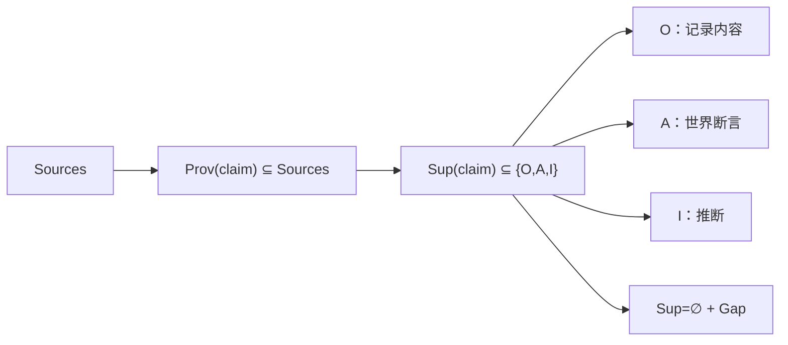

# 8 · 形式化模型与规范示例

> 本篇给出人物—事件描述结构的**形式化定义、关键约束、视图模型**，并用一个完整示例说明符号如何落位。
> 设计层文档：不涉及字段、类型、JSON、存储、代码。
> 形式化服务于精确讨论与设计审查，**不是**提前绑定实现。

**阅读提示**：先读 8.1–8.4 的定义，再看 8.7 的例子；符号对照 [1-hierarchy](1-hierarchy.md) 1.1.1 与 [2-action-graph](2-action-graph.md) 2.2。

---

## 8.1 基本对象与时间表示

| 符号 | 定义 |
|---|---|
| `P` | 人物 |
| `E(P) = {e₁, …, eₙ}` | 人物的有限事件集合，`n ≥ 1` |
| `S(e), Ph(s), Ph(e)` | Event 的 Stage 集合、Stage 的 Phase 集合、Event 的全部 Phase |
| `A(e)` | Event 的动作集合（有限） |
| `R(e)` | 图 `G(e)` 的边集：每条边是 `(from, to, type, basis)` |
| `G(e) = (A(e), R(e))` | Event 动作总图（canonical） |
| `C(p), ΔC(a)` | Phase 基准上下文、Action 差量上下文 |
| `Ev` | 证据包（Sources, Claims, Conflicts, Gaps） |

**`R(e)` 是边集，不是额外数据**：`G(e)=(A(e),R(e))` 中，`A(e)` 是节点集，`R(e)` 是边集；一条边 `r=(a,b,type,basis)` 就是图中 `a→b` 的箭头。没有“图 + 另一份关系数据”两套东西；`type/basis` 只是边的标签与依据。phase 视图中的 `R(p)`、`∂R(p)` 都是 `R(e)` 的子集/引用，不复制边。

**时间表示（关键约定）**：

- 对每个对象 `x`，`I(x)` 表示**声称区间**：只在起止端点都已知时写成半开区间 `[l(x), r(x))`；端点未知时记 `I(x) = Unknown`，**不伪造端点**。
- `l(x), r(x)` 仅在 `I(x)` 已知时定义；`[l,r)` 始终满足 `l < r`（端点相等视为空区间，不用于表示“某月/某日”）。
- 时间精度映射：年 `YYYY → [YYYY-01-01, (YYYY+1)-01-01)`；月 `YYYY-MM → [YYYY-MM-01, 下月-01)`；日 `YYYY-MM-DD → [日期, 次日)`。
- 含**未知端点**的对象：不参与区间包含/先后推导；只能依赖来源明确陈述的关系，并标注不确定性。

> 这是为了使形式化可判定：所有区间运算只对已知端点定义。

**区间层级示意**



**读法**：箭头表示“区间被包含/动作落在其中”；`I(p) ⊆ I(s) ⊆ I(e)` 只有在端点已知时才能检查。动作可跨 phase，但包含树里不再画跨相位箭头，避免把“包含”与“跨相位”混在一起；跨相位规则见 8.3.1。未知端点记 `Unknown`，不画成具体区间。

---

## 8.2 层级与时间约束

### 8.2.1 区间约束（仅在端点已知时可检查）

```
若 I(p), I(s), I(e) 均已知：I(p) ⊆ I(s) ⊆ I(e)
若 I(s), I(s') 均已知：I(s) ∩ I(s') = ∅（同一 event 的不同 stage）
若 I(p), I(p') 均已知：I(p) ∩ I(p') = ∅（同一 stage 的不同 phase）
```

端点未知时，包含/不重叠关系记为“未验证”，不得默认成立。

### 8.2.2 分区与层族

- 端点已知时，`S(e)` 对 `I(e)` 构成**允许缺口的划分**：stage 两两不重叠，未覆盖部分必须有原因；端点未知时，仅声明“未验证”，不断言划分性质。
- 端点已知时，`Ph(s)` 对 `I(s)` 构成**允许缺口的划分**；端点未知时同理标“未验证”。
- 区间族 `{I(e)} ∪ {I(s)} ∪ {I(p)}` 在端点已知时为**层族（laminar family）**：任意两个区间不相交或一个包含另一个；端点未知时，只能逐项声明“未知”，不能断言层族性质成立。

### 8.2.3 边界理由

Stage/Phase 边界必须有可回指证据的“局面变化/行为模式变化”理由；无证据的变化不得作为边界。

---

## 8.3 动作与关系

### 8.3.1 动作归属

- `A(e)` 有限；每个动作 `a` 的时间声称区间为 `I(a)`（可 `Unknown`）。
- **主归属（部分函数）**：`π: A(e) ⇀ Ph(e)`；`π(a)` 是主 phase；`dom(π)` 是已归属动作。
- **未归属**：`A₀ = A(e) \\ dom(π)`；未归属动作保留在 `G(e)`，不进入任何 phase 视图，必须显式说明原因。
- **跨相位归属**：`σ: dom(π) → 2^{Ph(e)}`，满足 `π(a) ∉ σ(a)`。
- **相位成员**：`p ⊢ a ⇔ a ∈ dom(π) ∧ (p = π(a) ∨ p ∈ σ(a))`。
- **一致性**：若 `I(a), I(p)` 均已知，则 `p ⊢ a ⇒ I(a) ∩ I(p) ≠ ∅`；若 `p` 是指定主 phase 而区间不交，记录为边界/归属冲突，不静默接受。

> `{A(p) : p ∈ Ph(e)}` 覆盖 `dom(π)`，但不覆盖 `A₀`，因此是 `A(e)` 的**覆盖（cover）而非划分**。

### 8.3.2 关系表示（带依据）

关系是四元组：

```
r = (from, to, type, basis)
basis ∈ { observed, asserted, inferred, derived }
```

| basis | 含义 |
|---|---|
| `observed` | 来源直接记录（文件/记录中可读到） |
| `asserted` | 来源明确陈述（报道/访谈/声明） |
| `inferred` | 分析者推断 |
| `derived` | 由已知区间推导（不是来源陈述） |

关系类型：

```
R_t：precedes / overlaps / order_unknown
R_s：responds_to / enables / triggers / prevents
R_i：communicates_with / transacts_with / delegates_to / joint_action
R_k：continues / interrupted_by / resumes
R(e) = R_t ∪ R_s ∪ R_i ∪ R_k
```

`unknown` **不是边**：没有关系/没有证据时不建关系，用 `Gap` 记录；不得用一条 `unknown` 边表示“不知道”。

**两套“依据”不要混淆**：关系上的 `basis`（observed/asserted/inferred/derived）表示**关系怎么来的**；claim 上的 `Sup(x) ⊆ {O,A,I}` 表示**描述内容的支持模式**；`derived` 不是 `Sup` 的成员。

### 8.3.3 时间先后：先分离“依据”，再谈偏序

定义两类时间先序：

```
P_asserted = { (a,b) : (a,b,precedes,observed|asserted) ∈ R_t }
P_derived  = { (a,b) : (a,b,precedes,derived) ∈ R_t }     // 由 I(a), I(b) 推导
P          = P_asserted ∪ P_derived
```

- `derived` 边的条件：`I(a), I(b)` 已知且 `r(a) ≤ l(b)`；
- **冲突**：若 `(a,b)` 与 `(b,a)` 同时出现在 `P`，或 `P` 的传递闭包出现环，则记录 `Conflict`；**不得**把冲突静默消解；
- `≺` 只在冲突消解/排除后定义：`≺ = 传递闭包(P_consistent)`；若存在未消解冲突，`≺` 只是**局部/暂定**的，不得声称全局严格偏序成立；
- `a ∥ b`：在可用数据中既无 `a ≺ b` 也无 `b ≺ a`；它表示“不可比”，包括并发、顺序未知、冲突未决。

> 因此，`≺` 不是“只要取传递闭包就一定是偏序”；它只有在冲突处理后才可能是严格偏序。设计文档必须同时报告冲突。

**先序、依据与冲突**



**读法**：先不要把“所有时间关系”直接当成偏序。来源陈述的先序（asserted）与区间推导的先序（derived）分开；合并后先检查双向冲突与环；只有无冲突时才得到可用的 `≺`。冲突不是数据错误，而是必须保留的证据状态。

### 8.3.4 链、反链与线性扩展

- **链（chain）**：两两可比的子集；对应有依据的串行结构。
- **反链（antichain）**：两两不可比的子集；对应并发、顺序未知或冲突未决。
- **线性扩展（linear extension）**：把 `≺` 补成总序的一种方式；它只是众多可能之一，不能当作唯一顺序。

---

## 8.4 视图模型（内部关系 + 边界引用）

### 8.4.1 Phase 视图

对 phase `p ∈ Ph(e)`：

```
A(p)    = { a ∈ dom(π) : p ⊢ a }                 // 视图动作集，A(p) ⊆ A(e)
R(p)    = { r ∈ R(e) : from(r), to(r) ∈ A(p) }   // 内部关系，R(p) ⊆ R(e)
∂R(p)   = { r ∈ R(e) : 恰有一端在 A(p) }          // 边界引用
View(p) = (A(p), R(p), ∂R(p))
G(p)    = View(p)   // 本系列用 G(p) 作为简写
```

**为什么保留 `G(e)`**：动作在 event 内只存一份；跨相位关系、未归属动作 `A₀` 需要一个事件级容器；`View(p)` 是对 `G(e)` 的截取 + 边界引用，不是另一套独立动作集合。因此 `G(e)` 不是阶段之上的“第二层”，而是 canonical graph。

**canonical ≠ 先构造**：这里说的是逻辑全集，不是实现步骤。记录时可以 phase-first；把各 phase 的动作去重、补上跨 phase 关系与 `A₀` 关系后，就得到同一个 `G(e)`：

```
A(e) = A₀ ∪ ⋃_{p ∈ Ph(e)} A(p)
R(e) = (⋃_p R(p)) ∪ R_cross ∪ R_A0
```

（`R_cross` 为跨 phase 视图的关系，`R_A0` 为涉及未归属动作的关系。）


- `A(p) ⊆ A(e)` **恒成立**（不是“可能不是子集”）；
- `View(p)` 是**视图对象**，不是图：`∂R(p)` 中的边一端指向视图外；
- 不同 phase 视图的 `A(p)` 可以重叠（跨相位动作），因此 `{A(p)}` 是覆盖而非划分；
- `A₀` 不属于任何 phase 视图。

**视图的构造**



**读法**：视图 = 动作集 + 内部关系 + 边界引用。`A(p) ⊆ A(e)`、`R(p) ⊆ R(e)` 恒成立；`∂R(p)` 是跨视图的“边界引用”，不是视图内部边。因此 `View(p)` 不是图，而是“图的一部分 + 伸出去的引用”。

### 8.4.2 Stage 视图

```
A(s)    = ⋃_{p ∈ Ph(s)} A(p)
R(s)    = { r ∈ R(e) : from(r), to(r) ∈ A(s) }
∂R(s)   = { r ∈ R(e) : 恰有一端在 A(s) }
View(s) = (A(s), R(s), ∂R(s))
```

`View(s)` 同样是视图对象；跨 stage 动作可以出现在多个 stage 视图中，但不复制动作。

### 8.4.3 视图关系

- `A(p) ⊆ A(s) ⊆ A(e)`；`R(p) ⊆ R(s) ⊆ R(e)`（按上述定义）；
- 视图不是 `G(e)` 的严格诱导子图：边界引用保留了跨视图关系；
- **不使用“投影”一词描述视图关系**（未定义映射）；只说“视图由动作集、内部关系、边界引用构成”；
- `G(e)` **不要求连通**：可以分解为多个连通分支；phase 是视图，不是连通性单位。

**为什么保留边界引用**：只保留内部边会切断“本 phase 动作与下一 phase 动作”的关系；保留边界引用（不复制节点）可以在不重复动作的情况下保持全局关系可见。

---

## 8.5 上下文模型

```
C(p) = (Env(p), Rel(p), State(p))
ΔC(a) = (ΔEnv(a), ΔRel(a), ΔState(a))
```

- `C(a) = C(π(a)) ⊕ ΔC(a)`（`a ∈ dom(π)`）；`A₀` 中动作没有 phase 基准，只能记录 `ΔC(a)` 或显式未知；
- `⊕` 是“叠加/覆盖”：差量中的条目覆盖或补充基准；若同一条目出现冲突，保留冲突，不静默取一；
- `Env`：环境；`Rel`：关系/他人；`State`：目标/资源/约束/知识（belief）。

**belief 与事后事实**：动作的“条件/触发/知识来源”只能使用动作时点可知信息；事后事实只能用于结果说明。该规则是**证据使用约束**，不是“人物行为由 belief 因果决定”的强主张。

---

## 8.6 证据模型

```
Ev = (Sources, Claims, Conflicts, Gaps)
Prov: Claims → 2^{Sources}
Sup:  Claims → 2^{O, A, I}
```

- `O`（record）：claim 是**来源/记录本身的内容**（例如“该公告写道 X”）；
- `A`（asserted）：claim 是关于世界的来源断言（包括官方声明）；不是直接可核验的记录内容；
- `I`（inferred）：分析者推断；
- `O` 与 `A` 按 **claim 内容**区分，互斥；若一条 claim 同时涉及“记录内容”和“世界断言”，拆成两条 claim；
- `Sup(x)` 是**集合**：同一 claim 可以有多条证据、多种支持方式；`Sup(x)=∅` 表示没有支持，必须同时记录 `Gap`；
- 不存在单值 `U` 状态：**未知 = `Sup(x)=∅` 且 `Gaps(x)` 记录**；
- `Prov(x) ⊆ Sources`（不是 `Ev`）；
- `Conflicts(x)` 记录同一 claim 的来源矛盾；`Gaps(x)` 记录缺口；
- 支持模式不是线性强弱序，也不是质量评分；它只说明“这句话是怎么来的”。

**支持模式与缺口**



**读法**：先有来源，再有证据引用；一条 claim 可以有多个支持模式（集合），不是单值；`Sup=∅` 不是第四种模式，而是“没有支持 + 记录缺口”。`O`/`A` 按 claim 内容区分，不按来源类型区分。

**为什么这样建模**：描述结构要回答“这句话是怎么来的”。把“记录内容/世界断言/推断/未知”分开，才能让读者判断哪些可直接复核、哪些需追溯、哪些只是分析判断；它也能防止把推断伪装成事实。

---

## 8.7 规范示例（形式化）

以下沿用 [6-illustrative-example](6-illustrative-example.md) 的虚构人物 Alex Chen 与事件 E1；6 与 8.7 使用同一套 Stage/Phase/Action 归属。

### 8.7.1 集合与时间

```
E(P) = {e₁, e₂}
e₁: I(e₁) = [2020-01-01, 2020-07-01)
S(e₁) = {s₁, s₂}
  I(s₁) = [2020-01-01, 2020-02-10)
  I(s₂) = [2020-02-10, 2020-07-01)
Ph(s₁) = {p₁}
  I(p₁) = [2020-01-01, 2020-02-10)
Ph(s₂) = {p₂, p₃, p₄}
  I(p₂) = [2020-02-10, 2020-02-11)
  I(p₃) = [2020-02-11, 2020-04-01)
  I(p₄) = [2020-04-01, 2020-07-01)
A(e₁) = {a₁, a₂, a₃, a₄, a₅, a₆}
```

**自检**：`I(p₁) ⊆ I(s₁) ⊆ I(e₁)`；`I(p₂), I(p₃), I(p₄) ⊆ I(s₂)`；p₁ 覆盖 S1；p₂/p₃/p₄ 对 S2 构成无重叠划分（p₂ 与 p₃ 在 2020-02-10/11 交界相邻）。

> 精度说明：事件/阶段的 2020-01 至 2020-06 是**月精度**；动作的日精度（如 2020-01-21）来自更具体的来源（会议记录、报道日期）。没有更细来源的动作只保留月精度，不补日。

### 8.7.2 动作与归属

| 动作 | `I(a)` | `π(a)` | `σ(a)` |
|---|---|---|---|
| a₁ 内部会议 | [2020-01-21, 2020-01-22) | p₁ | ∅ |
| a₂ 与律师会面 | [2020-01-21, 2020-01-22) | p₁ | ∅ |
| a₃ 对外声明 | [2020-02-10, 2020-02-11) | p₂ | ∅ |
| a₄ 与监管沟通 | [2020-02-15, 2020-02-16) | p₃ | ∅ |
| a₅ 补充披露 | [2020-04-20, 2020-04-21) | p₄ | ∅ |
| a₆ 接受正式调查 | [2020-06-01, 2020-06-02) | p₄ | ∅ |

检查：

- `A(p₁) = {a₁, a₂}`；`A(p₂) = {a₃}`；`A(p₃) = {a₄}`；`A(p₄) = {a₅, a₆}`；
- 每个 `p ⊢ a` 满足 `I(a) ∩ I(p) ≠ ∅`；
- 本示例无跨相位动作（`σ=∅`）；不为了展示功能强行制造跨相位动作。

### 8.7.3 关系集合（带依据）

```
R_t = { (a₁,a₃,precedes,derived), (a₂,a₃,precedes,derived),
        (a₃,a₄,precedes,derived), (a₄,a₅,precedes,derived),
        (a₄,a₆,precedes,derived), (a₅,a₆,precedes,derived) }

R_s = { (a₃,a₁,responds_to,asserted),   // a₃ 回应 a₁
        (a₄,a₂,responds_to,inferred),   // a₄ 回应 a₂（推断）
        (a₅,a₃,responds_to,asserted),   // a₅ 回应 a₃
        (a₅,a₄,responds_to,inferred) }  // a₅ 回应 a₄（推断）

R_i = ∅
R_k = { (a₆,a₄,continues,asserted) }     // a₆ 延续 a₄
```

> 本示例的 `precedes` 均由已知区间推导（`derived`），不是来源明说“先后”；若某来源明确说“之后”，才记 `asserted`。`a₁ ∥ a₂`（同日、来源未说明先后）不建关系；`order_unknown` 是可记录的关系类型，但本示例选择不建关系、保持不可比，二者择一即可。

### 8.7.4 偏序、链/反链

```
P_asserted = ∅
P_derived  = { (a₁,a₃), (a₂,a₃), (a₃,a₄), (a₄,a₅), (a₄,a₆), (a₅,a₆) }
≺          = 传递闭包(P_asserted ∪ P_derived)
Conflict   = ∅
```

- 链：`{a₁, a₃, a₄, a₅, a₆}`、`{a₂, a₃, a₄, a₅, a₆}`；
- 反链：`{a₁, a₂}`（同日不可比）；
- 不存在包含全部动作的链；
- 这些先后是**区间推导**，不是来源陈述；引用时须标 `derived`。

### 8.7.5 视图

```
View(p₁) = ({a₁,a₂}, ∅, ∂R(p₁))
View(p₂) = ({a₃}, ∅, ∂R(p₂))
View(p₃) = ({a₄}, ∅, ∂R(p₃))
View(p₄) = ({a₅,a₆}, {(a₅,a₆,precedes,derived)}, ∂R(p₄))
G(e₁)    = ({a₁..a₆}, R(e₁))
```

说明：

- `View(p₁)` 中 a₁、a₂ 不可比，因此 `R(p₁)=∅`；不可比不是边；
- `View(p₂)`、`View(p₃)` 各一个动作，符合“允许单动作 phase”；
- `View(p₄)` 的 `a₅≺a₆` 是 `derived` 边，属于 `R(e)`，因此视图里有它、`G(e)` 里也有它；
- 各视图之间没有共享动作；若存在跨相位动作，按 8.4 的 `∂R` 边界引用处理。

### 8.7.6 上下文与证据

```
C(p₂) = (Env: 媒体持续关注、外部预期不稳;
         Rel: 媒体/公众;
         State: 目标—稳定外部预期)
ΔC(a₃) = (Env: 媒体持续关注;
          State: 知识—调查已公开)
C(a₃) = C(p₂) ⊕ ΔC(a₃)
```

证据摘要：

| 内容 | `Sup` | `Gaps/说明` |
|---|---|---|
| 调查启动、内部会议、律师会面 | `{A}` | 有报道引文 |
| 对外声明内容 | `{A}` | 官方声明可复核 |
| a₁ 与 a₂ 的先后 | `∅` | `Gap`：同日、来源未说明 |
| a₃→a₄ 的先后 | `∅`（关系为 derived） | 由日期推导，不是来源陈述 |
| 人物“稳定预期”的动机 | `{I}` | 由行为推断，来源未直接陈述 |
| 调查全部内部细节 | `∅` | `Gap`：公开资料未覆盖 |

### 8.7.7 6 ↔ 8.7 交叉自检

| 检查 | 结果 |
|---|---|
| 6.1 图与 6.2.3 表的 S1/S2、P1–P4 归属一致 | 通过 |
| A5 属于 P4（不在 P3） | 通过 |
| A1/A2 同日不可比；A3→A4 由日期先后 | 通过 |
| 8.7.2 与 6.2.3 的动作/phase 一一对应 | 通过 |
| 所有 `p ⊢ a` 满足 `I(a) ∩ I(p) ≠ ∅` | 通过 |
| `precedes` 均标 `derived`，未冒充来源陈述 | 通过 |
| 1.7 时间线与 6/8.7 的 Stage/Phase 顺序一致 | 通过 |

> 该自检只针对 6/8.7 的示例范围；不证明真实数据质量、覆盖度或因果。

---

## 8.8 关键约束（设计层）

| 编号 | 约束 |
|---|---|
| **FM-1** | 端点已知时：Stage 对 Event、Phase 对 Stage 构成允许缺口划分，区间族为层族；端点未知时只声明“未验证”，不得断言性质成立。 |
| **FM-2** | 每个 action 或者有唯一主 phase `π(a)`，或者显式未归属 `A₀`；`A₀` 不进任何 phase 视图但保留在 `G(e)`；动作节点不复制。 |
| **FM-3** | 时间先序按 basis 分为 asserted/derived；合并后必须检查双向冲突与环；存在冲突时不得声称全局严格偏序成立；`a ∥ b` 表示“不可比”，不等于“并发已确定”。 |
| **FM-4** | 语义关系允许成环；必须区分来源陈述与推断；不得声称识别真实因果。 |
| **FM-5** | `View(p)`/`View(s)` 由动作集、内部关系、边界引用构成；`A(p) ⊆ A(e)`、`R(p) ⊆ R(e)`；视图不是严格诱导子图，不使用未定义的“投影”。 |
| **FM-6** | `C(a)=C(π(a))⊕ΔC(a)`（已归属）或仅有动作级差量（未归属）；belief 是“允许使用信息”的约束，不是因果断言；事后事实不得解释当时动作。 |
| **FM-7** | 证据用 `Sup(x) ⊆ {O,A,I}` 与 `Gaps(x)` 表达；`Sup=∅` 即未知/缺口；支持模式不是线性强弱序或质量评分；`Prov(x) ⊆ Sources`。 |
| **FM-8** | 结构描述“证据支持的行为”，不宣称覆盖真实世界全部行为；冲突/缺口显式保留。 |

---

## 8.9 与其他文档的关系

- 层级与边界：[1-hierarchy](1-hierarchy.md)；
- 动作与关系：[2-action-graph](2-action-graph.md)；
- 上下文：[3-context-model](3-context-model.md)；
- 证据：[4-evidence](4-evidence.md)；
- 规范要求：[7-specification](7-specification.md)；
- 概念示例：[6-illustrative-example](6-illustrative-example.md)。
