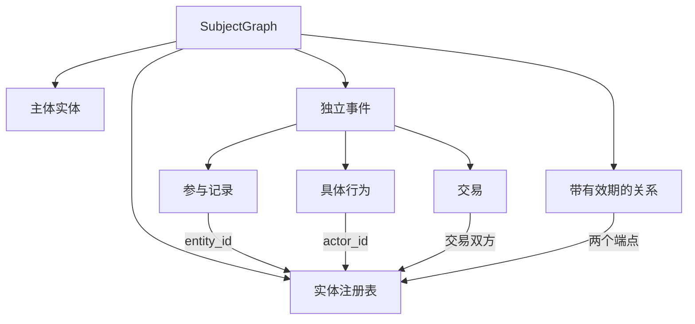

# 原生主体图：人物与公司

人物模式新增并行导出 `FinalPersonEPG.json`（`person-epg-3.0`）。新的关系模型、字段字典及旧格式转换见 [人物 EPG Schema](person_epg_schema.md)。下文仍描述供现有构建与 HTML 使用的 `subject-graph-1.0`。

`person` / `company` 模式直接生成 `SubjectGraph`。图的根是稳定主体，一个时期内的多段经历独立组织，共享实体注册表。原事件模式仍生成原来的 EventCascade。

这版适配覆盖 schema、构图、校验、前端和历史读取。它不增加补搜；已有资料可以直接重新构图。它也不证明现有资料足以覆盖人物完整生平。

## 结构



Python 定义和 JSON Schema 位于 `finmy/subject_graph/schema.py`，版本为 `subject-graph-1.0`。

| 组件 | 关键字段与语义 |
| --- | --- |
| SubjectGraph | `subject_id` 指向实体表；`subject_type` 为 individual / organization；`coverage_start/end` 是请求范围 |
| Entity | `entity_id`、`name`、`aliases`、`entity_type`、`attributes`；同一实体跨事件复用同一个 ID |
| Event | `event_id`、标题、起止时间、`subject_relevance`、描述，以及参与、行为、交易列表；允许重叠与空档 |
| Participation | `entity_id`、本事件中的角色及参与时间；不自动从其他事件继承 |
| Action | `actor_id`、行为类型、时间、具体内容；发言归发言人，购股归实际公司 |
| Transaction | 实际转移双方、时间、标的和细节；非交易经历使用空列表，未知对手方为 unknown |
| Relation | `from_entity_id/to_entity_id`、关系类型、有效期、关联事件 ID；一般背景关系可不绑定事件 |
| VerifiableField | `value`、`evidence_source_contents`、`reasons`、可选 `confidence`；保留支持原文 |

每个事件必须填写有证据的 `subject_relevance`，说明为什么属于该主体经历。人物无需出现在每个事件的参与表中。公司背景可以相关，但相关性不等于个人决策归属，领导身份也不等于控制性持股。

日期保留 `YYYY`、`YYYY-MM`、`YYYY-MM-DD` 或明确时间戳的原始精度。未知日期写 unknown；不得为了连贯或填满时间线补造日期。关系的有效期可早于研究窗口。关系的 event_ids 可指向提供依据或背景的事件；两端实体未同时列为参与者时仅警告，不阻断生成，也不自动补造参与记录。不存在的实体或事件引用仍会阻断。兼容投影仅导出双方均有参与记录的事件内关系，其他关系保留在原生图中。

## 构图与校验

1. `SubjectPlanner` 根据全部输入资料发现独立事件，并建立统一实体表。
2. `SubjectEventReconstructor` 逐事件填入参与、行为和交易，引用已注册实体。
3. 确定性校验检查 schema、ID 唯一性、引用、参与归属、时间冲突及证据原文。
4. 默认最多一轮 `SubjectGraphRepair`，只返回出错字段的局部 JSON Patch，由程序合并回原图再校验，不重新输出整张图。修复响应无法使用时保存 `subject_repair_error.json`，保留已构建的图继续校验。结构或引用关系仍不合格则终止；仅有证据出处问题时，保留图并给对应字段添加 `evidence_status: needs_review` 标记，展示醒目提示。
5. 保存原生 JSON 和 HTML，再生成旧 EventCascade 兼容投影。

已核实事实字段必须提供输入资料中的原文片段；待核实内容保留原值和模型引用，但不会视作已验证证据。配置中的主体名称可以以 `configured_identity` 标记，但它不能证明人物参与或行动。原文校验只核对出处，不保证片段在语义上足以支持结论；仍需抽查行为内容、归属和材料覆盖。

可选构图限制：

```yaml
builder_config:
  subject_graph:
    max_events: 60       # 1..200；超限明确报错，不静默截断
    repair_attempts: 1   # 0 或 1
```

一次正常构图调用模型 `2 + 2 × 事件数` 次（规划、逐事件构建及复查、全局复查），必要时再修复一次，不触发新的检索。默认上限是工程保护，不是目标事件数量。

## 配置与界面

沿用完整配置中的模型和保存目录，加入如下块。主体模式目前使用 `AgentEventBuilder`。

```yaml
builder_config:
  builder_type: AgentEventBuilder
  reconstruction:
    mode: person
    subject:
      subject_id: person_warren_buffett
      name: Warren Buffett
      aliases: ["Warren E. Buffett", "巴菲特"]
      coverage_start: "2022-01-01"
      coverage_end: "2023-12-31"
      scope: ""
```

`subject_id` 和 `name` 必填；scope 留空表示该人物在所选时期内有资料支持的各项活动。原始请求也应写人物与时期；如果继续输入 OXY 限定请求，构图仍会尊重这个范围。公司模式改为 `mode: company` 并填写实际公司身份。日期可为 null，或带引号的年、年月、日期。

Pipeline 页只提供 Event / Person。Person 沿用原描述、关键词和资料上传，只增加一个 Person name；ID 自动生成，同一配置中的同一人物复用原 ID。时间和专题要求直接写在描述里，界面不再使用旧配置中的隐藏时间、别名或专题限制，也没有高级表单。结果页提供 HTML 下载，下载后查看 EventCascadeGanttVisualizer 原有 Gantt，包括参与者标记、关系连线和时间窗口控件；只调整人物标题、图例和说明。卡片时间线已删除。未能表达为事件内连线的背景关系保留在原生 JSON。历史读取优先选择同目录的 `FinalSubjectGraph.json`。

Web 主体模式在资料筛选后直接调用原生构图，跳过旧金融匹配和查询总结链路。Web 检索阶段仍可能联网；只复用已有输入时使用下面的 CLI。

直接调用旧 `FinmyPipeline` 也会保留返回对象中的 `subject_graph`，但仍会初始化数据库、检索器和其他旧前处理组件。复用文本时优先使用这里的 CLI 或 `build_from_contents`。

## 复用现有巴菲特输入

在已安装项目依赖、已配置模型 API 的仓库环境执行。将输入路径改为实际保存的 `builder_input_contents.json`；该文件必须是非空字符串列表。这个入口不检索资料，但构图仍需要模型 API。

```bash
python -m finmy.subject_graph.runner \
  --config configs/pipline.yml \
  --scope-config configs/person_buffett_2022_2023.scope.yml \
  --input /path/to/saved_buffett_run/builder_input_contents.json \
  --output-dir outputs/subject_graph_runs
```

旧的 `configs/person_buffett_oxy.scope.yml` 仍可用于主动限定 OXY 专题。仅有 OXY 资料时，即使配置扩大范围，也不会自动获得其他经历。

每轮构图保存：

| 文件 | 用途 |
| --- | --- |
| `FinalSubjectGraph.json` | 原生主图，后续分析以它为准 |
| `FinalSubjectGraph.html` | 可离线打开的主体经历视图，无外部脚本或 CDN |
| `FinalEventCascade.json` / `IntegratedEventCascade.json` | 兼容旧工具的投影，不代替原生主图 |
| `subject_build_input.json` / `reconstruction_scope.json` | 本次实际输入、来源文本及任务范围 |
| `RawSubjectGraph.json` / 各 Agent 结果 | 原始构图和修复过程 |
| `subject_graph_validation.json` | 最后一次结构与出处校验结果 |

原始检索来源清单仍在旧运行目录，需与新输出一起保留。这里不会重新获取或覆盖原网页。

原生 JSON 可以完全离线重新渲染，输出到新目录：

```bash
python -m finmy.subject_graph.runner \
  --render-only /path/to/FinalSubjectGraph.json \
  --output-dir outputs/subject_preview
```

兼容投影将一个原生 Event 映射为一个 Stage / Episode。它不表示发现了因果阶段；全局实体、参与时间及未绑定事件的关系不能由旧格式完整表达，因此不要把投影再当作原生结果回填。

## 验证与迁移边界

在完整依赖环境运行 `python -m unittest discover -s tests -v`。新增测试覆盖原生模型调用链、证据与引用校验、行动归属、人物/公司配置、原生展示、历史读取、服务路由和兼容导出；模型返回使用可控样例，不检验真实历史完整性。

本次开发环境的可运行测试全部通过；`test_infer_input_compat` 因缺少外部 `lmbase` 无法导入。尚未运行真实 API 构图，也未完成实际浏览器截图检查。旧 HTML 不能无损还原出证据齐全的新 schema；需要使用原始输入重新构图。

本补丁基于上一版人物模式补丁及对应上游 UI 文件。应用前在你的仓库运行 `git apply --check /path/to/finmycelium_subject_graph.patch`，成功后再 `git apply`。现有未提交修改如与补丁重叠，应先保留并合并，不要强制覆盖。

## 从已保存的失败结果恢复

引用中的中英文标点（如逗号、冒号、引号）或网页空格差异会先还原为输入中的原文片段，再执行严格校验；文字、数字和否定含义不会模糊匹配。`subject_quote_restoration.json` 保存每处还原及原文位置。模型修复不能更改配置中的 coverage 边界。

对于已保存的 `RawSubjectGraph.json` 和 `subject_build_input.json`，可完全离线恢复：

```bash
python -m finmy.subject_graph.recover /path/to/build_output_20261103215915661838
```

结果写入相邻的 `build_output_20261103215915661838_recovered` 新目录；原文件保留。结构错误仍会阻止发布；仅有证据匹配问题时，在 JSON 和页面中保留待核实标记。恢复过程不调用模型或重新搜索。在 Results 页加载新目录中的 `FinalSubjectGraph.json`。

已有 `FinalSubjectGraph.json` 时，恢复优先使用该图并保留审核记录和警告，不退回修订前的原始图。只有原始图时，恢复会用保存的 planner 和 `subject_event_sources.json` 重做事件证据隔离及范围检查；存在隔离记录却缺少分配信息时停止恢复。已有被接受的后续修订或合并但缺少最终图时，也停止恢复，避免丢失这些决定。仅包含上述两个文件的旧运行仍可恢复查看，但会明确提示事件证据归属尚待审核。

`subject_evidence_review.json` 列出待核实字段；待核实字段保留在 JSON 中，兼容导出保留待核实说明。自动校验的 `valid` 表示结构可使用，不能单独当作事实全部已核实；严格原文检查仍可用 `validate_subject_graph(graph, sources)`，只有明确传入 `allow_unverified_evidence=True` 才允许带标记的证据问题作为警告。

现有逐事件 `SubjectEventReviewer` 同时检查时间逻辑、个人归属和遗漏：允许用局部
`corrections` 修正已有字段，再处理补充内容，不增加模型调用轮次。日期转换沿用原有
日历规则：保留原表达与推导理由；季节和季度表示发生窗口，不取区间端点作为行为日期。
后来的报道可证明此前的行为，但后来的价格或结果不能自动成为此前的决策依据。
错误归属应保留推测措辞或公司行为，不能由职位、投资规模推定个人决策。

修正仅作用于当前事件，引用限定在其已分配资料中。每组相关修改原子应用；失败组不影响
其他独立组。缺省空列表和单对象响应统一转换，字段类型错误按字段记录。
局部修正支持完整字段替换、删除记录、`add .../-` 追加；路径可使用行为／参与／交易 ID，
数字索引始终对应复查输入。已不存在的删除目标明确拒绝，不猜测。

明确处于请求范围外的事件转为保留原始日期和引用的背景，原记录写入
`subject_scope_review.json`；未知日期和跨界事件保留。超出所属事件的参与／行为／交易
沿用证据隔离流程，不通过把已知日期改成 unknown 来消除冲突。报道中的跨期价格比较
保留为报道背景，不自动解释为成交价格或个人决策依据。
`subject_event_detail_review.json` 保存接受／拒绝的修正及原记录。最终覆盖复查可提出
`event_merges`，目前接受同日且有共同事件证据的重复股东信／会议，保留互补内容、来源和关系引用；
仅同日或主题相近不会自动合并。记录见 `subject_coverage_review.json`。
已纠正的原记录会传入后续覆盖复查，原样重新加入会被拒绝。全局复查通过 `statement_merges` 指定同一次发言的保留和删除记录；
程序核对发言人、精确日期、共同引用与所属事件，再合并细节、删除重复行为。
发言合并先于事件合并；交易事件和交易记录保留。无法确认的重复候选继续保留供复查。这些检查不调用搜索；语义判断仍由当前模型完成，
离线测试验证的是修正和合并机制。


### 按完整时间范围检索

Person 流程默认从描述提取时间范围，使用整个范围、原始描述与关键词查询，每个搜索源首次查询一次。Bocha 使用
`freshness`，Baidu 使用 `search_filter.range.page_time` 传递发布时间边界；
返回结果在抓取前再次核对日期，日期缺失或超范围不会进入自动搜索的构建输入。
事件发生时间仍由正文提取，不能用发布时间替代。手动上传的材料保持原有流程。

正文读取仅处理 HTML，有限超时、最多 4 MiB、无 Selenium 回退。
索引页尝试进入带“全文／实录／transcript”链接的正文；子页面必须提供自己的
发布时间。读不到正文的 PDF、视频或受限页面保留失败记录，不把搜索摘要当正文。
大会、访谈、股东信及接班发言的资料过短、只有索引或缺少发言线索时，
最多进行一轮定向补搜。判断使用长度与发言标记启发式，不代表内容已经语义完备；
没有搜索命中的年份不会自动触发补搜。

首次分别查询两个搜索源，Bocha 取 10 条、Baidu 取 20 条；旧配置中的 topics / max_queries 不再拆分或限定查询。
正文补搜和决策补搜每次分别至多取 2／5 条（首搜数量的四分之一，向下取整），请求次数上限不变。
补搜与已有正文去重；上下文依次分配给首搜、正文补搜、决策补搜，后者只使用剩余字符，
不会缩减前者已分配的片段。预算已满时新增资料可能全部省略，原文仍在来源清单中保存；
`context_budget_report.json` 中的 search_phase 和 included 字段可核对实际纳入情况。
全程最多 40 次正文抓取，补搜最多 3 次搜索调用，并向后续搜索源分配抓取额度。
默认经过 300 秒后不再启动新请求，正在执行的请求仍受自身超时限制。
这些参数可在现有配置顶层按需调整，无需增加输入字段：

```yaml
subject_search:
  enabled: true
  max_parse_calls: 40
  max_followup_queries: 3
  max_links_per_index: 2
  max_elapsed_seconds: 300
```

需要扩大“资料发布时间”但不扩大事件时期时，可另配 `publication_start` /
`publication_end`。查询范围缺失或含糊时直接报错，不静默扩大搜索。
`subject_search_report.json` 保存查询范围、逐条取舍及未解决的缺失；
`subject_search_sources.json` 保存正文和来源清单。
Event 模式沿用原有检索；`subject_search.enabled: false` 可显式恢复旧检索。

### 模糊时间的定位与原文显示

时间字段可选携带 `time_window`，由模型依据原文和上下文转换。例如：

```json
{
  "value": "2022-07",
  "evidence_source_contents": ["2022年7月下旬，公司购入股份。"],
  "reasons": ["下旬按21日至当月末定位。"],
  "time_window": {
    "start": "2022-07-21",
    "end": "2022-07-31",
    "original": "2022年7月下旬",
    "approximate": true
  }
}
```

校验和兼容投影统一读取这个范围；图面保留原有日期标签。原表达“2022年7月下旬（约）”、
转换范围及“发生于该范围内，具体日期不详。”仅显示在悬浮框中。命名日期能确定到日时，
两端相同且 approximate=false。年份使用资料上下文，不使用运行年份。
没有新增必填项、搜索或复查轮次。旧字段继续兼容；已有 JSON 不会自动补出缺失的
time_window，需要用新 Prompt 重新构建，或补入有依据的时间窗口后重新渲染。
